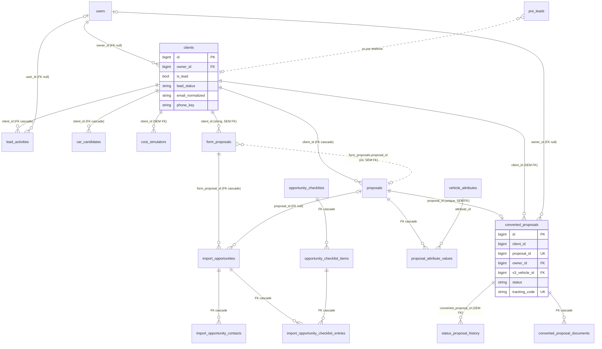
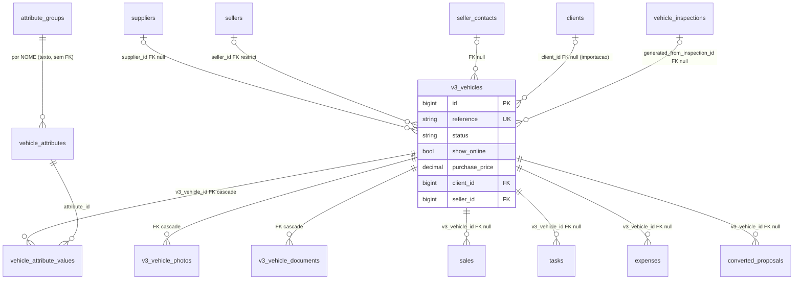
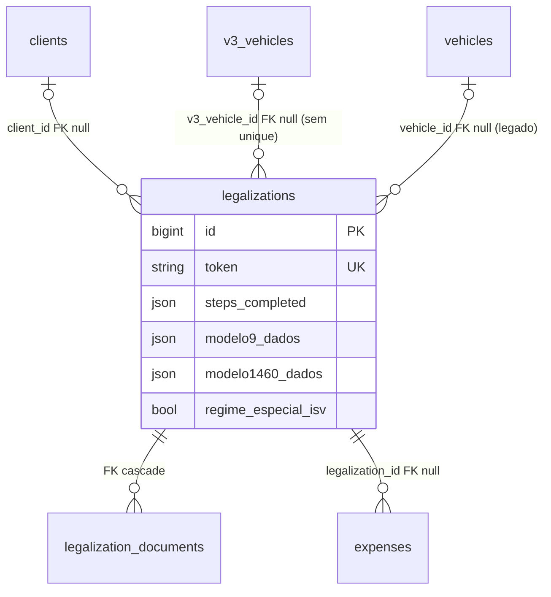
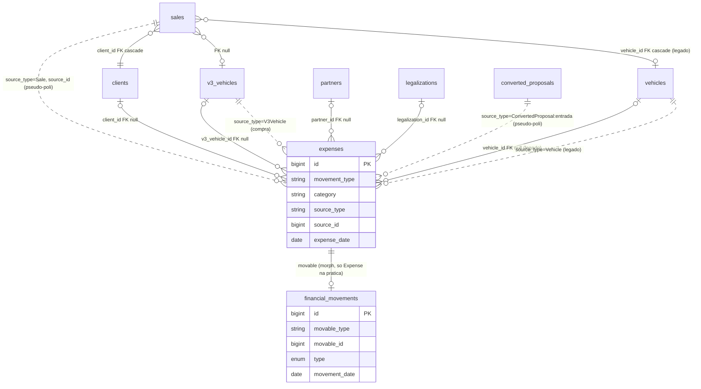
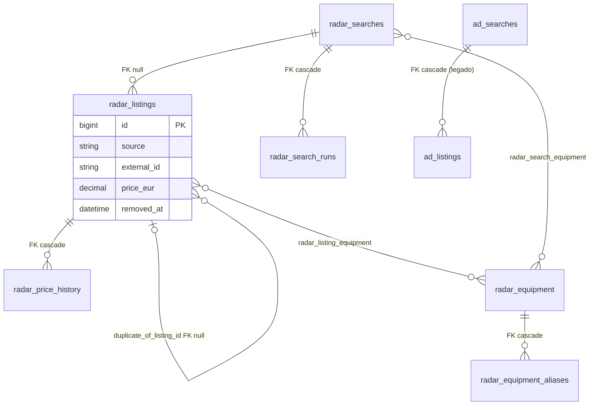
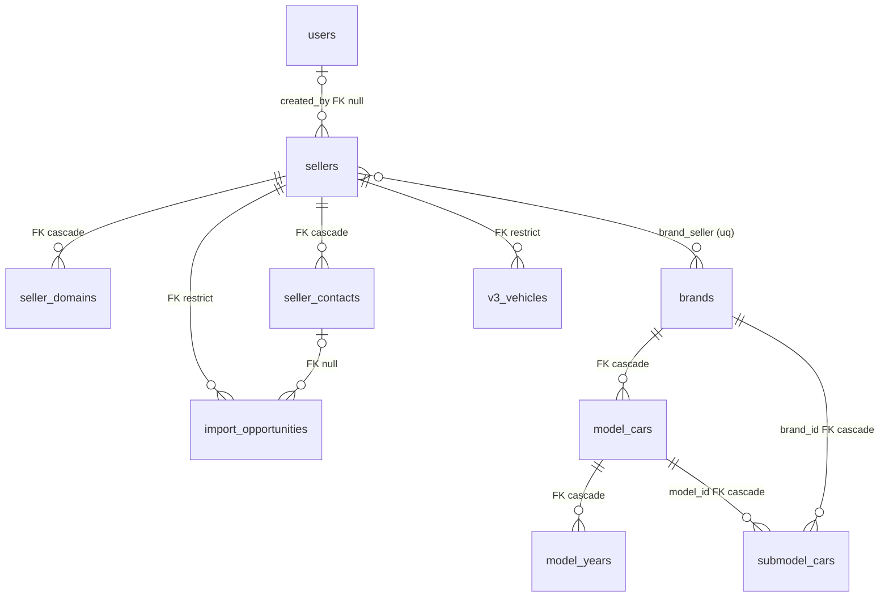
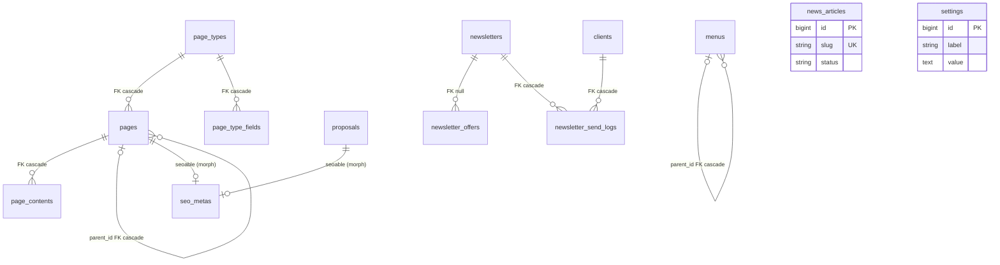
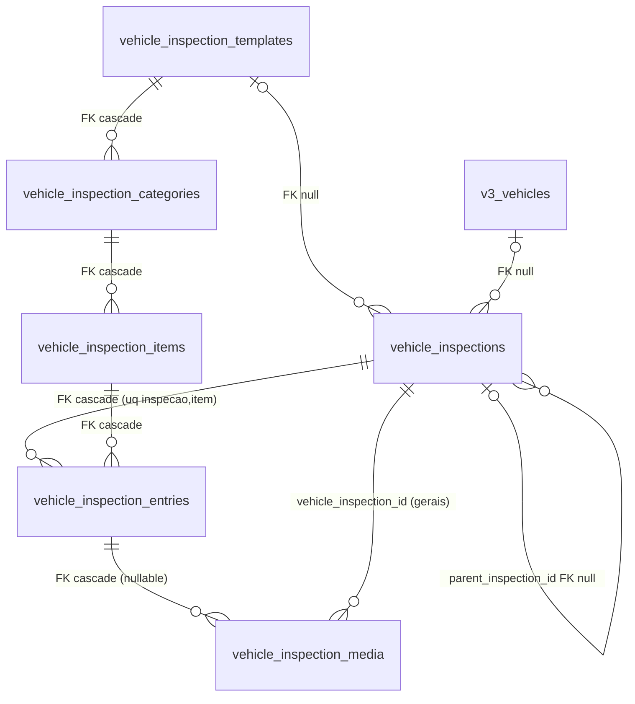
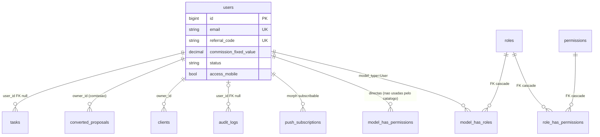

# Auditoria de arquitetura — IzzyCar

Auditoria só de leitura (nenhum ficheiro de código, migration ou `.env` foi alterado; nenhuma ligação à BD; nenhum comando `artisan` executado). Data: 2026-10-31. Branch `main`, 481 commits, último a 2026-10-27.

Convenção de leitura: **[Confirmado]** = visto no código/migrations citados; **[Hipótese]** = inferido, falta validar (tipicamente, estado real da BD de produção).

Limite metodológico: não foi inspecionada a BD de produção. "Migrations vs models" compara só ficheiros. Há evidência de que produção tem colunas que nenhuma migration cria (ver 4.4), por isso o esquema real pode divergir.

---

## 1. Stack e arquitetura geral

### 1.1 Stack real (confirmado em `composer.json`/`composer.lock`/`package-lock.json`)

| Camada | Versão / ferramenta |
|---|---|
| PHP | `^8.2` (`composer.json`; sem `platform` fixo no lock) |
| Framework | `laravel/framework` v12.70.1; `laravel/ui` v4.6.3 (auth scaffolding + Bootstrap); `laravel/tinker`; `laravel/legacy-factories` |
| Permissões | `spatie/laravel-permission` 6.25.0 (+ camada própria em `app/Permissions`) |
| PDF | `barryvdh/laravel-dompdf` 3.1.2, `mpdf/mpdf` 8.3.1, `barryvdh/laravel-snappy` 1.0.5 (wkhtmltopdf), `spatie/browsershot` 5.2.3 (Chromium/puppeteer) — **4 motores de PDF** |
| Excel | `openspout/openspout` 4.28.5 (exports XLSX em `app/Exports`) |
| Imagens | `intervention/image` 3.11.7 (`ImageOptimizerService`, `ThumbnailService`) |
| Push | `laravel-notification-channels/webpush` 12.1.0 (`HasPushSubscriptions` no `User`) |
| Sitemap | `spatie/laravel-sitemap` 7.4.0 |
| Ficheiros | `unisharp/laravel-filemanager` 2.13.0 (`config/lfm.php`, rotas `laravel-filemanager` com `web`+`auth`, `routes/web.php:102`) |
| HTTP/mail | `guzzlehttp/guzzle` 7.16.1, `symfony/http-client`, `symfony/mailgun-mailer`, `symfony/postmark-mailer` |
| Testes | `phpunit/phpunit` 11.5.55, `mockery`, `nunomaduro/collision`, `fakerphp/faker` |
| Front-end (build) | `laravel-mix` 5.0.9 sobre `webpack` 4.47.0, `sass` 1.90, `vue-template-compiler` (sem uso aparente); `webpack.mix.js` tem só `mix.js('resources/js/app.js')` + `sass('resources/sass/app.scss')` |
| Front-end (libs) | `tom-select` 2.4.3, `axios`, `puppeteer` 24.16.2 (dependência de runtime, usada com Browsershot [Hipótese]) |
| BD | MySQL (produção, Hostinger); sqlite `:memory:` nos testes (`phpunit.xml:24-25`) |
| Cache / sessão / fila | defaults `file` / `file` / `sync` (`config/cache.php:21`, `config/queue.php:16`, `.env.example`) |
| Scrapers | Python em `scarperAutoscout/` (pasta com typo "scarper"; venv dentro do repo) e `scripts/*.py` soltos |

Observações:
- [Confirmado] `composer.json:71` — script `pre-update-cmd` chama `Statamic\Console\Composer\Scripts::preUpdateCmd`, mas o Statamic não está em `require`. Resíduo que faria falhar um `composer update`.
- [Confirmado] Estrutura "Laravel 10" em Laravel 12: `bootstrap/app.php` instancia `Application` à mão com `App\Http\Kernel`/`App\Console\Kernel`; não usa o esqueleto `Application::configure()`. Funciona, mas foge ao padrão e dificulta upgrades.
- [Confirmado] Mix 5/Webpack 4 estão fora de suporte; o `package.json` não tem `engines`.
- [Confirmado] Não existe `.github/` nem outro CI no repositório.

### 1.2 Estrutura de pastas

```
app/
  Console/Commands (21 comandos) · Console/Kernel.php (schedule)
  Enums/ (9: LeadSource, LeadStatus, OpportunityStatus, VehicleFuel, Contact*, ChecklistItemStatus, HasOptions)
  Exports/ (ExportRegistry, definições XLSX: Client, Lead, Legalization, Movement, Vehicle)
  Http/Controllers/  (raiz = V1/legado + público; Admin/ = V2/V3; Admin/Mobile/; Frontend/; Api/; Auth/)
  Http/Middleware/ (16)  · Http/Requests/ (validação não trivial)
  Mail/ (17 Mailables) · Notifications/ (4)
  Models/ (77 ficheiros) · Models/Concerns/AssociatesSellerBrand
  Observers/ (6) · Permissions/ (4) · Providers/ (5)
  Services/ (~50, lógica de negócio) · Support/ (helpers: BrandLogos, VehicleCache, PushNotifier…) · Traits/HasSeo
config/ (permissions.php = catálogo próprio; permission.php = Spatie; security.php; lfm.php; snappy.php; webpush.php)
database/migrations (178) · seeders (14) · factories (só UserFactory)
resources/views/{admin/v2,admin/v3,frontend,emails,pdf,…} · resources/js · resources/sass
routes/{web.php 975 linhas, frontend.php, api.php, channels.php, console.php}
tests/{Feature (~60), Unit (7)}
docs/ (funil-comercial, leads-e-clientes, cotacoes, viaturas, seguranca-csp, ficheiros-privados)
scarperAutoscout/ (scraper Python do Radar) · scripts/ (scripts Python antigos) · AutoScoutSearch/ · "info-*" (pastas de documentação solta na raiz)
```

Ruído na raiz: `info-faq`, `info-importação`, `retomas`, `plataforma vendas`, `users`, `please`, `server.php` etc. (não analisados em profundidade).

### 1.3 Middleware

`app/Http/Kernel.php`:
- Globais: TrustProxies, HandleCors, PreventRequestsDuringMaintenance, ValidatePostSize, TrimStrings, ConvertEmptyStringsToNull (`Kernel.php:17-24`).
- Grupo `web`: cookies, sessão, CSRF, `ContentSecurityPolicyReportOnly` (CSP só em modo relatório; ver `docs/seguranca-csp.md`). Grupo `api`: só throttle.
- Aliases (`Kernel.php:57+`): `auth`, `blockInProd` (modo manutenção por `Setting maintenance_mode`, só em `production`), `role`/`permission` (Spatie), `mobile.access` (`EnsureMobileAccess`: exige `users.access_mobile`), `restrictAngariador`, `authorizeResource`, `antispam` (`BlockSpamSubmissions`), `verifyWhatsAppSignature`.
- Backoffice: `Route::prefix('gestao')->middleware(['auth','restrictAngariador','authorizeResource'])` (`routes/web.php:106`).
  - `RestrictAngariadorArea`: utilizador sem roles → 403; utilizador cujo único role é `angariador` só acede a rotas `admin.angariador.*` (funciona também durante impersonation).
  - `AuthorizeResource`: resolve a regra da rota no catálogo e, com `permissions.enforce=false` (default, `config/permissions.php:33`), **só regista** no canal de log `permissions` (`would_block`) e deixa passar.

### 1.4 Autenticação

- [Confirmado] Guard `web` (sessão) + provider `eloquent` `App\Models\User` (`config/auth.php`). Guard `api` do tipo `token` existe mas `routes/api.php` (41 linhas) é pequeno — webhook WhatsApp (`VerifyWhatsAppSignature`) e APIs internas de marcas/extras.
- Login/registo/reset via `Auth/*` (laravel/ui) + `SetPasswordController` (definir password por token, `SetPasswordMail`).
- Política de passwords central: `Password::defaults` min 10, maiúsc./minúsc., números, `uncompromised()` fora de testes (`AppServiceProvider.php:46-50`).
- Auditoria de login/logout via `Event::listen(Login|Logout)` → `AuditLog::record` (`AppServiceProvider.php:60-67`).
- Impersonation: a chave de sessão `impersonator_id` é lida no `AuthorizeResource`; o ponto de arranque não foi localizado nesta auditoria [Hipótese: em `UserV2Controller`].
- Angariadores: registo público (`AngariadorRegistrationController`), `users.status` `pendente|aprovado` (`User::isApproved/isPending`), contrato assinado e documentos de identificação em colunas do `users`.

### 1.5 Sistema de permissões

Duas camadas sobrepostas:
1. **Spatie** (`roles`, `permissions`, `model_has_*`, `role_has_permissions`; migration `2025_08_26_120248_create_permission_tables.php`). Sem teams.
2. **Catálogo próprio** `config/permissions.php` (310 linhas) lido por `PermissionRegistry` (326 linhas):
   - Estrutura Módulo → Objeto → Ações (`view|create|update|delete`) → Âmbito (`all|own`). Nome da permissão: `<objeto>.<ação>[.<âmbito>]` (ex.: `leads.view.own`).
   - Módulos: funil, operacoes, rede, analise, conteudo, config, sistema (≈ 35 objetos).
   - `routes` por objeto (padrões `admin.v2.leads.*`), `own_routes` (rotas que filtram por dono registo a registo), `owner` (coluna ou caminho `client.owner_id`), `route_actions`, `shared` (rotas livres para qualquer autenticado, `:225`), `admin_only` (`:258`), `profiles` (`:277`).
   - `PermissionService`: `scope()`, `allows()`, `owns()`, `applyScope(Builder, User, resource)`, `canAccessRoute/Url`. Soma de perfis, âmbito mais abrangente ganha. `isAdmin` = `hasRole('admin')`.
   - `PermissionSynchronizer` (comando `permissions:sync`) cria permissões Spatie a partir do catálogo e perfis iniciais. `permissions:report` lê o log `permissions`.
   - `AuthServiceProvider`: `Gate::before` — admin passa sempre; habilidades do catálogo resolvem-se pelo `PermissionService` (`:41`). Blade `@canroute`, `@canroutes`, `@canurl` (`:62-65`).
- Roles iniciais (confirmado em `config/permissions.php:277-309` e `RolesAndPermissionsSeeder`): `admin` (sem lista), `Importador`, `angariador`, `cms`.
- [Confirmado] `PERMISSIONS_ENFORCE` desligado por omissão → **a autorização por catálogo não bloqueia nada**; só os controllers Mobile e alguns do angariador verificam explicitamente (comentários "para valer também com PERMISSIONS_ENFORCE desligado", ex. `Admin/Mobile/ClientController.php:22`). Estado real em produção depende do `.env` [Hipótese].
- `PermissionCatalogTest` impõe que cada rota `/gestao` esteja no catálogo.

### 1.6 Providers, observers, eventos, jobs

- Providers: `AppServiceProvider` (observers, listeners de login, View composer do site público, `BrandLogos` scoped), `AuthServiceProvider`, `EventServiceProvider` (apenas `Registered → SendEmailVerificationNotification`), `RouteServiceProvider`, `BroadcastServiceProvider`.
- Observers registados em `AppServiceProvider.php:52-57`:

| Model | Observer | Efeito |
|---|---|---|
| Page | SeoObserver | `saved`: se o request tem `seo`, faz `seo()->updateOrCreate` |
| Proposal | SeoObserver + ProposalObserver | auditoria; `Aprovada` converte lead em cliente; `Enviado` envia 2 emails (cliente, angariador) + follow-up automático +2 dias; `deleting` repõe estado das oportunidades |
| Sale | SaleObserver | `saved` → `Expense::syncFromSale`; `deleted` apaga Expense automática |
| Vehicle (V1) | VehicleObserver | `saved` → `Expense::syncFromVehicle`; `deleted` apaga Expense |
| Expense | ExpenseObserver | `saved` → `FinancialMovement::syncFromExpense`; `deleted` apaga o movimento |
| Client | ClientObserver | auditoria created/updated/deleted |

- Eventos nos próprios models (`booted`): Client (`saving`: chaves de duplicados), ConvertedProposal (tracking_code, datas das tranches, comissão fixada, sync para Expense, histórico de estado), Legalization (token), Setting (invalida cache), SellerContact (normalização), V3Vehicle/V3VehiclePhoto (`VehicleCache::flush`), `AssociatesSellerBrand` (trait: liga marca ao vendedor).
- **Não há eventos de domínio, listeners nem Jobs** (não existe `app/Events|Listeners|Jobs`). Fila = `sync`. [Confirmado] Nenhum Mailable implementa `ShouldQueue` (só `use Queueable`); logo todos os emails são enviados dentro do pedido HTTP. As tabelas `jobs`, `job_batches`, `failed_jobs` existem mas ficam sem uso.

### 1.7 Commands e schedule

`app/Console/Kernel.php:27-66` (CLI do Laravel é invocado por cron do alojamento [Hipótese]):

| Comando | Cadência |
|---|---|
| `sitemap:generate` | diário |
| `tasks:send-reminders` | 00:00 |
| `legalizations:send-tracking-emails` | 15:00 |
| `leads:followup-reminder` | **a cada minuto** |
| `commissions:overdue-alert` | 09:00 |
| `reports:monthly` / `quarterly` / `annual` | dia 1, 01:00 / 01:10 (abr/jul/out) / 01:20 (1 jan) |
| `radar:refresh-active` | 06:00, 14:00, 22:00 |
| `radar:classify-trims` | 06:30, 14:30, 22:30 |
| `google:sync-reviews` | **comentado** (`:36`) |

Comandos sem schedule: `clients:duplicates`, `clients:merge`, `converted-proposals:recalculate-tranches`, `images:thumbnails`, `brands:import-logos`, `import:car-data`, `ads:import`, `files:move-to-private`, `permissions:sync`, `permissions:report`.

### 1.8 Integrações externas

- AutoScout24 / Standvirtual / Carmine: scraper Python `scarperAutoscout/` escreve diretamente nas tabelas `radar_*` da mesma BD MySQL; o Laravel dispara-o por `exec()` (`AutoscoutScraperRunner`) ou, quando o alojamento bloqueia `exec`, marca `radar_searches.run_requested_at` e um cron Python independente (`scraper.cli run-requested`) recolhe o pedido (documentado em `AutoscoutScraperRunner.php`, cabeçalho). **Acoplamento forte por esquema**: o Python depende dos nomes de colunas/tabelas.
- `VehicleListingImportService`, `Autoscout|Standvirtual|CarmineTaxonomyService`, `RadarTrimPriceAiService` (OpenAI, `services.openai.key`), `RadarValueScoreService`.
- Google: reviews (`SyncGoogleReviews`, OAuth refresh token), Maps/Geocoding (`GeocodingService`).
- WhatsApp Cloud API: webhook `Api/WhatsAppWebhookController` (+ `PreLead` criado a partir de mensagens), assinatura verificada.
- Mail: Mailgun/Postmark/SES configurados em `config/services.php`; Mailables em `app/Mail`.
- Web Push (VAPID, `config/webpush.php`), `PushNotifier`.
- PDFs: Modelo 9/1460/1RA (`Modelo*PdfService`), contratos (`ContractService`, `AngariadorContractService`), relatórios mensal/trimestral/anual.

### 1.9 Testes

- `tests/Feature` (~60 classes) e `tests/Unit` (7). BD `sqlite :memory:`; classes com BD usam `Tests\RefreshesDatabaseWithoutMysqlOnlyMigrations` (lista migrations só-MySQL). `ExampleTest` falha desde antes (CLAUDE.md).
- Só existe **uma factory** (`UserFactory`); os testes criam dados à mão. Models com `HasFactory` sem factory correspondente: Client, Proposal, ConvertedProposal, Sale, Expense, Supplier, Partner, Vehicle, V3Vehicle, VehicleImage, VehicleAttributeValue, ProposalAttributeValue, ProposedCar, AttributeGroup, Newsletter [Confirmado: `database/factories` só tem `UserFactory.php`]. `laravel/legacy-factories` está instalado mas não há factories legadas.
- Cobertura focada em funil (fases 1-3), permissões, movimentos, exportações, segurança. Sem testes de integração do scraper nem dos comandos agendados [Hipótese: não encontrei testes de `Radar*`/`SendMonthlyReport`].

### 1.10 Build e deploy conhecidos

- Memória do projeto (não confirmável no repo): alojamento partilhado Hostinger; **a pasta `public/` do domínio é uma cópia separada** — `git pull` não a atualiza, ficheiros de `public/` copiam-se à mão. `exec/proc_open` desativados no alojamento (confirmado em `AutoscoutScraperRunner`).
- Assets: `npm run prod` (Mix) gera `public/js` e `public/css` (ficheiros compilados no repositório? `public/.DS_Store` está versionado — mostra ruído; [Hipótese] assets compilados são commitados).
- Sem CI/CD, sem `Dockerfile`, sem pipeline de testes automática. `.claude/settings.json` nega `migrate` e `db:*` ao agente.
- Migrations têm de ser corridas à mão em produção (regra do `CLAUDE.md`).

---

## 2. Catálogo de models (`app/Models`, 77 ficheiros)

Legenda: PK = `id` auto-incremento salvo indicação; "G" = `$guarded` (nenhum model usa `$guarded`: todos usam `$fillable`, ou nenhum → ver); **SoftDeletes não é usado em nenhum model** [Confirmado: nenhum `use SoftDeletes` em `app/Models`]. Casts só indicados quando relevantes. Timestamps padrão salvo indicação. `HasFactory` indicado quando existe.

### 2.1 Leads, clientes, cotações, pedidos

| Model (tabela) | Fillable / casts / atributos | Relações (cardinalidade) | Regras de negócio, scopes, eventos |
|---|---|---|---|
| **Client** (`clients`) `Client.php:14-48` | owner_id, angariador_code, name, vat_number, birth_date, gender, phone, email, language, identification_number, validate_identification_number, address, postal_code, city, client_type, origin, observation, consent*, is_lead, converted_at, lead_source, lead_status, next_followup_at, followup_note. Casts: datas, `is_lead` bool. **Não fillable mas escritos**: `email_normalized`, `phone_key` (`:54-58`) | owner → User (N:1, `owner_id`); proposals 1:N; convertedProposals 1:N; formProposals 1:N; sale (`sale()`, 1:N, nome no singular) `:126`; vehicles 1:N V3Vehicle `:132`; costSimulators 1:N; activities 1:N (desc.); latestActivity 1:1 (`latestOfMany`); carCandidates 1:N (ordem). **`client()` belongsTo(Client) `:122` é inválido** (ver 4.1) | `saving`: normaliza email/telefone via `ClientMatcher`. `convertToClient()` `:114`. Scopes `filtrarClientes`, `filtrarLeads` (partilhados com exportação XLSX). `LOWER(client_type)` por inconsistência de dados. Lead e Cliente são a **mesma tabela** (`is_lead`). Observer: ClientObserver |
| **LeadActivity** (`lead_activities`) | client_id, user_id, type, title, body, icon, color | client N:1; user N:1 | `TYPES` constante; `log()` (sistema) e `logManual()` (utilizador autenticado). Timeline do cliente |
| **PreLead** (`pre_leads`) | name, phone, message, status | — (liga a Client só por telefone, sem FK) | Criada pelo webhook WhatsApp; `phone` indexado |
| **CarCandidate** (`car_candidates`) | client_id, title, link, price, description, status, notes, order_position | client N:1 | `STATUS_OPTIONS`; ordenado por `order_position` |
| **CostSimulator** (`cost_simulators`) | token, client_id, brand, model, custos…, isv_table, read, fuel, year, cc, co2… | client N:1 | `read` bool; migration não tem FK em `client_id` (4.5) |
| **ImportSimulator** (`import_simulator`) | — (vazio) | — | **Morto**: sem uso; nome de tabela não bate (4.2) |
| **FormProposal** (`form_proposals`) `FormProposal.php` | pedido de importação (name, phone, email, brand, model, fuel, budget, retoma_*, buyer_type, payment_type, origin, title, created_by, angariador_code, status, version, proposal_id, client_id…). Cast: `retoma_photos` array | client N:1; opportunities 1:N (`latest`); creator N:1 User. **Falta `proposal()`** | `ORIGIN_SITE/MANUAL`; `isManual()`; atributo `label` |
| **ImportOpportunity** (`import_opportunities`) `ImportOpportunity.php:19+` | form_proposal_id, proposal_id, brand…vin, country, photo_path, seller_id, seller_contact_id, client_quote_requested_at, status, contact_*, notes, created_by. Casts enums: `VehicleFuel`, `OpportunityStatus`, `ContactMethod`, `ContactStatus`; defaults `status=por_contactar` | formProposal N:1 (FK obrigatória, cascade); proposal N:1 (nullOnDelete); seller N:1; sellerContact N:1; checklistEntries 1:N; contacts 1:N; creator N:1 | Atributos `title`, `photo_url`, `formatted_price`; trait `AssociatesSellerBrand`; `COUNTRIES` |
| **ImportOpportunityContact** | import_opportunity_id, contacted_at, method, type, message, user_id (casts enum) | opportunity N:1; user N:1 | histórico de contactos |
| **ImportOpportunityChecklistEntry** | import_opportunity_id, opportunity_checklist_item_id, status (enum), updated_by | opportunity, item, updatedBy (N:1) | único (oportunidade,item) |
| **OpportunityChecklist** (`opportunity_checklists`) | slug, name, applies_to_fuels (array), sort_order, is_active | items 1:N | scope `active`; `appliesToFuel()` |
| **OpportunityChecklistItem** | opportunity_checklist_id, slug, label, sort_order, is_active | checklist N:1 | — |
| **Proposal** (`proposals`) `Proposal.php:16-104` | client_id, brand…, custos (transport, ipo, imt, isv, plates, inspection, commission, iuc), proposed_car_*, images (array), fuel, value, status, url, proposal_code… Usa `HasFactory`, `HasSeo` | client N:1; attributeValues 1:N; seo morphOne. **Faltam**: convertedProposal (1:1), opportunities (1:N), formProposal | `VALIDITY_DAYS=15`; `totalCost()`; `isExpired()`; `isAccepted()` faz query a `ConvertedProposal` `:83` (N+1 em listas); `isRejected()`; flag em memória `skipSentEmails`. Observers Seo + Proposal |
| **ProposalAttributeValue** | proposal_id, attribute_id, value | proposal N:1; attribute N:1 VehicleAttribute | — |
| **ProposedCar** (`proposed_cars`) | … | `clientRequest()` → classe **inexistente** `ClientRequest` `:33` | **Morto**; sem migration (4.2) |
| **ConvertedProposal** (`converted_proposals`) `ConvertedProposal.php` | ~50 campos (estado, custos, flags `*_pago`, tranches, comissão, vin, tracking). Casts: `angariador_commission` decimal, datas, `comissao_paga` bool. **Não fillable mas escrito**: `tracking_code` | client N:1; proposal N:1 (1:1 de facto: `unique(proposal_id)`); owner N:1 User; v3Vehicle N:1; statusHistories 1:N; documents 1:N | `PIPELINE_STATUSES`, `CANCELLED_STATUSES` (`Cancelada`+legado `Cancelado`), `SILENT_BY_DEFAULT`; `boardColumn()`, `serviceTotal()`, `setVinAttribute`, `isCancelled()`, `trackingUrl()`, `deliveredAt()`, `isCommissionOverdue()` (48h após Entrega), `commissionTotals()`; scope `notCancelled`. `booted` `:179-219`: tracking_code, datas das tranches, comissão congelada, `saved` → `Expense::syncFromConvertedProposal`, `deleted` → `forgetConvertedProposal`, `updated` → `StatusProposalHistory` |
| **ConvertedProposalDocument** | converted_proposal_id, tipo, nome_original, caminho, enviado_em | convertedProposal N:1 | ficheiros privados |
| **StatusProposalHistory** (`status_proposal_history`) | converted_proposal_id, old_status, new_status | `proposal()` → **ConvertedProposal** (nome enganador) | sem FK na BD (4.5) |

### 2.2 Viaturas, legalização, venda, inspeção

| Model | Fillable / casts | Relações | Regras / notas |
|---|---|---|---|
| **V3Vehicle** (`v3_vehicles`) `V3Vehicle.php:18-243` — **fonte de verdade** | ref., brand/model/sub_model/version/year/month/day/fuel, km, power, cc, color, vin, registration, datas, notes, ad_text, show_online, home_featured(+order), is_imported, status, client_id, supplier_id, seller_id, seller_contact_id, purchase_*, asking_price, generated_from_inspection_id. Casts: datas, bools, floats, ints | supplier, client, seller, sellerContact, generatedFromInspection (N:1); photos 1:N; documents 1:N; legalization 1:1 (`hasOne`, sem unique na BD); exportLegalization 1:1 (menor id); expenses 1:N; legalizationExpenses (hasManyThrough Legalization→Expense); sales 1:N; attributeValues 1:N | `booted`: `VehicleCache::flush` em saved/deleted. `generateReference()` `V3-AAAA-NNN` por `count()+1` do ano `:67` (risco de colisão após apagar [Hipótese]). Atributos: `cover_photo`, `expenses_total`, `total_cost`, `status_label/color`, `year_label`; estáticos `statusOptions`, `fuelOptions` (strings, não usa o enum `VehicleFuel`). Scope `filtrar`. **Sem SoftDeletes e sem observer financeiro** (4.3) |
| **V3VehiclePhoto** | v3_vehicle_id, path, order_position, is_cover, focal_x/y | vehicle N:1 | flush de cache |
| **V3VehicleDocument** | v3_vehicle_id, tipo, titulo, nome_original, caminho | vehicle N:1 | `getLabel()` usa `Legalization::DOCUMENTOS` |
| **Vehicle** (`vehicles`) — **legado V1/V2** `Vehicle.php:17-85` | reference, brand…, purchase_*, sell_price, consigned_vehicle, warranty_*… | supplier N:1; images 1:N; attributeValues 1:N; expenses 1:N; sale 1:1; documents 1:N; legalizations 1:N | Observer `VehicleObserver`. Ainda referenciado por Sale, Task, Legalization, Expense, FinancialMovement, controllers V1 |
| **VehicleImage** | vehicle_id, path, order | vehicle N:1 | legado |
| **VehicleDocument** | vehicle_id, tipo, … | vehicle N:1 | legado; `tipos()` |
| **VehicleAttribute** (`vehicle_attributes`) | name, alemao, key, type, options(array), order, attribute_group, field_name_autoscout/mobile | attributeGroup N:1 por **nome** (`attribute_group`→`attribute_groups.name`) `:26` | catálogo de equipamentos |
| **AttributeGroup** | name, order | attributes 1:N por nome `:15` | chave de junção = texto (4.1) |
| **VehicleAttributeValue** | vehicle_id, v3_vehicle_id, attribute_id, value | vehicle N:1; v3Vehicle N:1; attribute N:1 | tabela partilhada V1+V3 |
| **Legalization** (`legalizations`) `Legalization.php:12-296` | client_id, vehicle_id, v3_vehicle_id, marca, modelo, combustivel, matricula, num_homologacao, num_processo_imt, notas, regime_especial_isv, invoice_path, modelo9_dados, modelo1460_dados, steps_completed. Casts: JSON arrays, bools (`email_enviado` no cast mas não fillable) | client N:1; vehicle N:1 (legado); v3Vehicle N:1; expenses 1:N (desc. data); documents 1:N | `DOCUMENTOS`, `DOCUMENTOS_REGIME_ESPECIAL`, `PASSOS` (7 passos), `ESTADOS`; `boot creating` gera `token` (32); scopes `filtrar`/`estado` (JSON_LENGTH); `progressPercent()`, `currentStep()`, `trackingUrl()`, versões traduzidas. Estado derivado de `steps_completed` (JSON), sem coluna de estado |
| **LegalizationDocument** | legalization_id, tipo, nome_original, caminho | legalization N:1 | — |
| **Sale** (`sales`) | vehicle_id, v3_vehicle_id, client_id, sale_date/price, vat_*, margens, totalCost, totalExpenses, rentabilidades, trade_in_* | vehicle N:1 (legado); v3Vehicle N:1; client N:1. **Falta** `tradeInVehicle` | Observer: `SaleObserver`. `HasFactory` |
| **VehicleInspection** (`vehicle_inspections`) | template_id, v3_vehicle_id, parent_inspection_id, estado, dados viatura, contadores, completed_at, converted_at | parent N:1; revisions 1:N; template N:1; vehicle N:1 V3Vehicle; entries 1:N; media (through) ; generalMedia 1:N | `media(): HasMany` devolve `hasManyThrough` `:85-88` → **TypeError** se chamada [Confirmado pelo tipo de retorno; ver 4.1] |
| **VehicleInspectionTemplate / Category / Item / Entry / Media** | ver ficheiros | Template 1:N Category 1:N Item 1:N Entry N:1 Inspection; Entry 1:N Media; Media N:1 Inspection (gerais) | `applies_to_fuels` (array) filtra itens por combustível; `Entry::score()` ok=1, atenção=0.5; único (inspeção,item) |
| **Task** (`tasks`) | title, description, due_date, reminder_date, user_id, user_name, vehicle_id, v3_vehicle_id, status, reminder_sent | user N:1; vehicle N:1 (legado); v3Vehicle N:1 | scopes `pending`, `completed`, `needsReminderToday`; `user_name` duplica `users.name` |
| **TransportQuote** | brand, model, car_type, origem/destino + coords, supplier_id, price, … | supplier N:1 | `CAR_TYPES` |
| **Supplier** (`suppliers`) | type, company_name, … | (inversas ausentes: vehicles, transportQuotes) | `HasFactory`. `email` único na BD |
| **Partner** | name, …, show_on_site | — | atributo `image_thumb`; é ligado a `Expense.partner_id` (sem `expenses()` inversa) |
| **ConsignmentEvaluation** | pedido público de consignação; `photos` array | — | `$statusLabels` estático; sem relação a Client/V3Vehicle |

### 2.3 Financeiro

| Model | Detalhe |
|---|---|
| **Expense** (`expenses`) `Expense.php` — tabela legada "despesas" evoluída para **movimentos** (migration `2026_05_15_200000_evolve_expenses_to_movements_table`) | Fillable `:13-41`: movement_type, expense_category (legado), category, vehicle_id, v3_vehicle_id, legalization_id, client_id, partner_id, title, amount/amount_gross/vat_rate/vat_amount/amount_net, expense_date, observations, attachment_path, payment_method, status, source_type, source_id. Relações N:1: vehicle, v3Vehicle, client, partner, legalization. Pseudo-polimorfismo `source_type`/`source_id` **sem relação Eloquent** e com valores compostos (`ConvertedProposal::class.':primeira_tranche'`, `:274-290`). Estáticos `syncFromSale`, `syncFromConvertedProposal`, `syncFromV3Vehicle`, `syncFromVehicle`, `forgetConvertedProposal`; scopes `filtrar`, `fromConvertedProposal`; taxonomias `movementTypes/categories/paymentMethods/statuses` em arrays (não enums). Observer `ExpenseObserver` projeta para `FinancialMovement`. `movement_type` só aceita `expense|income` nas listas, mas o comentário no fillable prevê mais tipos |
| **FinancialMovement** (`financial_movements`) | Livro derivado: `movable` morphTo; type (enum BD income/expense), category, description, montantes, movement_date. Na prática `movable_type` é sempre `Expense::class`. `syncFromSale` e `syncFromVehicle` (`:42`, `:79`) **já não são chamados** (só `syncFromExpense`, `ExpenseObserver.php:12` e `FinancialDashboardController.php:191`). Usado só em relatórios e dashboard (`ReportDataService`, `FinancialDashboardController`) |

### 2.4 Radar de preços

| Model | Detalhe |
|---|---|
| **RadarSearch** (`radar_searches`) | name (único), make, model, filters (array), base_url, standvirtual_base_url, carmine_base_url, import_cost_eur, is_active, new_listings_seen_at, run_requested_at. listings 1:N, runs 1:N, latestRun 1:1 (`latestOfMany('started_at')`), equipment N:M (`radar_search_equipment`). `latestRunFor(source)` |
| **RadarListing** (`radar_listings`) | external_id, source, radar_search_id (nullable), make…, price_eur, trim_price_multiplier, include_in_average, duplicate_of_listing_id, first/last_seen_at, removed_at. search N:1; priceHistory 1:N; duplicateOf N:1 (auto-referência); equipment N:M (`radar_listing_equipment`). Chave única `(source, external_id)` |
| **RadarPriceHistory** (`radar_price_history`, sem timestamps) | radar_listing_id, price_eur, scraped_at; listing N:1 |
| **RadarSearchRun** | search N:1; `UPDATED_AT=null`; escrito pelo Python |
| **RadarEquipment** (`radar_equipment`) / **RadarEquipmentAlias** | catálogo normalizado + aliases por fonte; listings/searches N:M |
| **AdSearch / AdListing** (`ad_searches`, `ad_listings`) | Scraper antigo (Standvirtual/AutoScout via comando `ads:import`): 1:N; AdListing com 33 booleanos de equipamento. Pode ser substituído pelo Radar [Hipótese] |
| **RecommendationPost** | dados de posts sociais (`SocialPostController`); sem relações; arrays em casts |

### 2.5 Vendedores

| Model | Detalhe |
|---|---|
| **Seller** (`sellers`) | name, website, country, address, notes, is_active, created_by. domains 1:N, contacts 1:N, activeContacts, primaryContact 1:1, brands N:M (`brand_seller`), vehicles 1:N V3Vehicle, opportunities 1:N, creator N:1. Scopes `active`, `worksBrand`, `search` (inclui números normalizados). `syncDomains()`, `hasHistory()` (impedir apagar). FK `restrictOnDelete` nas tabelas filhas |
| **SellerContact** | seller_id, name, role, email, phone, whatsapp, is_primary, is_active; `saving` calcula `email_normalized`, `email_domain`, `phone_normalized`, `whatsapp_normalized` (não fillable); opportunities 1:N; vehicles 1:N. `is_primary` não é único por vendedor na BD |
| **SellerDomain** | seller_id, domain; único (seller,domain) |
| **Brand** (`brands`) | name, logo_path; sellers N:M; models/modelCars 1:N (**duas relações iguais**, `:29`/`:34`). Atributo `logo_url` |
| **ModelCar / ModelYear / SubmodelCar** | catálogo marca→modelo→ano/submodelo. `ModelCar.submodel` é coluna **e** relação `submodels()` homónima de domínio. `SubmodelCar::model()` é `hasMany(ModelCar)` (incorreto, 4.1). `years()` e `modelYears()` duplicam |
| **Trait `AssociatesSellerBrand`** | `saved`: liga a marca (texto) às marcas do vendedor via `SellerService::attachBrandByName` |

### 2.6 CMS, notícias, site

| Model | Detalhe |
|---|---|
| **Page** (`pages`) | fillable inclui `menu_id` mas **a tabela não tem essa coluna** (nenhuma migration a cria); `menu()` usa FK `page_id` inexistente (`Page.php:27`). pageType N:1, contents 1:N, parent/children (auto-referência), seo morphOne. `HasSeo` + `SeoObserver`. A coluna `is_active` existe mas não é fillable |
| **PageType / PageTypeField / PageContent** | tipos de página dinâmicos (constantes NEWS, HOMEPAGE…); `PageContent` guarda `field_name`/`field_value` (EAV) |
| **Menu** (`menus`) | title, url, parent_id, order, route_name, show_online; children / children_active / parent; scope `main`. Usado no composer do site (`AppServiceProvider.php:70`) |
| **MenuItem** / **_Menu** | `menu_items` **não tem migration**; `_Menu.php` declara outra classe `App\Models\Menu` (nome de ficheiro não PSR-4). Código morto (`_MenuController`, `MenuItemController`) |
| **NewsArticle** (`news_articles`) | slug único; casts gallery/published_at; scope `published` (status texto `'Publicado'`); `read_time`; `generateSlug` |
| **Newsletter / NewsletterOffer / NewsletterSendLog** | Newsletter 1:N Offer; 1:N SendLog; `sentClients` N:M Client por `newsletter_send_logs` (pivot com model próprio); único (newsletter,client) |
| **Testimonial** | rating float, published, google_review_id único |
| **SeoMeta** | morph `seoable`; usado por Page e Proposal |
| **Setting** (`settings`) | chave/valor (`label`/`value`); cache `settings_all` 1 h, invalidada em `saved/deleted` (`Setting.php:16`); `cachedValue()` |
| **AuditLog** (`audit_logs`, sem `updated_at`) | `record()` com filtragem de campos sensíveis; `recordCreated/Updated/Deleted`; `auditable_type/id` manual (sem `morphTo`) |
| **User** (`users`) | `User.php:17-73`: fillable sem `access_mobile`, `referral_code` incluído; casts por método (`hashed`, `decimal:2`, `boolean`) **coexistindo** com `$casts` (redundante); `HasRoles`, `Notifiable`, `HasPushSubscriptions`. `ownedLeads()` 1:N Client. Faltam: convertedProposals (owner), tasks, activities, createdSellers. `isAngariadorOnly()`, `generateUniqueReferralCode()` |
| **Car** | vazio, sem tabela; **morto** |

---

## 3. Diagramas Mermaid (`erDiagram`) por módulo

Notação: apenas chaves e colunas relevantes. Linhas a tracejado (`..`) = relação **sem FK na BD** (só lógica).

### 3.1 Leads, clientes e cotações



### 3.2 Viaturas V3



### 3.3 Legalização



### 3.4 Financeiro e movimentos



### 3.5 Radar



### 3.6 Vendedores



### 3.7 CMS, notícias, site



### 3.8 Vistoria (inspeções)



### 3.9 Utilizadores e permissões



---

## 4. Problemas identificados

Gravidade: **A** alta (risco de erro de dados/ruptura), **M** média, **B** baixa/higiene.

### 4.1 Relações em falta, incorretas ou ambíguas

| # | Gravidade | Problema | Local | Estado |
|---|---|---|---|---|
| 1 | M | `Client::client()` é `belongsTo(Client)` → procura `clients.client_id`, que não existe; qualquer uso quebra | `Client.php:122` | Confirmado (uso real não pesquisado) |
| 2 | M | `Page::menu()` usa FK `page_id` em `menus` e `pages.menu_id` (fillable) não existe | `Page.php:13,27`; `create_pages_table` | Confirmado |
| 3 | M | `SubmodelCar::model()` é `hasMany(ModelCar)` (devia ser `belongsTo(ModelCar,'model_id')`) | `SubmodelCar.php:18` | Confirmado |
| 4 | M | `VehicleInspection::media()` anuncia `HasMany` mas devolve `HasManyThrough` → TypeError no PHP 8 | `VehicleInspection.php:85-88` | Confirmado pelo tipo; não verifiquei se há chamadas (`->media` sobre inspeção) |
| 5 | M | `ProposedCar::clientRequest()` → classe `ClientRequest` inexistente; model e tabela mortos | `ProposedCar.php:33` | Confirmado |
| 6 | M | Faltam relações já suportadas pela BD: `Proposal::convertedProposal()` (1:1, `unique(proposal_id)`), `Proposal::opportunities()`, `FormProposal::proposal()`, `Client::legalizations()`, `Client::expenses()`, `Sale::tradeInVehicle()`, `Supplier::vehicles()/transportQuotes()`, `Partner::expenses()`, `User::convertedProposals()/tasks()`, `Legalization` ↔ `LeadActivity` | vários | Confirmado |
| 7 | M | `Proposal::isAccepted()` faz uma query por chamada (N+1 em listagens/kanban) | `Proposal.php:81-84` | Confirmado |
| 8 | B | Nomes ambíguos: `Client::sale()` (hasMany no singular); `StatusProposalHistory::proposal()` devolve `ConvertedProposal`; `Brand::models()` = `Brand::modelCars()`; `ModelCar::years()` = `modelYears()` | vários | Confirmado |
| 9 | M | Junção por **texto**: `attribute_groups.name` ↔ `vehicle_attributes.attribute_group`; renomear um grupo orfana atributos | `AttributeGroup.php:15`, `VehicleAttribute.php:26` | Confirmado |
| 10 | M | Pseudo-polimorfismo de `Expense.source_type/source_id` sem relação Eloquent e com sufixo composto (`ConvertedProposal:entrada`); `FinancialMovement.movable` aponta sempre para `Expense` | `Expense.php:274-290` | Confirmado |
| 11 | B | `AuditLog.auditable_*` sem `morphTo()` | `AuditLog.php` | Confirmado |
| 12 | M | `V3Vehicle::legalization()` é `hasOne` mas a BD permite várias (sem unique); o código já contorna em `exportLegalization()` | `V3Vehicle.php:106-120` | Confirmado |

### 4.2 Tabelas sem model e models sem tabela (migrations vs models)

Tabelas **sem model Eloquent** (por desenho ou omissão):
- Framework: `cache`, `cache_locks`, `jobs`, `job_batches`, `failed_jobs`, `password_reset_tokens`, `sessions`.
- Spatie: `roles`, `permissions`, `model_has_roles`, `model_has_permissions`, `role_has_permissions`; `push_subscriptions` (pacote webpush).
- Pivots usados por `belongsToMany`: `brand_seller`, `radar_listing_equipment`, `radar_search_equipment` — correto sem model (apenas `newsletter_send_logs` tem model como pivot).

Models **sem tabela criada por migration** (vestígios):
- `Car` (`cars`), `ProposedCar` (`proposed_cars`), `MenuItem` (`menu_items`) e `_Menu` — **sem migration** [Confirmado: `grep` às migrations]. Em produção podem existir tabelas criadas à mão [Hipótese].
- `ImportSimulator`: sem `$table`, Eloquent procuraria `import_simulators`, mas a migration cria `import_simulator`. Sem uso no código.

Colunas que **existem em produção mas sem migration que as crie** (migrations "ensure" de remendo): `clients.owner_id` e `users.commission_fixed_value` (`2026_09_30_135000_ensure_production_only_columns_exist.php`), e `converted_proposals.owner_id` (`2026_10_01_135500_ensure_commission_columns_on_converted_proposals.php`). Prova de **drift entre repositório e produção**: outras colunas podem estar na mesma situação [Hipótese]. Coluna usada pelo model sem migration: `pages.menu_id` (fillable) — provavelmente nunca existiu.

Colunas escritas mas fora de `$fillable` (funciona porque se atribui por propriedade): `clients.email_normalized/phone_key`, `converted_proposals.tracking_code`, `legalizations.token/email_enviado`, `users.access_mobile`, `seller_contacts.*_normalized`. Padrão aceitável, mas esconde-se do `fillable` e dos testes de massa-atribuição.

### 4.3 Duplicação e legado

1. **Vehicle (V1) vs V3Vehicle** — `V3Vehicle` é a fonte de verdade (CLAUDE.md), mas o legado continua ligado: `Sale.vehicle_id` (FK cascade, agora nullable), `Task.vehicle_id` (cascade), `Legalization.vehicle_id`, `Expense.vehicle_id`, `VehicleAttributeValue.vehicle_id` (NOT NULL na criação, tornado partilhado com `v3_vehicle_id` — ver 4.5), `VehicleObserver` ainda ativo (`AppServiceProvider.php:55`), `FinancialDashboardController.php:177-191` ainda reconstrói a partir de `Vehicle`. Modelos V1 `Vehicle/VehicleImage/VehicleDocument` e as colunas `vehicle_id` duplicam cada relação (`vehicle()` + `v3Vehicle()` em Sale, Task, Legalization, Expense).
2. **Expense vs FinancialMovement** — duas tabelas com os mesmos montantes (`amount_gross/vat_rate/vat_amount/amount_net`) e a mesma data. `FinancialMovement` é projeção de `Expense` (Observer), mas tem ainda `syncFromSale` e `syncFromVehicle` mortos e categorias em português (texto) vs `Expense.category` em inglês (chave). Relatórios (`ReportDataService.php:45-84`) leem `FinancialMovement`, listagens leem `Expense` → risco de números diferentes se o sync falhar (sem transação nem retry, e `updateOrCreate` por `movable`). CLAUDE.md diz que `Expense` está a ser substituído por movimentos, mas hoje **é o contrário na prática**: `Expense` é a tabela de origem e `v2/movements` apenas outra UI sobre ela (`MovementV2Controller`, `MovementService` usam `Expense`).
3. **Pipeline de sync encadeado** — `ConvertedProposal.saved → Expense (até 10 linhas por cotação convertida) → ExpenseObserver → FinancialMovement`. Cada gravação de uma cotação convertida pode gerar até ~20 writes e leituras (`firstOrNew`+`save` por entrada); correr dentro do pedido, sem fila.
4. **Controllers V1/V2** — rotas V1 desligadas (`routes/web.php:164-169`, comentário "desligado — o V2/V3 substitui-o"), mas os controllers continuam em `app/Http/Controllers`: `SupplierController`, `PartnerController`, `ExpenseController`, `SaleController`, `UserController`, `SettingController`, `RoleController`, `PermissionController`, `VehicleAttributeController`, `AttributeGroupController`, `HomeController`, `_MenuController`, e `VehicleController` (sem rota direta; as `v2/vehicles` só redirecionam para V3, `web.php:474-480`); `ClientController`/`ConvertedProposalController`/`ProposalController` V1 mantêm ações ainda roteadas (`contractService`, `updateStatus`, páginas públicas da cotação). Também vivos mas não-V2: `BrandController`, `MenuController`, `PageController`, `PageTypeController`, `AdSearchController`, `AnuncioController` (rotas em `web.php:929-967`). Total ≈ 12 controllers sem rota (≈ 1500 linhas de código morto, só V1 Vehicle/Expense/Sale somam 642).
5. **Dois scrapers/radares** — `AdSearch/AdListing` (+`ImportAdListings`, `AnuncioController`, `AdSearchController`) vs `Radar*`. O primeiro tem 33 colunas booleanas de equipamento fixas.
6. **Quatro motores de PDF** (dompdf, mpdf, snappy, browsershot) — custo de manutenção e fontes duplicadas.
7. **Enums vs arrays/strings** — `app/Enums` só cobre Oportunidades/Leads; estados de `ConvertedProposal`, `V3Vehicle.status`, `Task.status`, `Proposal.status`, `Expense.*`, `Legalization.ESTADOS`, `Client.client_type` ficam em constantes/arrays/strings livres (e `fuelOptions` do V3 duplica `VehicleFuel`). Já houve inconsistência de dados (`Cancelada/Cancelado`, `empresa/Empresa`).
8. **Dois sistemas de menus** (`Menu` com `MenuV2Controller`/`MenuController` vs `MenuItem/_Menu` morto) e dois de cotação (`Proposal` vs `ProposedCar`).

### 4.4 Integridade e órfãos

| # | Gravidade | Risco | Evidência |
|---|---|---|---|
| 1 | **A** | **Eliminar uma V3Vehicle deixa a despesa automática de compra viva**: o FK `expenses.v3_vehicle_id` faz `nullOnDelete`, `V3Vehicle` não tem observer de `deleted`, e o `destroy()` só apaga ficheiros e o registo. A `Expense` (`source_type=V3Vehicle`) e o `FinancialMovement` continuam, passando a despesa "da empresa" e distorcendo relatórios | `V3VehicleController.php:112-124`; `Expense.php:377-416`; só há sync no `savePurchase` (`:217`) |
| 2 | **A** | **Cotação convertida sem FKs**: `converted_proposals.client_id` e `proposal_id` só têm índice, sem FK; `status_proposal_history.converted_proposal_id` sem FK nem índice; apagar um cliente/cotação deixa convertidas e histórico órfãos | `create_converted_proposals_table.php:32-33,85-86`; `create_status_proposal_history_table.php:15` |
| 3 | M | `form_proposals.client_id` é `string` (comentário "se existir na BD") e `proposal_id` é `integer` signed, sem FK; as junções `Client`↔`FormProposal` dependem de cast implícito do MySQL e não usam índice de forma eficaz | `create_form_proposal_table.php:21,44` |
| 4 | M | `cost_simulators.client_id` `foreignId` sem `constrained()` (sem FK) | `create_cost_simulator_table.php:16` |
| 5 | M | `sales.trade_in_vehicle_id` é `integer` sem FK e sem relação; não se sabe se aponta para `vehicles` ou `v3_vehicles` | `add_trade_to_sales.php:16` |
| 6 | M | `Sale` continua com FK `vehicle_id` → `vehicles` `cascade` (apesar de nullable): apagar uma viatura V1 apaga a venda e, por observer, a despesa | `create_sales_table.php:12` |
| 7 | M | `Task.vehicle_id` com `cascade` (apaga tarefas ao apagar viatura V1); `v3_vehicle_id` com `set null` — comportamento diferente para o mesmo conceito | `create_tasks_table.php:29`, `add_v3_vehicle_id_to_tasks.php:18` |
| 8 | M | `legalizations.v3_vehicle_id` sem `unique`: processos duplicados para a mesma viatura são possíveis | `V3Vehicle.php:111-113` |
| 9 | M | `V3Vehicle::generateReference()` usa `count()+1` por ano: apagar uma viatura e criar outra pode repetir a referência → violação do `unique(reference)` | `V3Vehicle.php:67-72` |
| 10 | M | Documentos/ficheiros em disco sem FK de integridade: `caminho`/`path` (V3, legalização, inspeção, convertidas); apagar o registo sem apagar o ficheiro (ou vice-versa) | modelos `*Document`, `V3VehicleController.php:116-117` |
| 11 | M | `seller_contacts.is_primary` não é único por vendedor na BD; `Seller::primaryContact()` assume 1 | `Seller.php:56-59` |
| 12 | B | `AuditLog` regista `getAttributes()` completos em `recordCreated/Deleted` (inclui dados pessoais de clientes) sem política de retenção [Hipótese de risco RGPD] | `AuditLog.php:62-80` |
| 13 | B | `SeoObserver` lê `request()->has('seo')` — qualquer `save()` de `Page/Proposal` no mesmo pedido que tenha `seo` regrava SEO; efeito colateral global | `SeoObserver.php` |
| 14 | M | `ProposalObserver::notifyProposalSent` envia emails dentro do `created/updated` do model com fila `sync`: falha do SMTP pode rebentar a gravação (sem try/catch visível) | `ProposalObserver.php` |
| 15 | B | `leads:followup-reminder` corre todos os minutos em `sync` sem lock (`withoutOverlapping`) | `Kernel.php:39` |

### 4.5 FKs e índices em falta

FKs em falta (colunas relacionais sem constraint): `converted_proposals.client_id/proposal_id`; `status_proposal_history.converted_proposal_id`; `form_proposals.client_id/proposal_id`; `cost_simulators.client_id`; `sales.trade_in_vehicle_id`; `attribute_groups`↔`vehicle_attributes` (texto); `expenses.source_type/source_id` (por desenho).

Índices que provavelmente faltam [Hipótese: baseada nas migrations; confirmar com `SHOW INDEX` em cópia]:
- `expenses`: `(source_type, source_id)` — usado em todos os `updateOrCreate`/`firstOrNew` do sync; `expense_date`, `movement_type`, `category`, `status` (filtros da listagem em `Expense::filtrar`, que filtra `whereYear(expense_date)` — função sobre coluna, não usa índice).
- `financial_movements`: já tem `morphs` (índice `movable_type, movable_id`) e `(movement_date,type)`; `whereYear/YEAR(movement_date)` em dashboards anula o índice.
- `v3_vehicles`: `status`, `show_online`, `home_featured` (listagem pública com cache, mas filtro direto); `registration`, `vin`.
- `clients`: `is_lead`, `lead_status`, `next_followup_at` (o comando por minuto consulta `next_followup_at`), `owner_id` tem índice implícito do FK; `vat_number`.
- `proposals`: `status`, `proposal_code` já único; `client_id` (FK com índice).
- `tasks`: `(status, due_date)`, `reminder_date`.
- `radar_listings`: `(removed_at, last_seen_at)`, `make/model` (pesquisas de preço médio); `radar_price_history` já tem `(listing, scraped_at)`.
- `audit_logs`: já tem `(auditable_type, auditable_id)` e `(user_id, created_at)`; falta `created_at` isolado (listagens por data).
- `lead_activities`: `(client_id, created_at)` (timeline).
- `legalizations`: `v3_vehicle_id` (FK já cria índice); `unique` em falta (4.4-8).

Nomes de FK/índice: as migrations recentes usam nomes explícitos curtos quando há risco de 64 caracteres (ex. `import_opp_checklist_entries_*`, `fk_brand_seller_*`). As antigas confiam no nome automático — aceitável, já existem em produção.

### 4.6 Outros pontos de arquitetura

- **Autorização desativada por omissão** (`enforce=false`): qualquer utilizador autenticado com ≥1 perfil não-angariador acede a todas as rotas `/gestao/*` (exceto onde os controllers Mobile verificam). O risco depende do `.env` real [Hipótese]. `RestrictAngariadorArea` é a única barreira dura.
- **Papéis hard-coded por string**: `'admin'` em `PermissionService::isAdmin`, `'angariador'` em `User::isAngariadorOnly`, `Importador/cms` em `config/permissions.php`.
- **Services estáticos nos models** (`Expense::sync*`, `FinancialMovement::sync*`, `AuditLog::record`, `LeadActivity::log`) misturam persistência com regras de negócio; `ConvertedProposal` calcula comissão e totais no model.
- **`config/permissions.php` define `profiles`** usados por migration e seeder: o estado real dos roles em produção é o da BD, não o ficheiro.
- **Cache de vistas e de listagem** por `VehicleCache::flush()` em cada `saved` de V3Vehicle/Foto: invalida tudo a cada auto-save AJAX (V3VehicleController tem save-general/purchase/equipment).
- Sem política `Policy` Eloquent (`$policies` vazio): autorização por catálogo + `Gate::before`.

---

## 5. Propostas (não implementadas)

Ordem sugerida: primeiro o que corrige dados (P1-P3), depois consolidação (P4-P6), por fim estrutura (P7-P10). Cada item indica ficheiros afetados e estratégia. Regras comuns: migration por alteração, nomes de FK/índice explícitos (<64 caracteres), dizer que falta `php artisan migrate` em produção, nunca editar migrations aplicadas, testar em sqlite e validar contra **cópia** da BD de produção antes de aplicar.

### P1. Integridade do ciclo de vida de V3Vehicle e das despesas automáticas
- **Problema:** 4.4-1, 4.4-9.
- **Estrutura:** `App\Observers\V3VehicleObserver` com `saved` (chama `Expense::syncFromV3Vehicle` quando mudam `purchase_*`) e `deleted` (apaga `Expense` com `source_type=V3Vehicle::class` e `source_id`); registar em `AppServiceProvider`. `V3Vehicle::generateReference()` passa a usar `max(sufixo)+1` ou tabela/contador com lock (`DB::transaction` + `lockForUpdate`).
- **Ficheiros:** `app/Observers/V3VehicleObserver.php` (novo), `AppServiceProvider.php`, `V3Vehicle.php`, `V3VehicleController.php` (remove a chamada manual `:217` se o observer a substituir), testes novos.
- **Migração:** one-off (comando artisan, dry-run primeiro) para listar `expenses` com `source_type=V3Vehicle` cujo `source_id` já não existe em `v3_vehicles`; decisão manual do Pedro (apagar ou manter como despesa da empresa) antes de agir. Sem alterações de esquema.

### P2. Chaves estrangeiras e tipos em falta no funil
- **Problema:** 4.4-2/3/4/5, 4.5.
- **Estrutura (uma migration por tabela, com pré-verificação de órfãos):**
  - `converted_proposals`: FK `fk_cp_client` → `clients` (`nullOnDelete`), `fk_cp_proposal` → `proposals` (`nullOnDelete`; já há `unique`).
  - `status_proposal_history`: `converted_proposal_id` → `unsignedBigInteger` com FK `fk_sph_converted` `cascadeOnDelete` + índice.
  - `form_proposals`: `client_id` de `string` para `unsignedBigInteger` (converter e limpar valores não numéricos primeiro), FK `fk_fp_client` `nullOnDelete`; `proposal_id` para `unsignedBigInteger` + FK `fk_fp_proposal` `nullOnDelete`.
  - `cost_simulators.client_id`: FK `fk_cs_client` `cascadeOnDelete`.
  - `sales.trade_in_vehicle_id`: decidir alvo (`v3_vehicles`) e FK `nullOnDelete`.
- **Estratégia:** (1) query de órfãos em read-only na cópia; (2) corrigir/limpar dados; (3) adicionar FK; (4) as migrations só-MySQL entram na lista de `RefreshesDatabaseWithoutMysqlOnlyMigrations` se necessário (`change()` de tipo no sqlite). Risco: `form_proposals.client_id` string pode ter valores vazios/inválidos — cast prévio obrigatório. Mudanças de tipo de coluna em MySQL com muitos dados pedem janela curta de manutenção.
- **Ficheiros:** 4-5 migrations novas; `FormProposal`, `ConvertedProposal`, `StatusProposalHistory`, `CostSimulator`, `Sale` (relações adicionadas).

### P3. Correção das relações erradas e adição das em falta
- **Estrutura:** corrigir `Client::client()` (remover), `Page::menu()` (remover até existir `pages.menu_id`, ou migration que a crie), `SubmodelCar::model()` → `belongsTo(ModelCar::class,'model_id')`, `VehicleInspection::media()` → `HasManyThrough` no tipo de retorno. Adicionar: `Proposal::convertedProposal(): HasOne`, `Proposal::opportunities(): HasMany`, `FormProposal::proposal()`, `Client::legalizations()`, `Client::expenses()`, `Sale::tradeInVehicle()`, `User::convertedProposals()`, `Supplier::vehicles()`, `Partner::expenses()`; `Proposal::isAccepted()` passa a usar a relação com `withExists('convertedProposal')` nos kanbans.
- **Ficheiros:** os models acima; controllers/services que fazem `ConvertedProposal::where('proposal_id',…)` (Proposal kanban, `ProposalService`). Sem migrations. Cobrir com testes de relação.

### P4. Consolidar movimentos financeiros (Expense ↔ FinancialMovement)
- **Decisão a tomar:** escolher **uma** tabela de verdade. Recomendação: manter `expenses` como registo transacional (já tem origem, cliente, viatura, anexo, estado) e tornar `financial_movements` uma **vista/projeção explícita**: ou (a) substituir a tabela por uma VIEW MySQL de `expenses`, ou (b) manter a tabela mas apenas via `ExpenseObserver` e remover `syncFromSale/syncFromVehicle` mortos. Alternativa maior: renomear conceptualmente `expenses` → `movements` (model `Movement`, tabela `movements`) e eliminar `FinancialMovement`, conforme a intenção do CLAUDE.md.
- **Estrutura concreta (opção b, menos risco):** (1) apagar `FinancialMovement::syncFromSale/syncFromVehicle`; (2) criar enum `App\Enums\MovementCategory` (chaves atuais de `Expense::categories()`) e `MovementStatus`, `PaymentMethod`; (3) substituir `source_type/source_id` por morph real: coluna `source_key` opcional ou tabela `movement_sources`, ou, mais simples, `source_type` apenas com `Class` e nova coluna `source_entry` (`primeira_tranche`…) + relação `Expense::source(): MorphTo` com `Relation::morphMap`; (4) `ReportDataService` passa a ler `Expense` ou a view, com a mesma fórmula; (5) transação em `ExpenseObserver` e em `syncFromConvertedProposal`.
- **Migração:** adicionar `source_entry` nullable, preencher a partir do sufixo de `source_type` (`SPLIT ':'`), manter coluna antiga durante uma release, ler das duas, depois limpar. Índice `(source_type, source_id, source_entry)`.
- **Ficheiros:** `Expense.php`, `FinancialMovement.php`, `ExpenseObserver.php`, `ReportDataService.php`, `FinancialDashboardController.php` (:177-191 backfill), `MovementService.php`, `MovementV2Controller.php`, exports de movimentos, testes `MovementServiceTest`/`LinkedMovementsTest`.

### P5. Retirar o legado V1 de viaturas
- **Fase 1 (sem BD):** apagar controllers/rotas mortos (12 controllers sem rota, `VehicleController`, `ExpenseController`, `SaleController`, `_MenuController`, `HomeController`…), models mortos (`Car`, `ImportSimulator`, `ProposedCar`, `_Menu`, `MenuItem` se se confirmar que `menu_items` não existe em produção), views V1 órfãs, o script `pre-update-cmd` do Statamic em `composer.json`.
- **Fase 2 (dados):** medir em cópia quantas linhas têm `vehicle_id` sem `v3_vehicle_id` em `sales`, `expenses`, `tasks`, `legalizations`, `vehicle_attribute_values`. Migrar para V3 quando possível (script idempotente), depois: remover `VehicleObserver`, `Vehicle::observe`, `syncFromVehicle`, `Expense::vehicle()` etc.
- **Fase 3 (esquema):** `dropForeign` + `dropColumn vehicle_id` nas tabelas dependentes; por fim `vehicles`, `vehicle_images`, `vehicle_documents`. Antes, `mysqldump` das tabelas e confirmação do Pedro; nunca automático.
- **Ficheiros:** `Vehicle*.php`, `Sale.php`, `Task.php`, `Legalization.php`, `Expense.php`, `FinancialMovement.php`, `VehicleAttributeValue.php`, `AppServiceProvider.php`, `config/permissions.php` (`admin.v2.vehicles.*`), routes.

### P6. Enums para valores fechados
- **Estrutura:** `ConvertedProposalStatus` (com `PIPELINE`, `isCancelled`, `silentByDefault`), `V3VehicleStatus` (`em_stock|reservado|vendido`), `TaskStatus`, `ProposalStatus` (`Rascunho|Enviado|Aprovada|Reprovada…`), `LegalizationStage`, `ClientType`, `ExpenseCategory`. Todos com `HasOptions`. Casts nos models; `VehicleFuel` substitui `V3Vehicle::fuelOptions()`.
- **Estratégia:** introduzir enums como casts com `tryFrom` tolerante antes de normalizar dados (há valores legados `Cancelado`, `empresa`); migration de normalização só depois de relatório de valores distintos (`SELECT DISTINCT`) em cópia. Evitar `ENUM` MySQL (CLAUDE.md): manter `string`.
- **Ficheiros:** `app/Enums/*`, models, services (`ProposalService`, `ConvertedProposalService`), views com `@if($status === '…')`, testes de caracterização existentes (`ConvertedProposalStatusCharacterizationTest`).

### P7. Fila real para emails e tarefas pesadas
- **Estrutura:** `QUEUE_CONNECTION=database` (as tabelas `jobs`/`failed_jobs` já existem); Mailables com `ShouldQueue`; `ProposalObserver::notifyProposalSent` passa a despachar `SendProposalEmails` (Job) em `afterCommit`; `radar:*` e relatórios continuam em comandos. No alojamento partilhado correr `php artisan queue:work --stop-when-empty` a cada minuto por cron.
- **Riscos:** `QUEUE_CONNECTION` é `.env` (decisão do Pedro); testes devem usar `Mail::fake`/`Queue::fake`. Adicionar `withoutOverlapping()` e `onOneServer` ao schedule por minuto (4.4-15).
- **Ficheiros:** `app/Mail/*`, `ProposalObserver.php`, `Kernel.php`, `config/queue.php`, novo `app/Jobs/*`.

### P8. Índices e revisão de consultas
- **Estrutura:** migration única "índices de desempenho" com nomes curtos: `expenses(source_type,source_id)`, `expenses(expense_date)`, `expenses(movement_type,category)`, `clients(is_lead,lead_status)`, `clients(next_followup_at)`, `v3_vehicles(status,show_online)`, `tasks(status,due_date)`, `lead_activities(client_id,created_at)`, `radar_listings(removed_at,last_seen_at)`. Substituir `whereYear(col)` por intervalo de datas (`whereBetween`) em `Expense::filtrar` (`:68`) e dashboards.
- **Estratégia:** medir primeiro com `EXPLAIN` na cópia; criar índices online (`ALGORITHM=INPLACE` é o default em InnoDB para `ADD INDEX`). Menor risco do conjunto.
- **Ficheiros:** 1 migration, `Expense.php`, `FinancialDashboardController.php`, `ReportDataService.php`.

### P9. Novos models/relações para o domínio
1. **`Sale` ↔ `ConvertedProposal`**: hoje não existe ligação entre venda a cliente final e processo de importação (a "Venda" é de stock V3; "Convertida" é importação). Documentar a separação em `docs/` e, se houver caso de uso, criar `Sale.converted_proposal_id` nullable.
2. **`LegalizationStep` (tabela)** em vez do JSON `steps_completed`: `legalization_id`, `step`, `completed_at`, `completed_by` (único por par). Justificação: quem concluiu e quando (hoje impossível), filtros por estado sem `JSON_LENGTH` (que obriga a emulação em sqlite, `Legalization.php:195-218`). Estratégia: criar tabela, backfill a partir do JSON (`completed_at = updated_at`), dupla escrita durante uma release, depois remover o JSON. Ficheiros: `Legalization.php`, `LegalizationController`, `LegalizationExport`, kanban, `SendLegalizationTrackingEmails`.
3. **`Attachment`/`Document` genérico (morph)** para unificar `ConvertedProposalDocument`, `LegalizationDocument`, `V3VehicleDocument`, `VehicleDocument`, `VehicleInspectionMedia` (campos comuns `tipo`, `nome_original`, `caminho`) — `documentable_type/id`. Justificação: 5 models quase idênticos e o mesmo problema de ficheiros órfãos (4.4-10); `PrivateFiles` já centraliza o acesso. Estratégia incremental (migrar um tipo por release), manter tabelas até validação.
4. **`Lead`/`Client` separação opcional**: hoje `clients.is_lead`. Manter (já documentado em `docs/leads-e-clientes.md`) mas encapsular com `scopeLeads()`/`scopeClients()` e `Lead`/`Customer` como models de scope sobre a mesma tabela para evitar `where('is_lead')` espalhado. Sem alteração de BD.
5. **`UserCommissionRate` / histórico de comissão**: `users.commission_fixed_value` mais `converted_proposals.angariador_commission` congelada já resolvem o histórico; basta documentar. Só criar tabela se surgirem tabelas de comissão por tipo.
6. **Relações Eloquent para `Expense.source`** com `Relation::morphMap(['sale'=>Sale::class, 'v3_vehicle'=>V3Vehicle::class, 'converted_proposal'=>ConvertedProposal::class])` em `AppServiceProvider` (liga com P4; migrar os valores de `source_type` de FQCN para alias).

### P10. Governação e operação
- **Autorização:** plano para ligar `PERMISSIONS_ENFORCE` por fases: (1) analisar `permissions:report` em produção durante 1-2 semanas; (2) corrigir perfis; (3) ligar em staging; (4) ligar em produção. É a maior lacuna de segurança (4.6). Não requer código novo.
- **Esquema:** exigir que toda a coluna de produção tenha migration; corrigir o drift com migrations "ensure" já existentes e fazer uma auditoria com `php artisan schema:dump` **numa cópia** para comparar com o repositório.
- **CI:** workflow mínimo (GitHub Actions) com `composer install`, `php artisan test`, `php -l`; sem acesso à BD real.
- **Build/deploy:** documentar o procedimento (git pull + cópia de `public/` + `npm run prod` + `php artisan config:cache|route:cache|view:cache` + `migrate`) em `docs/`; avaliar migrar de Mix 5/Webpack 4 para Vite (Laravel 12 traz suporte nativo) numa tarefa isolada, com impacto em `resources/views/layouts` e `public/`.
- **Higiene do repositório:** retirar do versionamento `.DS_Store`, `scarperAutoscout/venv`, pastas "info-*" e `AutoScoutSearch` (mover para fora ou `.gitignore`), renomear `scarperAutoscout` (cuidado: caminho fixo em `AutoscoutScraperRunner::SCRAPER_DIR` e no crontab).
- **Factories:** criar factories para os models com `HasFactory` e para Seller/ImportOpportunity/V3Vehicle para reduzir a montagem manual nos testes.

---

## Resumo (10 linhas)

1. Stack: Laravel 12.70 / PHP ≥8.2 / MySQL, Spatie Permission 6.25, 4 motores de PDF, Mix 5 + Webpack 4, scraper Python a escrever diretamente nas tabelas `radar_*`; fila `sync`, sem Jobs, sem eventos de domínio, sem CI.
2. 77 models em `app/Models`; nenhum usa SoftDeletes; 6 observers; regras de negócio importantes estão dentro dos models (`ConvertedProposal`, `Expense`, `Client`).
3. Permissões em duas camadas (Spatie + catálogo `config/permissions.php`), mas `PERMISSIONS_ENFORCE` está desligado por omissão, pelo que só regista; a única barreira dura é `RestrictAngariadorArea` e verificações nos controllers Mobile.
4. Pipeline financeiro encadeado: `ConvertedProposal`/`Sale`/`V3Vehicle` → `Expense` → `FinancialMovement`; os dois últimos duplicam montantes, e `source_type/source_id` é pseudo-polimórfico.
5. Alto risco: eliminar uma `V3Vehicle` deixa a despesa de compra (e o movimento) como órfã (`V3VehicleController.php:112`; sem observer de `deleted`).
6. Alto risco: `converted_proposals.client_id/proposal_id`, `status_proposal_history`, `form_proposals.client_id` (é `string`!), `cost_simulators.client_id` e `sales.trade_in_vehicle_id` não têm FK.
7. Relações erradas: `Client::client()`, `Page::menu()` (coluna `pages.menu_id` não existe), `SubmodelCar::model()`, `VehicleInspection::media()` (tipo de retorno incorreto), `ProposedCar` → `ClientRequest` inexistente.
8. Legado: `Vehicle` V1 ainda ligado a sales/tasks/expenses/legalizations/observer; ~12 controllers V1 sem rota; models mortos (`Car`, `ProposedCar`, `ImportSimulator`, `MenuItem`/`_Menu` sem migration).
9. Drift repositório/produção: colunas só existentes em produção (`clients.owner_id`, `users.commission_fixed_value`, `converted_proposals.owner_id`) e remendos `ensure_*`; faltam índices em `expenses`, `clients`, `tasks`, `v3_vehicles`.
10. Propostas P1-P10 (observer V3, FKs com limpeza prévia de órfãos, relações em falta, consolidação Expense/FinancialMovement com morphMap, retirada do V1 em 3 fases, enums, fila `database`, índices, ligar enforce por fases, CI/higiene) — nada implementado; qualquer migration exige validação em cópia e `php artisan migrate` manual em produção.
