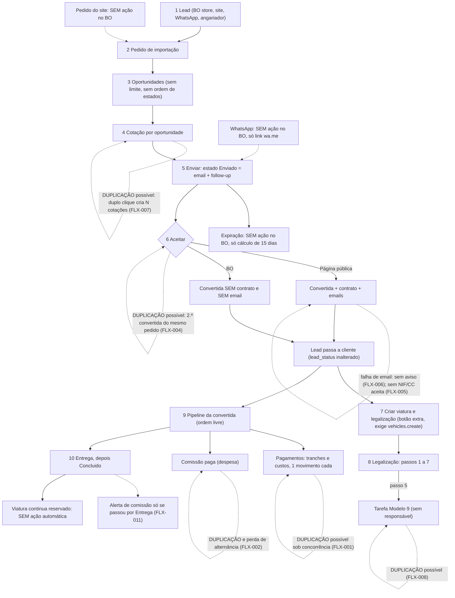

# Fluxo da lead à entrega: importação por conta do cliente

Auditoria funcional do percurso completo, com testes automáticos em MySQL real. Data: 2026-11-01. Este documento consolida e substitui os rascunhos `_fluxo-mapa.md`, `_fluxo-resultados-principal.md` e `_fluxo-resultados-falhas.md`.

Ligações: [problemas.md](problemas.md) (IDs SEG/LOG), [plano-de-acao.md](plano-de-acao.md), [../funil-comercial.md](../funil-comercial.md), [../../tests/Fluxo/README.md](../../tests/Fluxo/README.md).

Legenda de confiança: **Confirmado** = reproduzido nos testes em MySQL de teste (e, onde indicado, confirmado por leitura do código). **Suspeito** = inferido do código ou do esquema, sem prova em produção.

---

## 1. Resumo e parecer final

### Parecer

**O percurso lead até entrega pode ser concluído integralmente pela interface do backoffice, mas só com intervenções manuais em vários pontos e com riscos de duplicação sob uso simultâneo.** Esta conclusão vem de pedidos HTTP às rotas e controllers reais (ver secção 2: não houve navegador, a camada visual não foi validada). Num MySQL criado só com as migrations do repositório, o percurso **não funciona** sem alinhar o esquema (secção 3): o utilizador teria erros 500 logo na criação da lead e no envio da cotação. Se a produção tem o esquema do repositório, este é o problema mais urgente (FLX-003); se foi alterada à mão, não o é. **Isto não foi verificado em produção.**

**Intervenções manuais que o percurso exige** (confirmadas nos testes):
1. Aceitação pelo BO (cliente aceitou por telefone): não envia contrato nem email; o contrato tem de sair do BO e ser enviado por fora.
2. Preencher à mão, até três vezes, o VIN, o preço do carro e a matrícula de origem (oportunidade, convertida, viatura). A matrícula de destino só passa para a viatura se estiver preenchida antes de a criar.
3. Criar a viatura e a legalização com um botão extra (a viatura não nasce da aceitação), e exigir a permissão `vehicles.create`.
4. Registar o pagamento do carro (não gera movimento; a etapa "Pagamento do Carro" é só etiqueta).
5. Avançar todas as etapas do pipeline, o estado da lead (nunca muda sozinho), o estado da viatura (fica `reservado`) e fechar a tarefa do Modelo 9 (nasce sem responsável).
6. Rejeitar à mão a oportunidade que ficou sem cotação e as outras cotações do pedido (aceitar uma não invalida as restantes).
7. Expirar cotações: não existe expiração gravada nem comando; só um cálculo de 15 dias que bloqueia a aceitação pública.
8. Enviar por WhatsApp: só existe um link `wa.me`; depois é preciso marcar "Enviado" sem notificar.
9. Pedido de importação "do site": só nasce pelo formulário público (não há ação no BO).

**Problemas mais graves** (secção 8): movimentos financeiros duplicados e comissão que perde alternâncias sob pedidos simultâneos (FLX-001, FLX-002, confirmados em 5/5 repetições); possível drift de ENUMs (FLX-003); duas convertidas do mesmo pedido (FLX-004); aceitação pública sem NIF/CC no servidor (FLX-005); falha de email na aceitação sem aviso (FLX-006).

**O que é preparação isolada e não conta como conclusão pela interface:** alinhamento do esquema da base de teste, seed de definições, criação do vendedor, viagens no tempo (relógio), simulação de falha SMTP, e o envelhecimento de cotações (secção 3).

**O que não foi validado:** navegador (HTML, JavaScript, botões, modais), SMTP real, produção (versão MySQL, índices, duplicados), mobile, bulk, uploads em paralelo (secção 11).

---

## 2. Ambiente e versão testada

| Item | Valor |
|---|---|
| Código | Último commit conhecido `cf0e01d` (ramo `main`, lido de `.git/refs/heads/main`), **mais alterações por commitar**: `tests/Fluxo/`, `phpunit.fluxo-mysql.xml`, `docs/auditoria/*fluxo*` e uma alteração anterior e alheia em `resources/views/frontend/partials/frontend-footer-desktop.blade.php`. Nenhuma alteração ao código da aplicação. |
| MySQL de teste | 8.0.33 local (InnoDB, `REPEATABLE READ` por omissão), `127.0.0.1:3306` |
| MySQL de produção | **Versão DESCONHECIDA, não verificada.** Configuração, isolamento e carga também. |
| Base | `izzycar_fluxo_teste`, isolada (outras bases locais não são tocadas) |
| Guarda | O trait `UsaMysqlIsolado` verifica driver mysql, host local e nome exato da base (configuração e `SELECT DATABASE()`) antes de migrar; aborta senão. Cada worker concorrente repete a guarda antes de qualquer pedido. |
| Configuração | `phpunit.fluxo-mysql.xml` força BD, mailer `array`, fila `sync`; o `.env` (que aponta para produção) não é lido nos workers. |
| Integrações | Sem reais: `Http::fake`, `Notification::fake`, `Storage::fake` (ou diretório temporário nos workers), log `null`. Falha SMTP simulada por `TransportFalha`. |
| Dados | "TESTE FLUXO ...", emails `@teste.invalid`, telefone 910000001. |
| Perfil | Percurso principal com o perfil real **Importador** (permissões geradas por `PermissionSynchronizer` a partir de `config/permissions.php`); aceitação como visitante. |

**Limitações importantes**
- **Sem navegador.** "UI" nestes testes significa **pedidos HTTP às mesmas rotas, middlewares e controllers** (`actingAs` ou `Request::create`), **não cliques**. Não se validou HTML renderizado, JavaScript, `required` do browser, modais, botões ocultos, nem o aspeto. Onde o relatório diz "o botão desaparece" ou "campo `required`", é leitura do código Blade, não observação.
- A produção pode ter esquema, dados, versão MySQL, `APP_TIMEZONE`, SMTP e fila diferentes.
- O `throttle:5,1` foi verificado só sequencialmente.

---

## 3. Preparações isoladas (não são ações do utilizador)

Documentadas à parte porque **não contam** como funcionamento pela interface.

| Preparação | O que faz | Porquê | Âmbito |
|---|---|---|---|
| Migrations que falham | `migrate:fresh` das 178 não fecha em MySQL 8.0.33 (173/178). O trait corre ficheiro a ficheiro e deixa 5 em falta: `2026_01_12_094536_add_consignment_page` (`page_type_id` sem default), `2026_05_27_000001_create_vehicle_inspection_tables` (FK com mais de 64 caracteres), `2026_05_27_000002_add_generated_from_inspection_id_to_v3_vehicles` (consequência), `2026_08_05_110100_add_angariador_code_...` e `2026_08_05_150000_add_comprovativo_pagamento_...` (colunas de que dependem ainda não existem: `clients.owner_id`, `comissao_paga_em`). | Mostra drift de migrations (FLX-014). `InfraSmokeTest::test_migracoes_aplicadas` fixa este conjunto. | Só `izzycar_fluxo_teste` |
| `completarMigracoesEmFalta()` | Corre as **duas** migrations do `angariador_code`/`comprovativo_pagamento` que falham por ordem (criam `clients.angariador_code`, `form_proposals.angariador_code`, `converted_proposals.comprovativo_pagamento`) e **alarga a VARCHAR** `proposals.status`, `converted_proposals.status` e `clients.origin` (eram ENUM). O tipo original é guardado e fixado em `test_drift_esquema_enums_migrations_vs_codigo`. | Sem isto o cenário rebenta (FLX-003, FLX-014). | Só após a guarda |
| Seed de definições (`settings`) | Cria as definições necessárias na base de teste (o motivo exato não foi reverificado nesta consolidação; ver `tests/Fluxo/Concerns/PreparaFunil.php`). | Base de teste vazia. | Só teste |
| Vendedor | `Seller::create` para a oportunidade A. | Dado de referência fora do funil. | Só teste |
| Relógio | `travelTo`: +16 dias para a expiração e volta ao dia 2 para aceitar B (no mundo real B teria expirado com A); +47 h e +49 h para o alerta de comissão. | Não existe forma de envelhecer cotações no BO. | Só teste |
| Config | `config(['mail.admin_address' => ...])` definido no teste. | Em `config/mail.php` não existe `admin_address`. | Só teste |
| Simulações | `TransportFalha` (SMTP a falhar), `ConcurrentRunner` e `worker.php` (processos reais). | Falhas e concorrência. | Só teste |

---

## 4. Estados e transições reais

### 4.1 Tabela de estados

| Entidade | Valores | Quem muda | Notas |
|---|---|---|---|
| Lead/cliente (`clients`) | `is_lead` true/false; `lead_status`: `nova, em_contacto, qualificada, fria, perdida` (`LeadService.php:18`; angariador só `nova,em_contacto,fria`) | Lead: manual e livre (`admin.v2.leads.status`). Conversão: manual, ao aceitar cotação (automático) ou observer redundante (`ProposalObserver::updated`) | A conversão só faz `is_lead=false` e `converted_at`; **não toca em `lead_status`** nem no follow-up. Cliente não regressa a lead. |
| Pedido (`form_proposals.status`) | `novo, em_analise, convertido, rejeitado, arquivado` (string, sem enum) | Manual (`MANUAL_STATUSES`, recusa `convertido`); `convertido` só na aceitação (`ProposalAcceptanceService.php:75`) | Pode voltar de `convertido` a `novo` à mão. O contador "Convertidos" da lista conta `proposal_id` não nulo, não `status`. |
| Oportunidade (`OpportunityStatus`) | `por_contactar, contactado, aguardar_resposta, em_negociacao, em_analise, selecionado, rejeitado` | Manual livre; `contactado` ao registar contacto; `selecionado` ao criar cotação; `rejeitado` ao reprovar cotação; `selecionado -> em_analise` ao apagar a cotação | Sem máquina de estados. Uma cotação por oportunidade e o inverso. Não é tocada ao aceitar. |
| Cotação (`proposals.status`) | `Pendente, Enviado, Aprovada, Reprovada, Sem resposta` | Via `ProposalAcceptanceService::changeStatus`; nasce `Pendente` | Ver 4.2. |
| Convertida (`converted_proposals.status`) | Iniciada, Negociação Carro, Pagamento do Carro, Transporte, IPO, DAV, ISV, Matriculação, IMT, Entrega, Registo automóvel, Concluido, Cancelada/Cancelado | `update-status` (com escolha de notificar); o formulário de edição aceita texto livre e notifica sempre | **Ordem não imposta**; "Pagamento do Carro" é só etiqueta. Duas grafias legadas de cancelado. |
| Viatura V3 (`status`) | `em_stock, reservado, vendido` | Manual | Viatura de importação nasce `reservado`, `show_online=false`; **nada a atualiza** ao entregar. |
| Legalização | Derivado de `steps_completed`: `nova` (0), `em_curso` (1 a 6), `concluida` (7) | `toggle-step` (módulo e tab) e kanban `move` | Regra N-1; desmarcar N desmarca os posteriores; kanban marca vários de uma vez. |
| Tarefa | `pendente, em_progresso, concluida, cancelada` | Manual; uma criação automática (Modelo 9, ao concluir o **passo 5**) | Sem ligação a cliente/lead/convertida; só `v3_vehicle_id`. A automática nasce sem `user_id`. |
| Comissão | `comissao_paga` (flag) + `comissao_paga_em` | `admin.v2.angariadores.toggle-paid` | Valor fixado na criação da convertida (`users.commission_fixed_value`, 100 por omissão). Gera despesa `commission` só enquanto paga e valor > 0. |

### 4.2 Estados da cotação: significados diferentes

| Termo | Existe como | Significado real |
|---|---|---|
| `Pendente` | estado | Nasce assim. Pode ser aceite sem nunca ter sido enviada. |
| `Enviado` | estado | Gatilho de emails e follow-up automático (+2 dias, só se a lead não tiver follow-up). Não prova que o cliente recebeu. Manual (o WhatsApp não o grava). |
| `Aprovada` | estado | Significa **aceite** (cliente ou BO), não aprovação interna. Só por `accept`. |
| `Reprovada` | estado | Rejeitada. Bloqueia a aceitação pública; rejeita as oportunidades ligadas. **O BO ainda a aceita** (FLX-004). |
| `Sem resposta` | estado | Só manual. **Não bloqueia a aceitação pública** nem toca nas oportunidades (FLX-015). |
| "Expirada" | **cálculo, não estado** | `created_at->diffInDays(now()) > 15` (`Proposal.php:55,76-79`). Aplica-se a qualquer estado. Bloqueia só a aceitação pública. Não renova ao editar ou reenviar. Conta desde a **criação**, não desde o envio. Fronteira medida: 15 d 1 h já expira. |
| "Recusada" | não existe | Aparece só em mapas de cores de views; o nome real é `Reprovada`. |
| "+30 dias" | alerta de lista | Pendente/Enviado com mais de 30 dias; `bulkReject` sem ids reprova-as. |
| Dashboard | contadores | `Pendente`/`Sem resposta` > 5 dias; `Sem resposta` > 7 dias. |

Três critérios sem ligação entre si (15 dias calculado, estado manual, alerta de 30 dias). Nada grava a expiração: o agendador (`app/Console/Kernel.php:29-71`) não tem nenhum comando de cotações.

### 4.3 Importação por conta do cliente vs stock próprio

| Aspeto | Importação (cliente) | Stock próprio |
|---|---|---|
| Entrada | lead, pedido, oportunidades, cotação, convertida | Viatura criada à mão (`admin.v3.vehicles.store`) ou por inspeção |
| Viatura | Criada **a partir da convertida** (`is_imported`, `reservado`, offline, `client_id`) | `em_stock` |
| Dinheiro | Movimentos da convertida (`source_type=ConvertedProposal::class:<entrada>`, sem `v3_vehicle_id`). O valor do carro **fica fora** das tranches e dos movimentos | Compra por `Expense::syncFromV3Vehicle`, despesas, `Sale` |
| Venda (`Sale`) | **Não existe no percurso** (o carro é do cliente) | `storeSale`, margens por `SaleCalculator` |
| Site público | Nunca | `show_online=true` |
| Legalização | Sim (7 passos) | Só se `is_imported` ou criada à mão |

Não impede a mistura: `storeSale` não verifica `is_imported`, e `show_online` pode ser ligado numa viatura de importação (leitura do código, **não testado**).

---

## 5. Percurso efetivamente existente



Linhas tracejadas: etapas sem ação no BO, ou pontos de duplicação possível.

---

## 6. Tabela por etapa

Teste principal: `tests/Fluxo/FluxoLeadAteEntregaTest.php` (método `etapaNN_*`; a linha é a do método). Legenda: ✔ conforme; ⚠ fricção ou limitação; ✘ erro (comportamento atual fixado no teste com comentário `BUG:`); ◻ preparação (não conta).

| Nº | Ação | Rota / ação | Esperado | Observado | Evidência | Estado |
|---|---|---|---|---|---|---|
| 1 | Criar lead com contactos e dono | `POST admin.v2.leads.store`, `admin.v2.leads.activity` | `is_lead=true`, `nova`, dono = angariador, timeline, email repetido bloqueado | Conforme. `angariador_code` fica null (só o formulário público com `?angariador=`). A origem por omissão "Manual BO" não cabe no ENUM (FLX-003) | `FluxoLeadAteEntregaTest.php:255` | ✔ (com FLX-003) |
| 2 | Pedido de importação | `POST admin.v2.form-proposals.store`; site: `POST frontend.import-submit` | Ligado ao cliente, `em_analise`; site liga à lead existente, `novo`, 1 só Client | Conforme | `:311`; `:1220` | ✔ |
| 3 | 3 oportunidades no mesmo pedido | `POST ...opportunities.store` x3, `contacts.store` | 3 `por_contactar`, sem cotação, sem timeline | Conforme; contacto de saída avança A para `contactado`; marca fora do catálogo recusada | `:353` | ✔ |
| 4 | 2 viram cotações, a 3.ª não | `GET createFromOpportunity`, `POST admin.v2.proposals.store` x2 | 2 `Pendente`, A/B `selecionado`, C intacta | Conforme; repetir "criar cotação" abre a existente (sequencial); `form_proposals.proposal_id` = 1.ª. Sob concorrência duplica (FLX-007) | `:433` | ✔ / ✘ conc. |
| 5 | Enviar as 2 cotações | `PATCH admin.v2.proposals.updateStatus` (Enviado) | 4 emails com link; follow-up +2 dias uma vez | Conforme; `lead_status` não muda; WhatsApp só link `wa.me` | `:488` | ✔ / WhatsApp ◻ |
| 6a | Expiração calculada (+16 dias) | `GET proposals.detail`, `POST proposals.accept` | Público recusa; estado continua | "Cotação Expirada", "já expirou", `status=Enviado`, 0 convertidas; BO continua a mostrar `Enviado` | `:539` | ✔ |
| 6b | Estado manual "Sem resposta" | `PATCH admin.v2.proposals.updateStatus` | Gravado, sem emails | Conforme; oportunidade intacta; sem entrada na timeline (FLX-023) | `:539`; `:1256`; `:1268` | ✔ / ⚠ |
| 7 | Aceitar B pela página pública | `POST proposals.accept` (visitante) com NIF, CC, validade, morada | B `Aprovada`, convertida, contrato, emails | Conforme: contrato PDF guardado e anexado, 3 emails, dados do cliente completados, reaceitar recusado | `:599` | ✔ |
| 8 | Convertida criada | efeito da aceitação | Campos copiados, tranches, histórico, pedido `convertido` | Serviço 2545, tranches 1272,50 + 1272,50, comissão 100, VIN/matrículas/viatura null, 0 movimentos; nada é invalidado nas outras cotações/oportunidades | `:658` | ✔ / FLX-004, FLX-009, FLX-010 |
| 9 | Lead passa a cliente | efeito da aceitação | `is_lead=false`, `converted_at`, histórico/dono preservados | Conforme; `lead_status` continua `nova` e o follow-up ativo; ficha de lead passa a 404 | `:730` | ✔ / ⚠ |
| 10 | Viatura a partir da convertida | `PUT converted-proposals.update` (VIN, matrículas), `POST ...create-vehicle` | Viatura importada/reservada/offline + legalização, idempotente | Conforme. Não copiados: VIN, preço, matrícula de origem (só na nota) | `:782` | ✔ / FLX-009 |
| 11a | Pipeline | `PATCH ...update-status` | Estado, histórico, 1 email | Conforme; mesmo estado não repete email | `:880` | ✔ |
| 11b | Compra (`valor_carro`/`carro_pago`) | `PUT converted-proposals.update` | Registo do pagamento | Gravado; **0 movimentos**; etapa e flag independentes; viatura sem preço | `:880` | ⚠ |
| 11c | Tranches | `PUT ...update` (`*_tranche_pago`) | 1 movimento de receita por tranche | Conforme (1272,50, `import_service`); regravar não duplica (sequencial) | `:880` | ✔ |
| 11d | Custos pagos | `PUT ...update` (flags) | 1 despesa por custo | 8 movimentos antes da comissão e 2.ª tranche; desmarcar apaga; sem `v3_vehicle_id`; data = hoje | `:880` | ✔ |
| 11e | Documentos | `uploadSigned`, `documents.upload`, `legalizations.upload-document`, tab da viatura | Ficheiros guardados | Conforme (Storage fake); três locais diferentes | `:880` | ✔ / ⚠ |
| 11f | Legalização 1 a 7, tarefa, Modelo 9 | `toggle-step` (módulo e tab), `modelo9.save-and-generate` | N-1, 1 tarefa, PDF | 422 ao saltar (duas mensagens); cascata ao desmarcar; tarefa no **passo 5**, sem `user_id`, +30 d/+15 d, não duplica (sequencial); PDF gerado | `:880` | ✔ / ⚠ |
| 11g | Tarefas | `admin.tasks.*` | Visível | Conforme | `:880` | ✔ |
| 11h | Alerta de comissão | `artisan commissions:overdue-alert`, Carbon | Nada às 47 h; 1 email às 49 h; sem repetição | Conforme (cache de 7 dias); sem alerta se saltar Entrega | `:880`; `:1303` | ✔ / ✘ FLX-011 |
| 11i | Comissão do angariador | `POST admin.v2.angariadores.toggle-paid` | Paga + despesa 100; alternar sem duplicar | Conforme sequencial (10 movimentos no total) | `:880` | ✔ (conc.: FLX-002) |
| 11j | Entrega e conclusão | `update-status` | Histórico de 12 estados | Conforme; não propaga: viatura `reservado`, tarefa pendente | `:880` | ✔ / ⚠ |
| 12 | Coerência e permissões | GET de listas/fichas/kanban/dashboard; `permissions.enforce` em runtime | Dados coerentes | Coerente (dashboard Clientes=1). Enforce desligado: cms passa. Enforce ligado: cms 403, sem perfil 403, angariador só no portal. **Importador sem `commissions`** | `:1097` | ✔ / ✘ FLX-012 |

---

## 7. Casos de falha e concorrência

Teste: `tests/Fluxo/FluxoFalhasConcorrenciaTest.php`. Apoio: `Concerns/PreparaFunil.php`, `Support/{ConcurrentRunner,GuardaWorker,TransportFalha}.php`, `bin/worker.php`.

**Como a concorrência é real:** `ConcurrentRunner` lança N processos PHP independentes (`proc_open`), cada um arranca a aplicação e faz `Request::create` + `$kernel->handle` (rotas, middlewares e controllers reais) contra a **mesma** base, com commits reais (a limpeza usa `TRUNCATE`, sem transações a envolver). Barreira: cada worker escreve `ready.<i>`; o runner escreve um ficheiro `go` com um instante comum (+150 ms) e os workers esperam ativamente. Dispersão medida entre o primeiro e o último pedido: **0,06 a 7,9 ms** (o teste exige < 250 ms). Cada cenário concorrente repete-se **5 vezes**. Segurança do worker: ambiente explícito derivado do XML, `.env` nunca lido, guarda da base em cada worker (`guardas_ok == nº de workers`, `db == izzycar_fluxo_teste`).

> **Ressalva: "não encontrado" não é "seguro".** Nos casos que resultaram limpos (C2, C5b) só se pode dizer que em 5 repetições de 8 processos a corrida não apareceu. A proteção real é a que se vê no código (lock e índice único), não o resultado do teste. Nem 0 deadlocks nem 0 erros 500 provam que não ocorram em produção.

| # | Caso | N proc x repetições | Esperado | Observado | Evidência (`FluxoFalhasConcorrenciaTest.php`) | Estado |
|---|---|---|---|---|---|---|
| 1 | Aceitação pública repetida | sequencial (3 pedidos + 6.º) | 2.º pedido recusado | 2.º e 3.º: "Esta cotação já foi aceite."; 0 linhas novas; 6.º pedido do IP no minuto dá 429 | `:172` | ✔ |
| 2 | Aceitação simultânea da mesma cotação | 8 x 5 | 1 convertida | 5/5: 1 convertida, 1 sucesso, 7 "já aceite"; 1 contrato, 1 atividade, 1 histórico; sem 500/deadlock. O lock da cotação serializa; o índice único é a rede | `:209` | ✔ (não prova) |
| 3 | Aceitação simultânea das duas cotações do mesmo pedido | 4+4 x 5 | (regra atual: nada impede) | 5/5: **2 convertidas**, pedido `convertido`, oportunidade C intacta; "Lead convertido em cliente" registado 2 vezes | `:248` | ✘ FLX-004, FLX-017 |
| 4a | Expirada (relógio), público | sequencial | Recusa, nada gravado | Fronteira: 14 d 23 h e 15 d 0 h não expiram, **15 d 1 h expira**; aos 16 d "já expirou", 0 linhas, `Enviado` | `:295` | ✔ (FLX-021) |
| 4b | Expirada, pelo BO | sequencial | (decisão de design) | Aceita, sem email nem contrato | `:295` | ⚠ |
| 4c | Reprovada, pelo BO | sequencial | Recusar ou repor oportunidade | Aceita; cotação `Aprovada` com oportunidade `rejeitado`; 2 convertidas | `:295` | ✘ FLX-004 |
| 5a | Viatura repetida | sequencial | Idempotente | "Esta cotação convertida já tinha viatura.", 0 linhas novas | `:346` | ✔ |
| 5b | Viatura simultânea | 8 x 5 | 1 viatura + 1 legalização | 5/5: 1 viatura, 1 legalização, 1 atividade; sem 500/deadlock. Rede: `lockForUpdate` da convertida; continua sem índice único em `legalizations.v3_vehicle_id` | `:362` | ✔ (não prova) |
| 6a | Falha de email ao enviar a cotação | sequencial | Estado/follow-up gravados, falha registada | Estado, follow-up e atividade de falha gravados; **mas** a API diz `notified=true` e a timeline "Email enviado com o link de acesso." com os dois envios falhados | `:416` | ⚠ FLX-016 |
| 6b | Falha de email na aceitação pública | sequencial | Aceitação mantém-se, equipa avisada | Aceitação, convertida e contrato OK; cliente vê "receberá um email com o contrato" (falso); documento `enviado_em` antes do envio; angariador nem é tentado; nada na timeline; o log guarda a mensagem do SMTP com endereços | `:444` | ✘ FLX-006 |
| 6c | Aceitação de cliente sem email | sequencial | Não tentar enviar, avisar | Aceita; contrato com `enviado_em`; envia com destinatário vazio (transporte array aceita; **SMTP real não verificado**) | `:473` | ✘ FLX-006 |
| 6d | Falha de email no estado da convertida, alerta de comissão e acompanhamento da legalização | sequencial | Estado gravado; não marcar como enviado | `update-status` com `notified=false` (honesto); alerta propaga a exceção e não marca a cache; acompanhamento deixa `email_enviado=false` e reenvia depois; o erro do acompanhamento só na consola | `:488` | ✔ / ⚠ FLX-022 |
| 7 | Dados em falta por formulário | sequencial | Erros e nada gravado | Lead sem nome, pedido sem cliente, oportunidade sem marca/modelo ou VIN curto, cotação sem campos obrigatórios, email/validade inválidos, convertida inexistente (404): 0 linhas novas. **Exceções:** `admin.v3.vehicles.store` sem dados cria viatura vazia; aceitação com corpo vazio é aceite | `:537` | ✔ / ✘ FLX-005, FLX-019 |
| 8 | Matriz de permissões (18 rotas x 6 utilizadores x enforce) | sequencial | Ver abaixo | Ver abaixo | `:590` | ✔ / ⚠ FLX-013 |
| 9a | Índices únicos | n/a | `expenses(source_type, source_id)` único | **Não existe** (nem em `legalizations.v3_vehicle_id`, nem em `tasks`); existe em `converted_proposals.proposal_id` | `:664` | ✘ FLX-001 |
| 9b | Repetições sequenciais: comissão 4x, tranche, custos 2x, aceitar 2x pelo BO | sequencial | Sem duplicados | Comissão 1/0/1/0; tranche 1/1/0/1; custos 2x => 3 movimentos; aceitar 2x => 422 | `:678` | ✔ |
| 9c | Recálculo de tranches (comando) | sequencial | Idempotente | 60/40 => 1527,00/1018,00; sem `--apply` nada grava; 2.ª vez "Nada a alterar"; tranche paga ignorada | `:720` | ✔ |
| 9d | Passo 5 repetido | sequencial, duas portas | 1 tarefa | Tarefa aberta: não duplica. Tarefa **concluída ou cancelada**: nova tarefa | `:752` | ✘ FLX-008 |
| 9e | `togglePaid` da comissão | 6 x 5 | Par de cliques => não paga, 0 movimentos | 5/5: flag **paga** (lost update) e **2 a 3 movimentos de comissão**; 0 deadlocks/500 | `:777` | ✘ FLX-002 |
| 9f | Tranche e custos pagos em paralelo | 8 x 5 | 3 movimentos | 5/5 com duplicados: 4 a 11 movimentos (1.ª tranche até 3x, transporte até 4x, IPO até 6x), até 23 `financial_movements`; 0 deadlocks/500 | `:804` | ✘ FLX-001 |
| 9g | Passo 5 em paralelo | 3 módulo + 3 tab x 5 | 1 tarefa | 4/5 repetições com várias tarefas (4, 6, 5, 4); passos coerentes `[1..5]` | `:829` | ✘ FLX-008 |
| 9h | Cotação da mesma oportunidade em paralelo | 6 x 5 | 1 cotação | 5/5: **6 cotações** e 6 atividades; a oportunidade aponta para a última; as outras ficam órfãs | `:860` | ✘ FLX-007 |
| 10 | Reversão da legalização pelas duas portas | sequencial | N-1 coerente | Módulo e tab idênticos. Desmarcar o 3 com 4 a 7 feitos deixa `[1,2]` e não repõe ao remarcar. Convertida, viatura, `email_enviado`, `modelo9_dados` não mudam. Tarefa do Modelo 9 continua `pendente` após desfazer o 5. Kanban: `done` marca 7; coluna 6 marca 3, 4 e 5 de uma vez | `:883` | ⚠ FLX-020 |

### Matriz de permissões (estado HTTP)

| Utilizador | Enforce desligado | Enforce ligado |
|---|---|---|
| sem perfil | 403 nas 18 rotas | 403 nas 18 |
| angariador (fora do portal) | 403 nas 18 | 403 nas 18 |
| role vazio | passa em 17; 403 só em `POST converted.create-vehicle` | 403 nas 18 |
| cms (sem funil) | idem (17 passam) | 403 nas 18 |
| Importador | passa em todas | 403 só em `toggle-paid` e `GET angariadores.comissoes` |
| admin | passa em todas | passa em todas |

Rotas: leads (index/create/store), pedidos (store), oportunidades (store), cotações (index/store/updateStatus/accept BO), convertidas (index/update/create-vehicle), comissão (toggle-paid, lista), legalização (toggle-step nas duas portas), tarefas e movimentos (index). São 18 representativas, não as 150+ do percurso.

---

## 8. Erros encontrados

Ordenados por gravidade. "Confirmado" = reproduzido em MySQL 8.0.33 de teste. Todos os comandos correm com `vendor/bin/phpunit -c phpunit.fluxo-mysql.xml --filter <teste>` (exigem a base `izzycar_fluxo_teste`). Esforço: S (horas), M (1 a 2 dias), L (mais). Antigos IDs dos rascunhos entre parênteses (P = principal, F = falhas).

### Alta

**FLX-001 | Alta | Confirmado (MySQL de teste) | Movimentos financeiros duplicados sob concorrência** (F-B1)
- Causa: `Expense::syncFromConvertedProposal` (`app/Models/Expense.php:315-363`) usa `firstOrNew(source_type, source_id)` e `expenses` **não tem índice único** nessas colunas (as migrations não o criam; confirmado por leitura do código). `ConvertedProposal` chama o sync em cada `saved`.
- Reproduzir: `--filter test_c09_tranche_paga_em_paralelo_duplica_movimentos` (`FluxoFalhasConcorrenciaTest.php:804`) e `--filter test_c09_indices_unicos_em_falta` (`:664`). À mão: duas abas da convertida, "Guardar" ao mesmo tempo com a tranche marcada.
- Impacto: em 5/5 repetições com 8 processos, 4 a 11 movimentos em vez de 3 (até 23 `financial_movements`). Afeta receitas, despesas, relatórios e margens. Pode já ter acontecido em produção (verificar, secção 11).
- Correção proposta: (a) migration com índice único `(source_type, source_id)` de nome curto, **depois de limpar duplicados existentes**; (b) `updateOrCreate` dentro de transação com `lockForUpdate` na convertida; (c) `ConvertedProposalV2Controller::update` a gravar dentro de transação com lock.
- Validação: repetir os dois testes (devem passar a 3 movimentos) e a query de duplicados em produção.
- Esforço: M (migration + limpeza de dados; lembrar que falta correr `php artisan migrate` em produção). Ligação: LOG-008 (movimentos), LOG-017, plano 1.6 e 2.3 (índices únicos); **não existe ID equivalente**.

**FLX-002 | Alta | Confirmado | Comissão: `togglePaid` perde alternâncias e duplica a despesa** (F-B2)
- Causa: `AngariadorAdminController::togglePaid` (l.283-296) lê a flag e escreve sem transação nem lock; mais a causa de FLX-001.
- Reproduzir: `--filter test_c09_comissao_toggle_em_paralelo` (`:777`). À mão: duplo clique rápido em "Marcar paga".
- Impacto: 6 pedidos x 5: em 5/5 a flag fica "paga" com número par de cliques e há 2 a 3 despesas de comissão. Pagamento a angariador pode ser registado a dobrar.
- Correção proposta: transação com `lockForUpdate` na convertida; endpoints explícitos "marcar paga" e "marcar pendente" (idempotentes) em vez de alternar; botão desativado após o primeiro clique.
- Validação: o teste acima. Esforço: S. Ligação: FLX-001.

**FLX-003 | Alta (confirmar em produção) | Confirmado em esquema de teste; produção suspeito | Drift de ENUMs: valores gravados pelo código não cabem na coluna** (P-B1)
- Causa: `proposals.status` é ENUM `('', 'Pendente','Enviada','Aprovada','Reprovada','Sem resposta')` (`2025_03_06_093214_create_proposals_table.php:41`) e o código grava "Enviado"; `converted_proposals.status` (`2025_09_03_083206...:15`) não tem "Pagamento do Carro" nem "Cancelada" (tem "Cancelado"); `clients.origin` só aceita Olx/StandVirtual/Facebook/Instagram/Amigo/Outro (`2025_02_27_084551...:24`) e o BO usa "Manual BO" (valor por omissão), Email, Telefone, Referência. Nenhuma migration do repositório alarga estas colunas.
- Reproduzir: `--filter test_drift_esquema_enums_migrations_vs_codigo` (`FluxoLeadAteEntregaTest.php:1202`). Sem a preparação da secção 3, em MySQL estrito: criar lead sem mudar a origem, marcar cotação "Enviado", mudar a convertida para "Pagamento do Carro" dá 500 `Data truncated`.
- Impacto: se a produção tem o esquema do repositório, o fluxo principal falha logo; em MySQL não estrito, os valores seriam truncados para vazio em silêncio (**hipótese, não testada**). Se a produção foi alterada fora das migrations, não afeta.
- Correção proposta: migration que converta as três colunas para `string` (com nomes curtos), precedida de `SHOW CREATE TABLE` em produção; enums PHP como fonte única dos valores.
- Validação: `SHOW COLUMNS` em produção (secção 11); depois o teste de drift passa a esperar `varchar`.
- Esforço: S depois da verificação. Ligação: plano 2.8 ("ENUMs de proposals.status/converted_proposals.status para string") e LOG-007; **a coluna `clients.origin` não está no plano**.

### Média

**FLX-004 | Média | Confirmado | Aceitar uma cotação não invalida as outras: 2 convertidas do mesmo pedido** (P-B4, F-B4)
- Causa: `ProposalAcceptanceService::ensureAcceptable` (l.148-161) só olha a própria cotação; o BO ignora expiração e `Reprovada`; a oportunidade sem cotação continua a ser oferecida ao cliente na página pública.
- Reproduzir: `--filter test_aceitar_uma_cotacao_nao_invalida_as_outras` (`:1280`), `--filter test_c03_aceitacao_simultanea_das_duas_cotacoes_do_mesmo_pedido` (`FluxoFalhasConcorrenciaTest.php:248`), `--filter test_c04_cotacao_expirada_publico_e_backoffice` (`:295`).
- Impacto: carro duplicado; aceitar uma `Reprovada` deixa a oportunidade `rejeitado` com a cotação `Aprovada`.
- Correção: depende da regra de negócio (pergunta 1, secção 13). Opções: bloquear a aceitação se o pedido já tem convertida ativa, ou, ao aceitar, marcar as restantes como `Reprovada`/`Sem resposta` e a oportunidade sem cotação como `rejeitado`; no BO recusar aceitar `Reprovada` sem confirmação.
- Validação: os três testes passam a esperar 1 convertida. Esforço: S a M. Ligação: LOG-007; novo.

**FLX-005 | Média | Confirmado | Aceitação pública sem NIF/CC/validade no servidor** (P-B7)
- Causa: `ProposalController::accept` valida tudo como `nullable` (l.171-183); o `required` existe só no browser (leitura de `view-proposal.blade.php`, não validado visualmente).
- Reproduzir: `--filter test_aceitacao_publica_sem_identificacao_e_aceite` (`:1243`); `test_c07_dados_em_falta_em_cada_formulario` (corpo vazio aceite).
- Impacto: cliente aceite sem identificação; contrato e Modelo 9 incompletos. A validade do CC também não é validada como futura.
- Correção: no servidor, exigir os campos que continuam em falta no cliente (os que o formulário mostra); validade futura. Esforço: S. Ligação: novo (relacionado com a aceitação).

**FLX-006 | Média | Confirmado (transporte simulado; SMTP real não verificado) | Falha de email na aceitação pública** (F-B6, F-B14)
- Causa: `ProposalController::accept` (l.190-206) e `sendAcceptanceEmail` (l.211-261): o contrato é registado com `enviado_em=now()` antes de enviar; o email ao angariador vem depois do do cliente, por isso uma exceção salta-o; só há `report()`; a resposta ao cliente é fixa ("receberá um email com o contrato").
- Reproduzir: `--filter test_c06b_falha_de_email_na_aceitacao_publica` (`FluxoFalhasConcorrenciaTest.php:444`) e `test_c06c_aceitacao_publica_de_cliente_sem_email` (`:473`).
- Impacto: contrato nunca enviado sem a equipa saber; angariador sem aviso; cliente sem email: `Mail::to(null)` (com SMTP real lançaria exceção); o log pode guardar endereços (cliente, cc e bcc fixos).
- Correção: gravar `enviado_em` só depois do envio; tentar cada destinatário isoladamente; registar na timeline (atividade) e avisar a equipa; mensagem ao cliente condicional; não registar a mensagem SMTP crua.
- Validação: `c06b`/`c06c` passam a esperar aviso e angariador notificado. Esforço: S a M. Ligação: LOG-006 (emails síncronos), SEG-017 (dados pessoais em logs), LOG-018 (BCC fixo).

**FLX-007 | Média | Confirmado | Cotação duplicada da mesma oportunidade** (F-B3)
- Causa: `existingForOpportunity` (`ProposalV2Controller.php:211,316`) não é atómica; sem índice único em `import_opportunities.proposal_id` nem lock.
- Reproduzir: `--filter test_c09_cotacao_duplicada_por_oportunidade_em_paralelo` (`:860`). À mão: duplo clique em "Guardar".
- Impacto: 6 pedidos => 6 cotações e 6 atividades; a oportunidade aponta para a última; as órfãs são visíveis ao cliente e aceitáveis.
- Correção: `lockForUpdate` da oportunidade dentro da transação de `ProposalService::create` e reverificar; botão desativado ao submeter. Esforço: S. Ligação: LOG-010 (criação de cotação sem transação, plano 2.3 "cotação em 9616cc9").

**FLX-008 | Média | Confirmado | Tarefa do Modelo 9 duplicada** (P-B8, F-B5)
- Causa: `LegalizationTaskService::ensureModelo9Task` (`app/Services/LegalizationTaskService.php:21-49`) verifica "já existe aberta" por `LIKE` no título e descrição, sem lock nem índice; só conta `pendente`/`em_progresso`.
- Reproduzir: `--filter test_c09_passo_5_em_paralelo_cria_varias_tarefas` (`:829`), `test_c09_passo_5_repetido_sequencial_e_tarefa_modelo9` (`:752`), `test_tarefa_modelo9_concluida_e_recriada_ao_repetir_o_passo_5` (`FluxoLeadAteEntregaTest.php:1326`).
- Impacto: 4 a 6 tarefas em 4/5 repetições concorrentes; tarefa concluída ou cancelada permite nova ao repetir o passo 5. Notar que o plano marca "2.15 Modelo 9 duplicado" como **corrigido** (`058e135`): a correção cobre o caso sequencial com tarefa aberta, **não** a concorrência nem o caso fechado.
- Correção: guardar a ligação ao processo numa coluna (`legalization_id` ou chave única) em vez de `LIKE`; contar qualquer estado; lock na legalização. Esforço: S a M. Ligação: plano 2.15 (reabrir).

**FLX-009 | Média | Confirmado | VIN, preço e matrícula de origem não passam da oportunidade para a convertida e a viatura** (fricção; regra a decidir)
- Causa: `ConvertedProposalService::convertedData` e `vehicleData` não copiam `vin` nem `valor_carro` (confirmado por leitura); matrícula de destino só se já preenchida.
- Reproduzir: `--filter test_percurso_completo_lead_ate_entrega` (`:1189`), etapas 8 e 10.
- Impacto: reescrita manual até 3 vezes; viatura sem preço de compra; erros de digitação em VIN/matrícula.
- Correção: copiar VIN da oportunidade, matrícula de origem e preço (como `valor_carro`) na conversão e na criação da viatura. Esforço: S.

**FLX-010 | Média | Confirmado | Campo "Ano" da convertida** (P-B6)
- Causa: o valor vem do texto livre `proposed_car_year_month` ("03/2021") para um `<input type="number">`; o PUT rejeita "03/2021" (inteiro) e vazio apaga o ano.
- Reproduzir: `--filter test_formulario_da_convertida_apaga_o_ano_texto_da_cotacao` (`:1315`).
- Correção: extrair o ano (regex, como a viatura) na conversão e/ou aceitar texto no campo. Esforço: S.

**FLX-011 | Média | Confirmado | Alerta de comissão só a partir de "Entrega"** (P-B5)
- Causa: `ConvertedProposal::isCommissionOverdue` lê o histórico `new_status='Entrega'`.
- Reproduzir: `--filter test_comissao_nao_alerta_se_a_convertida_salta_a_entrega` (`:1303`).
- Impacto: convertida que vai direto a Concluido nunca alerta; comissão por pagar sem aviso.
- Correção: contar também Concluido (e entrega por outro caminho). Esforço: S. Ligação: LOG-009.

**FLX-012 | Média (quando o enforce ligar) | Confirmado | Perfil Importador sem `commissions`** (P-B3)
- Reproduzir: ligar enforce em teste e `--filter test_percurso_completo_lead_ate_entrega` (`etapa12`, `:1097`); `test_c08_matriz_de_permissoes_do_percurso` (`FluxoFalhasConcorrenciaTest.php:590`).
- Impacto: com `PERMISSIONS_ENFORCE=true`, 403 em `admin.v2.angariadores.comissoes` e `toggle-paid`. Decisão do Pedro (pergunta 4). Esforço: S. Ligação: SEG-001, plano 1.2.

**FLX-013 | Média (decisão) | Confirmado | Enforce desligado: utilizador sem permissões faz tudo** (F-B7)
- Reproduzir: `--filter test_c08_matriz_de_permissoes_do_percurso` (`:590`).
- Impacto: role vazio ou `cms` cria leads, aceita cotações, edita convertidas e paga comissões; só regista `would_block`. Esforço: ver plano 1.2. Ligação: **SEG-001** (já existente; este é um dado novo de impacto concreto).

**FLX-014 | Média | Confirmado | `migrate:fresh` não fecha em MySQL 8.0.33** (P-B2)
- Reproduzir: `--filter test_migracoes_aplicadas` (`InfraSmokeTest.php:24`); detalhe na secção 3.
- Impacto: impossível reconstruir um ambiente a partir das migrations; duas migrations dependem de colunas criadas só mais tarde. Correção: nunca editar migrations aplicadas; criar migrations novas e idempotentes (`Schema::hasColumn`) e corrigir o nome da FK longa só para ambientes novos. Esforço: M. Ligação: regra do projeto sobre migrations e FKs de 64 caracteres.

### Baixa

| ID | Descrição | Teste | Correção proposta | Esforço | Ligação |
|---|---|---|---|---|---|
| FLX-015 | "Sem resposta" não bloqueia a aceitação pública nem toca nas oportunidades (P-B9) | `test_sem_resposta_nao_bloqueia_a_aceitacao_publica` (`:1256`) | Decidir a regra (pergunta 2) | S | novo |
| FLX-016 | `notified=true` e "Email enviado..." mesmo com os envios falhados (F-B9) | `test_c06a...` (`FluxoFalhasConcorrenciaTest.php:416`) | Devolver o resultado real do envio | S | LOG-006 |
| FLX-017 | "Lead convertido em cliente" registado 2 vezes em aceitações simultâneas do mesmo cliente (snapshot REPEATABLE READ no observer) (F-B8) | `test_c03...` (`:248`) | Reler o cliente com lock ou deduplicar a atividade | S | novo |
| FLX-018 | "Criar viatura" dá 403 a quem edita convertidas sem `vehicles.create`, mesmo com enforce desligado (P-B11) | `test_criar_viatura_exige_vehicles_create_mesmo_com_enforce_desligado` (`:1292`) | Documentar no ecrã ou ocultar o botão; alinhar com o catálogo | S | SEG-001 |
| FLX-019 | `admin.v3.vehicles.store` cria viatura vazia; aceitação pública aceita corpo vazio (F-B10) | `test_c07...` (`:537`) | Validar campos mínimos | S | FLX-005 |
| FLX-020 | Reversão da legalização: tarefa do Modelo 9 não é cancelada ao desfazer o passo 5; remarcar não repõe; kanban marca vários passos sem aviso (F-B11) | `test_c10...` (`:883`) | Avisar no kanban; cancelar a tarefa ao desfazer | S | FLX-008 |
| FLX-021 | Prazo em fração de dia: 15 d 1 h já expira (F-B12) | `test_c04...` (`:295`) | Confirmar a intenção; usar datas | S | LOG-002 (fuso) |
| FLX-022 | Falha do `legalizations:send-tracking-emails` só na consola, sem log nem alerta (F-B13) | `test_c06d...` (`:488`) | `try/catch` com log | S | LOG-009 |
| FLX-023 | Mudança rápida de estado da cotação (kanban/lista) não escreve na timeline da lead (P-B10) | `etapa06` (`:539`) | Escrever `LeadActivity` também aí | S | novo |

---

## 9. Problemas de utilização e propostas de melhoria

Classificação: **Erro** (comportamento incorreto), **Regra** (decisão de negócio em aberto), **Simplificação** (conforto, sem erro). Todos por leitura do código e do que os testes observaram; nada foi validado no ecrã.

| Tema | Problema | Tipo | Proposta concreta |
|---|---|---|---|
| Dados reintroduzidos | VIN em 3 sítios (oportunidade, convertida, viatura); preço do carro; matrícula de origem/destino (convertida, viatura, legalização, sem sincronização depois); vendedor só na viatura, texto livre na convertida | Simplificação (ver FLX-009) | Copiar na conversão e na criação da viatura; mostrar a origem do valor |
| Dados do cliente | NIF/CC/morada pedidos na aceitação pública; no BO não há alerta de "faltam dados" antes do contrato/Modelo 9 | Erro (FLX-005) | Validar no servidor; aviso no BO |
| Ordem obrigatória sem explicação | Passos da legalização por ordem (só a mensagem de erro explica); viatura exige `vehicles.create`; tab Legalização só com `is_imported` (desmarcar esconde sem aviso); alerta de comissão exige "Entrega"; tarefa do Modelo 9 nasce no passo 5 (intitulada de passo 6) | Simplificação | Texto de ajuda no ecrã; avisar ao desmarcar `is_imported`; alinhar o nome da tarefa |
| Ordem não imposta | Pedido volta de `convertido` a `novo`; convertida avança em qualquer ordem e o formulário aceita texto livre no estado; oportunidade `selecionado` sem cotação; aceitar cotação nunca enviada | Regra | Definir transições permitidas (LOG-007); validar o `status` do formulário |
| Estados manuais | `lead_status` nunca muda (nem ao converter); `Sem resposta`, `Reprovada`, `Enviado` manuais; `V3Vehicle.status` nunca passa a entregue; concluir não atualiza viatura, legalização nem tarefas | Regra | Estado final de lead ("convertida"?); ao concluir, perguntar se fecha a viatura e as tarefas |
| Nomes ambíguos | `Enviado` vs `Aprovada`/`Reprovada`; `Concluido` sem acento; `Cancelada`/`Cancelado`; "Aprovada" = aceite; `valor_comissao` (Izzycar) vs `angariador_commission` vs `valor_comissao_final` (sem uso); "Convertidos" na lista de pedidos conta `proposal_id`; parâmetro `{proposal}` que é uma `ConvertedProposal` na rota de comissões; "Esta cotação já foi aceite." para duas situações | Simplificação | Renomear no ecrã sem mexer nos valores gravados; corrigir o contador |
| Informação difícil de encontrar | Expiração calculada invisível no estado (filtros por estado não a apanham); três critérios de "sem resposta"; link de acompanhamento só aparece na UI e em emails de estado | Simplificação | Crachá de expirada também nos filtros; mostrar o link na convertida |
| Ações fora do módulo | Aceitar no BO redireciona para a convertida; contrato só em PDF e envio por fora; WhatsApp externo e depois marcar "Enviado" sem notificar; compra do carro em 3 sítios (convertida, despesas da viatura, `transport-quotes`); documentos em 3 locais; legalização em 2 portas com funcionalidades diferentes (Modelo 9/1460/1RA, fatura e kanban só no módulo; documentos do regime especial só no módulo; disco diferente no upload); comissão paga em 2 portas | Simplificação | Botão "enviar contrato" na convertida; uma só porta para pagar comissão; consolidar o registo do pagamento do carro |
| Contornos | Datas dos pagamentos = dia em que se marca (sem campo da data real nem valor real); tarefa sem ligação a cliente/convertida; endereços de email fixos no código (`geral@izzycar.pt`, `izzycarpt@gmail.com`); `mail.admin_address` não existe em `config/mail.php` | Erro / Regra | Campo de data real; destino por configuração (LOG-018) |
| Pagamento do carro | Etapa "Pagamento do Carro" é só etiqueta; `carro_pago` não gera movimento; o valor do carro fica fora das tranches | Regra | Decidir quem paga ao vendedor e onde fica o comprovativo (pergunta 8) |

---

## 10. Testes criados e resultados

Ficheiros em `tests/Fluxo/` (não fazem parte de `php artisan test`: o `phpunit.xml` só vê `tests/Unit` e `tests/Feature`). Corre-se com `vendor/bin/phpunit -c phpunit.fluxo-mysql.xml`. Resultados comunicados pelos relatórios de quem os correu (não os voltei a correr, por indicação).

| Ficheiro | Testes | Notas |
|---|---|---|
| `InfraSmokeTest.php` | 6 | Ligação à base certa, migrações aplicadas (173/178), user/client, limpeza, mail array, guarda a abortar |
| `FluxoLeadAteEntregaTest.php` | 12 | Percurso completo (12 etapas), etapas 1 a 5, drift de ENUMs, pedido do site, e 8 testes dirigidos a erros (FLX-003, 005, 004, 010, 011, 015, 018, 008) |
| `FluxoFalhasConcorrenciaTest.php` | 21 | 10 casos (C1 a C10), 5 deles com processos concorrentes reais |
| `Concerns/PreparaFunil.php`, `Concerns/UsaMysqlIsolado.php` | n/a | Preparação do funil e guarda |
| `Support/ConcurrentRunner.php`, `GuardaWorker.php`, `TransportFalha.php`; `bin/worker.php` | n/a | Concorrência e simulação de falha SMTP |

**Resultados reportados**
- Cenário principal (suite com infra): **18 testes (6 infra + 12), 2081 asserções, OK, ~34 s** (inclui o `migrate:fresh` único por processo).
- Suite completa Fluxo: **39 testes (21 novos), 3507 asserções, OK; 4 execuções seguidas estáveis, ~110 s cada** (a classe de falhas ~65 s, dos quais ~55 s são os cenários concorrentes).
- Tempos por teste novo: sequenciais 1,3 a 2,8 s; concorrentes 4,6 a 7,0 s (5 repetições, ~1 s cada, mais a preparação do funil).
- "OK" significa que os testes **passam a fixar o comportamento atual**, incluindo os erros (comentário `BUG:` nos testes). **Nada foi corrigido na implementação**; quando se corrigir, os testes marcados terão de ser invertidos.

---

## 11. Bloqueado ou por verificar

| Tema | Estado | O que fazer |
|---|---|---|
| SMTP real | Não verificado | O transporte `array` aceita mensagens sem destinatário; comportamento do cliente sem email, tempos e timeouts de envio síncrono, e se a mensagem de erro do SMTP traz endereços, ficam por medir |
| Produção: versão MySQL | **Desconhecida** | `SELECT VERSION();` |
| Produção: ENUMs (FLX-003) | Não verificado | Ver queries abaixo |
| Produção: índices (FLX-001, 007, 008) | Não verificado | Ver queries abaixo |
| Produção: duplicados já criados | Não verificado | Ver queries abaixo |
| Produção: `APP_TIMEZONE`, SMTP, `QUEUE_CONNECTION`, `PERMISSIONS_ENFORCE`, perfis reais | Não verificado | Ver plano de ação ("Precisa de dados ou verificação em produção") |
| Bulk | Não coberto | `bulk-status`/`bulk-reject` e `bulkReject` sem ids (30 dias) |
| Mobile (`/gestao/mobile`) | Não coberto | Incluindo `admin.mobile.proposals.accept` |
| Uploads em paralelo, PDFs longos sobrepostos | Não coberto | |
| Apagar viatura ou convertida em paralelo | Não coberto | Pergunta aberta: FK de `legalizations.v3_vehicle_id` ao apagar a viatura (a legalização pode ficar para trás) |
| Carga maior, deadlocks entre rotas diferentes | Não coberto | 5 repetições com 6 a 8 processos |
| Venda de stock (`Sale`), portal do angariador, `tasks:send-reminders` | Não coberto | |
| Navegador | **Não validado** | Guião da secção 12 |

### Queries de diagnóstico para produção (só leitura, NÃO executadas)

Correr apenas com `SELECT`/`SHOW`, de preferência numa réplica ou cópia; nada altera dados.

```sql
-- Versão e modo
SELECT VERSION(), @@sql_mode, @@transaction_isolation;

-- FLX-003: tipo das colunas e valores realmente gravados
SHOW COLUMNS FROM proposals LIKE 'status';
SHOW COLUMNS FROM converted_proposals LIKE 'status';
SHOW COLUMNS FROM clients LIKE 'origin';
SELECT status, COUNT(*) FROM proposals GROUP BY status;
SELECT status, COUNT(*) FROM converted_proposals GROUP BY status;
SELECT origin, COUNT(*) FROM clients GROUP BY origin;

-- FLX-001: índices e duplicados de movimentos automáticos
SHOW INDEX FROM expenses;
SELECT source_type, source_id, COUNT(*) AS n
FROM expenses WHERE source_id IS NOT NULL
GROUP BY source_type, source_id HAVING COUNT(*) > 1;

-- FLX-002: comissões duplicadas por convertida
SELECT source_id, COUNT(*) AS n FROM expenses
WHERE source_type LIKE '%ConvertedProposal%comiss%' OR category = 'commission'
GROUP BY source_id HAVING COUNT(*) > 1;

-- FLX-004: pedidos com mais de uma convertida ativa
SELECT io.form_proposal_id, COUNT(DISTINCT cp.id) AS convertidas
FROM import_opportunities io
JOIN converted_proposals cp ON cp.proposal_id = io.proposal_id
WHERE cp.status NOT IN ('Cancelada','Cancelado')
GROUP BY io.form_proposal_id HAVING COUNT(DISTINCT cp.id) > 1;

-- FLX-007: cotações do mesmo cliente/viatura criadas no mesmo minuto
SELECT client_id, brand, model, DATE_FORMAT(created_at,'%Y-%m-%d %H:%i') AS minuto, COUNT(*) AS n
FROM proposals GROUP BY client_id, brand, model, minuto HAVING COUNT(*) > 1;

-- FLX-008: tarefas do Modelo 9 repetidas e legalizações repetidas
SELECT v3_vehicle_id, COUNT(*) AS n FROM tasks
WHERE title LIKE 'Entregar Modelo 9 IMT%' GROUP BY v3_vehicle_id HAVING COUNT(*) > 1;
SHOW INDEX FROM legalizations;
SELECT v3_vehicle_id, COUNT(*) AS n FROM legalizations
GROUP BY v3_vehicle_id HAVING COUNT(*) > 1;

-- Pedidos convertidos sem convertida (incoerência)
SELECT fp.id FROM form_proposals fp
WHERE fp.status = 'convertido' AND fp.proposal_id IS NULL;
```

Antes de criar qualquer índice único em produção, as consultas de duplicados têm de devolver 0 linhas (ou os duplicados têm de ser tratados primeiro, com backup). Qualquer migration a entregar exige no fim: **falta correr `php artisan migrate` em produção**.

---

## 12. Guião manual para a camada de navegador

Objetivo: validar o que os testes não viram (HTML, JavaScript, `required`, modais, botões, mensagens). **Só num ambiente descartável** (cópia local com base própria; nunca na produção nem com o `.env` de produção). Mailer `log` ou `array`: nunca SMTP real (há endereços fixos no código).

### 12.1 Preparação (NÃO é ação do utilizador)

1. Base descartável (por exemplo `izzycar_fluxo_teste` recriada como em `tests/Fluxo/README.md`) com o esquema alinhado como na secção 3, e um utilizador com perfil Importador e outro admin.
2. `MAIL_MAILER=log`, `QUEUE_CONNECTION=sync`, `APP_ENV=local`.
3. **Expiração:** não existe comando de expiração de cotações (`Kernel.php` não tem nenhum; nada grava a expiração). Nos testes automáticos usa-se `Carbon::travelTo` (só em testes). Para o navegador, e **apenas na base descartável**, envelhecer a cotação à mão:
   `UPDATE proposals SET created_at = NOW() - INTERVAL 16 DAY WHERE proposal_code = '<CODIGO TESTE>';`
   Isto é preparação, não uma ação do utilizador, e **não deve ser feito em produção**. Não criei nenhum comando nem mecanismo novo para isto.
4. Para o alerta de comissão, o comando real é `php artisan commissions:overdue-alert` (cron diário às 09:00); precisa de uma convertida com histórico `Entrega` há mais de 48 h (na base descartável, retroceder `status_proposal_histories.created_at` com SQL, igualmente preparação).

### 12.2 Passos (ações do utilizador)

Dados a introduzir sempre marcados TESTE. Autenticar como Importador (e como admin onde indicado).

| Nº | Menu / URL | Dados | Verificar no ecrã |
|---|---|---|---|
| 1 | Leads, novo: `/gestao/v2/leads/create` | Nome `TESTE FLUXO Cliente`, email `teste.fluxo@teste.invalid`, telefone 910000001, **deixar a origem por omissão** | Grava sem erro (FLX-003); redireciona à ficha; timeline "Lead criado manualmente"; repetir o email dá erro legível |
| 2 | Ficha da lead, atividade | Tipo chamada, título `TESTE contacto` | Entrada na timeline |
| 3 | Ficha da lead, pedido de importação (`_client-requests`) | Marca e modelo do catálogo (ex. TESTE) | Pedido criado `em_analise`; marca fora do catálogo recusada |
| 4 | Pedido, secção Oportunidades, 3 vezes | Marcas/modelos TESTE, VIN de 17 caracteres numa delas, preço | 3 oportunidades `por_contactar`; VIN curto recusado; contacto de saída muda para `contactado` |
| 5 | Oportunidades A e B, botão "Criar cotação" | Preencher transporte; **preencher o ISV à mão** (vem a 0) | Pré-preenchimento; repetir "Criar cotação" abre a existente; **duplo clique em Guardar** (FLX-007) |
| 6 | Cotações, mudar A e B para `Enviado` (kanban e edição) | Diálogo "Enviar email..." marcado | Emails no log (cliente e angariador); follow-up +2 dias; botão WhatsApp abre `wa.me` |
| 7 | Cotação A: envelhecer (12.1, ponto 3) e abrir `/proposta/<codigo>` em janela anónima | n/a | "Cotação Expirada"; tentar aceitar dá "já expirou"; no BO a cotação continua `Enviado` com crachá "Expirada" |
| 8 | Cotação B, janela anónima `/proposta/<codigo>` | Deixar o NIF/CC **em branco** (o `required` do browser deve impedir); depois preencher NIF TESTE, CC TESTE, validade futura | Campos obrigatórios no browser; mensagem de sucesso; reaceitar recusa. Testar também desativar o `required` nas ferramentas do browser (FLX-005) |
| 9 | BO, convertida criada: `/gestao/v2/converted-proposals/<id>/edit` | n/a | Campos copiados; VIN e matrículas vazios; campo Ano (FLX-010); tranches 50/50; contrato nos documentos; a cotação A e a oportunidade C ainda aceitáveis (FLX-004) |
| 10 | Lista de leads vs clientes | n/a | A lead saiu da lista de leads; a ficha de lead dá 404; `lead_status` continua `nova` |
| 11 | Convertida: preencher VIN, matrícula de origem e destino, `valor_carro` TESTE; guardar | | Gravado; "Pagamento do Carro" sem efeito |
| 12 | Convertida, "Criar viatura e legalização" (confirmar) | Perfil sem `vehicles.create`: tentar também | Viatura `reservado`, offline, sem VIN/preço; legalização criada; 403 sem permissão (FLX-018); repetir o botão não duplica |
| 13 | Convertida, `update-status` com o diálogo de notificar | Percorrer Negociação Carro até Concluido, saltando e recuando | Histórico; etapas IPO/DAV/ISV/Matriculação com "avisar" desligado por omissão; email no log só quando notificado |
| 14 | Convertida, marcar tranche 1 e custos como pagos; **abrir a convertida em duas abas e guardar quase em simultâneo** (FLX-001) | | Movimentos em `/gestao/v2/movements`: 1 por entrada; verificar duplicados |
| 15 | Comissão: lista de comissões e formulário da convertida; **duplo clique** em "Marcar paga" (FLX-002) | | 1 despesa de comissão; estado coerente |
| 16 | Legalização (tab da viatura e módulo `/gestao/legalizacoes`) | Marcar passos 1 a 5; tentar o 7 | Mensagens de ordem (duas redações diferentes); tarefa do Modelo 9 criada no passo 5, sem responsável, em Tarefas; desmarcar o 5 e remarcar; arrastar no kanban (vários passos de uma vez) |
| 17 | Modelo 9, módulo de legalizações | Dados TESTE | PDF gerado; dados do cliente em falta aparecem em branco |
| 18 | Tarefas | Concluir a tarefa do Modelo 9; repetir o passo 5 | Nova tarefa criada (FLX-008) |
| 19 | Convertida, etapa Entrega e depois Concluido (testar também saltar Entrega) | | Viatura continua `reservado`; tarefa continua pendente; alerta de comissão (comando de 12.1) só se passou por Entrega (FLX-011) |
| 20 | Perfil Importador com enforce ligado (`PERMISSIONS_ENFORCE=true` só no ambiente descartável) | | 403 em comissões (FLX-012); restantes ecrãs acessíveis |

Registar para cada passo: captura do ecrã, mensagem de erro exata e se o comportamento coincide com o dos testes automáticos (secções 6 e 7).

---

## 13. Roteiro de correções recomendado e perguntas ao Pedro

### Ordem recomendada

1. **Verificar produção (só leitura):** queries da secção 11, para saber se FLX-003 se aplica e se já há duplicados (FLX-001, 002, 004, 007, 008). Isto condiciona tudo o resto.
2. FLX-003: migration que converte `proposals.status`, `converted_proposals.status` e `clients.origin` para `string` (se confirmado; já está no plano 2.8).
3. FLX-001 e FLX-002: lock e transação nas escritas da convertida e da comissão; migration do índice único em `expenses(source_type, source_id)` depois de limpar duplicados; botões idempotentes.
4. FLX-005 e FLX-006: validar identificação no servidor; envio de email robusto, com aviso à equipa e sem dados pessoais no log.
5. FLX-007 e FLX-008: lock da oportunidade e chave estável para a tarefa do Modelo 9 (reabrir o item 2.15 do plano).
6. FLX-004 (depende da decisão 1) e FLX-009/010 (copiar VIN, preço, ano).
7. FLX-011, 012, 013 em conjunto com a ativação das permissões (plano 1.2, SEG-001).
8. Baixas FLX-015 a 023 e as melhorias da secção 9.
9. Repetir `tests/Fluxo` depois de cada passo: os testes marcados `BUG:` têm de ser invertidos para esperar o comportamento correto.
10. Fazer a validação no navegador (secção 12).

### Perguntas ao Pedro (regras de negócio)

1. Aceitar uma cotação deve **invalidar as restantes** do mesmo pedido (e rejeitar a oportunidade sem cotação)? Deve o BO poder aceitar uma `Reprovada` ou expirada?
2. Deve existir **expiração persistida**? Qual o critério (15 dias, 30 dias, desde a criação ou desde o envio) e qual o estado final (`Sem resposta` ou `Reprovada`)? Quem decide? Convém um comando agendado?
3. O prazo de 15 dias conta desde a criação ou desde o envio? Editar ou reenviar deve renovar?
4. O perfil **Importador** deve ter o objeto `commissions` (ver e pagar comissões)?
5. Depois de converter, `lead_status` deve passar a um estado final (por exemplo "convertida") e o follow-up automático deve parar?
6. O pedido `convertido` pode voltar a `novo`? E cancelar a convertida deve repor o pedido?
7. A aceitação pelo BO (telefone) deve gerar o contrato e enviá-lo por email?
8. Quem paga o carro ao vendedor, e onde se regista o comprovativo? A etapa "Pagamento do Carro" deve gerar movimento ou marcar `carro_pago`?
9. A tarefa do Modelo 9 deve ser atribuída (a quem?) e ligar-se ao cliente/convertida? Nasce no passo 5 e chama-se passo 6: qual é o pretendido?
10. Confirmar se existe índice único em `expenses(source_type, source_id)` em produção e se é aceitável limpar duplicados.
11. Que enderecos de email são os corretos (`geral@izzycar.pt`, `izzycarpt@gmail.com`, `mail.admin_address`)? Podem passar a configuração?
12. `APP_TIMEZONE`, SMTP e `QUEUE_CONNECTION` de produção (afetam `isExpired`, lembretes e tempo de resposta do pedido público).
13. Uma só comissão por convertida (mesmo havendo duas convertidas do mesmo cliente) é o pretendido?
14. Ao apagar a viatura de uma convertida, a legalização deve ficar? (FK de `legalizations.v3_vehicle_id` não verificada.)

---

## Anexo A: rotas do percurso (BO)

Prefixo `/gestao` (grupo de rotas). O URI exato deve ser confirmado com `php artisan route:list` num ambiente descartável (não foi corrido).

| Etapa | Nome | Método e URI | Controller::método |
|---|---|---|---|
| Criar lead | `admin.v2.leads.store` | POST `/gestao/v2/leads` | `LeadV2Controller::store` |
| Converter lead | `admin.v2.leads.convert` | POST `/gestao/v2/leads/{id}/convert` | `LeadV2Controller::convert` |
| Atividade da lead | `admin.v2.leads.activity` | POST `/gestao/v2/leads/{id}/activity` | `LeadV2Controller::storeActivity` |
| Follow-up | `admin.v2.leads.followup` | POST | `LeadV2Controller` (l.162-173) |
| Pedido manual | `admin.v2.form-proposals.store` | POST `/gestao/v2/form-proposals` | `FormProposalV2Controller::store` |
| Estado do pedido | `admin.v2.form-proposals.update-status` | PATCH `/gestao/v2/form-proposals/{id}/status` | `FormProposalV2Controller::updateStatus` |
| Criar oportunidade | `admin.v2.form-proposals.opportunities.store` | POST `/gestao/v2/form-proposals/{formProposal}/oportunidades` | `ImportOpportunityController::store` |
| Estado da oportunidade | `...opportunities.update-status` | PATCH `.../oportunidades/{opportunity}/estado` | `ImportOpportunityController::updateStatus` |
| Contacto da oportunidade | `...opportunities.contacts.store` | POST `.../oportunidades/{opportunity}/contactos` | `ImportOpportunityContactController::store` |
| Cotação a partir da oportunidade | `admin.v2.proposals.createFromOpportunity` | GET `/gestao/v2/proposals/create-from-opportunity/{opportunity}` | `ProposalV2Controller::createFromOpportunity` |
| Guardar cotação | `admin.v2.proposals.store` | POST `/gestao/v2/proposals` | `ProposalV2Controller::store` |
| Mudar estado (enviar) | `admin.v2.proposals.updateStatus` | PATCH `/gestao/v2/proposals/{id}/status` | `ProposalV2Controller::updateStatus` |
| Aceitar no BO | `admin.v2.proposals.accept` | POST `/gestao/v2/proposals/{id}/accept` | `ProposalV2Controller::accept` |
| Reprovar em massa | `admin.v2.proposals.bulkReject` | POST `/gestao/v2/proposals/bulk-reject` | `ProposalV2Controller::bulkReject` |
| Página pública | `proposals.detail` | GET `/proposta/{proposal_code}` | `ProposalController::detail` |
| Aceitar (público) | `proposals.accept` | POST `/proposta/{proposal_code}/aceitar` (`throttle:5,1`) | `ProposalController::accept` |
| Pedir cotação alternativa (público) | `proposals.request-alternative` | POST `/proposta/{code}/opcoes/{opportunity}/pedir-cotacao` (`throttle:10,1`) | `ProposalController` |
| Criar viatura | `admin.v2.converted-proposals.create-vehicle` | POST `/gestao/v2/converted-proposals/{id}/viatura` | `ConvertedProposalV2Controller::createVehicle` |
| Estado da convertida | `admin.v2.converted-proposals.update-status` | PATCH `/gestao/v2/converted-proposals/{id}/update-status` | `ConvertedProposalController::updateStatus` |
| Editar convertida | `admin.v2.converted-proposals.update` | PUT `/gestao/v2/converted-proposals/{id}` | `ConvertedProposalV2Controller::update` |
| Comissão paga | `admin.v2.angariadores.toggle-paid` | POST `/gestao/v2/angariadores/comissoes/{proposal}/pagar` (o `{proposal}` é uma `ConvertedProposal`) | `AngariadorAdminController::togglePaid` |
| Passo da legalização (módulo) | `admin.legalizations.toggle-step` | POST `/gestao/legalizacoes/{legalization}/passo` | `LegalizationController::toggleStep` |
| Passo da legalização (viatura) | `admin.v3.vehicles.legalization.toggle-step` | POST `/gestao/v3/vehicles/{id}/legalization/step` | `V3VehicleController::toggleLegalizationStep` |
| Modelo 9 | `admin.legalizations.modelo9.save-and-generate` | POST `/gestao/legalizacoes/{legalization}/modelo9` | `LegalizationController::saveAndGenerateModelo9` |

## Anexo B: comandos e agendamentos (`app/Console/Kernel.php`)

`tasks:send-reminders` diário 00:00 (l.32); `legalizations:send-tracking-emails` diário 15:00 (l.35), única forma de o cliente receber o link de acompanhamento da legalização; `leads:followup-reminder` cada minuto (l.41); `commissions:overdue-alert` diário 09:00 (l.44, email a `mail.admin_address`, repete no máximo de 7 em 7 dias por cache). **Não existe** comando de expiração de cotações. `RecalculateConvertedTranches` (idempotente; ignora convertidas com tranche paga; sem `--apply` não grava) e `ClientDuplicates`/`ClientMerge` são manuais, sem ação no BO.

## Anexo C: etapas sem ação no BO

- Criar o pedido "do site" (só o formulário público).
- Expirar uma cotação por falta de resposta (só calculado; só se "envelhece" por BD ou teste).
- Enviar WhatsApp (só abre `wa.me`).
- Enviar o contrato por email depois de aceitar no BO.
- Enviar o link de acompanhamento da convertida se a aceitação foi no BO (só aparece na UI e em emails de mudança de estado).
- Atualizar `V3Vehicle.status` ao entregar ou concluir.
- Marcar a oportunidade sem cotação como rejeitada ao aceitar outra.
- Ligar tarefas ao cliente ou convertida; atribuir a tarefa do Modelo 9.
- Recalcular tranches (comando).
- Reverter a conversão da lead; repor `convertido` do pedido ao cancelar a convertida.

## Anexo D: referências de código (leitura estática, 31/10/2026)

Formato `ficheiro:linha` (leitura do código; onde um comportamento foi também reproduzido, vem na secção 6 ou 7).

**Lead e cliente.** `app/Models/Client.php:34` (lead = `Client` com `is_lead`), `Client.php:114-120` (`convertToClient`), `app/Services/LeadService.php:18,37-47,50-69,71-83,85-96` (estados, regras, criar, mudar, converter), `app/Services/ClientMatcher.php:36-55` (email ou 9 últimos dígitos do telefone), `app/Observers/ProposalObserver.php:16-24,32-45,65-71,84-157` (criação, conversão redundante, `deleting`, emails e follow-up). Formulário público: `app/Http/Controllers/Frontend/ImportController.php` (~l.125-190); portal do angariador só aceita `nova,em_contacto,fria` (`AngariadorController.php:56`).

**Pedido e oportunidade.** `app/Services/FormProposalService.php:25,52,100,123-131,145-151` (`MANUAL_STATUSES`, regras, `createManual`, recusa de `convertido`, sem bloqueio de saída), `app/Services/ImportOpportunityService.php:48-53,164-195,218-234` (checklists, contactos, `linkProposal`), `app/Http/Requests/ImportOpportunityRequest.php:36-65`, `app/Enums/OpportunityStatus.php`, FK `import_opportunities.form_proposal_id` com `cascadeOnDelete` (`2026_09_29_140100_create_import_opportunities_table.php:19`).

**Cotação.** `app/Services/ProposalService.php:29,35-45,61-113,121-140,180-183,221-306,346-352,390-393` (estados, custos por omissão — transporte 1350, IPO 100, IMT 45, registo 65, ISV 0, matrícula 20, inspeção 350, comissão 615 —, prefill, `existingForOpportunity`, `create`, `update`, `accept`), `app/Models/Proposal.php:55,76-85` (15 dias, `isExpired`, `isAccepted`), `ProposalV2Controller.php:71-80,122,209-231,306-337` (alerta de 30 dias, criar a partir da oportunidade, `store`), `app/Http/Controllers/ProposalController.php:30-32,101-157,171-261` (página pública, alternativas, aceitação e emails).

**Aceitação.** `app/Services/ProposalAcceptanceService.php:36-91` (transação com `lockForUpdate` na cotação e no cliente; índice único `converted_proposals.proposal_id` em `2026_10_01_140000_add_unique_proposal_id_to_converted_proposals_table.php:29`), `:103-130` (`changeStatus`), `:138-145` (`linkedRequests`), `:148-161` (`ensureAcceptable`), `:167-178` (`completeClient`, só campos vazios), `:180-220` (`convertedData`, sem VIN nem `fuel`).

**Convertida.** `app/Models/ConvertedProposal.php:13-39,26,202-223,240-280` (estados do pipeline, `SILENT_BY_DEFAULT`, datas das tranches, hooks de `saved`/`saving`, comissão, `isCommissionOverdue`), `app/Services/ConvertedProposalService.php:55-84,137-203` (mudar estado; criar viatura e legalização com lock), `app/Services/ServiceTranches.php:26-42` (serviço = transporte + inspeção + IPO + IMT + matrícula + registo + comissão, **sem ISV nem valor do carro**), `ConvertedProposalV2Controller.php:132-181,201-213,223,271-279` (criar à mão, `createVehicle`, estado livre, email sempre ao mudar), `ConvertedProposalController.php:12-31` (`update-status` com escolha de notificar). Movimentos: `app/Models/Expense.php:274-285,315-363`.

**Viatura e legalização.** `app/Models/V3Vehicle.php:215-243`, `V3VehicleController.php:58-80,156-197,500-557,799,834-902` (`store`, `saveGeneral`, `storeSale` sem verificação de `is_imported`, `createLegalization` sem lock, `toggleLegalizationStep`, upload de documentos para o disco por omissão), `app/Models/Legalization.php:71-205,254,265` (7 passos, estado derivado, `trackingUrl`), `LegalizationController.php:145-250,382-389` (`toggleStep`, `move`, upload, Modelo 9 sem validação de campos), `app/Services/LegalizationTaskService.php:21-49` (tarefa do Modelo 9), `app/Console/Commands/SendLegalizationTrackingEmails.php:35-70`.

**Comissões.** `AngariadorAdminController.php:58,283-296` (`togglePaid` sem lock), `app/Console/Commands/SendOverdueCommissionAlert.php:20-45`, `UserV2Controller.php:153-156` (100 por omissão). `valor_comissao_final` existe no formulário e nenhuma lógica o usa; `valor_comissao` é a comissão da Izzycar.

**Permissões.** `config/permissions.php:33` (`PERMISSIONS_ENFORCE=false`), `app/Http/Middleware/AuthorizeResource.php`, `app/Permissions/PermissionRegistry.php:293-325`. Em `ConvertedProposalV2Controller::createVehicle` o `can('vehicles.create')` é direto e corre mesmo com enforce desligado.

**Concorrência existente (resumo).** Aceitar: transação, lock e índice único. Viatura da convertida: transação e lock. Venda de stock: transação, lock e `sales()->exists()`. Follow-up: `Cache::add` (depende do cache do servidor). Alerta de comissão: cache de 7 dias. **Sem proteção:** movimentos da convertida, `togglePaid`, cotação por oportunidade, tarefa do Modelo 9, `LegalizationController::store` e `createLegalization` (sem verificação de duplicado).
