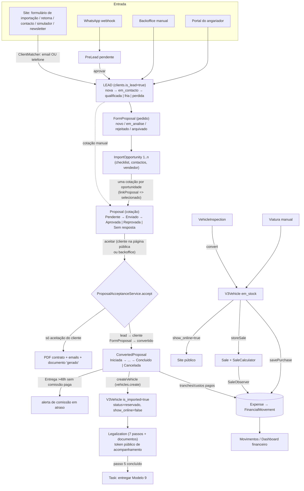

# Inventário funcional
> **Nota de revisão (2026-10-31):** este inventário descreve o código à data da auditoria. As afirmações que entretanto deixaram de ser verdade levam a marca **[Corrigido ...]** ou **[Parcial ...]** com o commit. A secção "Alterações após a auditoria" no fim resume tudo. Revisão final: os trabalhos que estavam em curso (rascunhos de notícias, vendas V3 no menu, Modelo 9 duplicado, consignação, limpeza V1, SEG-012/015/017) foram concluídos ou reclassificados (commits `68dbbe3`, `058e135`, `a33b12b`, `1bc16d9`, `2baf1d3`, `dd006d8`), por isso as marcas abaixo e a secção final foram atualizadas; fica por decidir o simulador de custos (300 contra 200). Suite: 1052 passam, 1 falha conhecida.

Revisão estática. Parte 1: backoffice núcleo. Parte 2: site público, mobile, angariador, radar e restantes módulos.

---

# Auditoria IzzyCar — Parte Funcionalidades 1: Backoffice núcleo

Revisão **estática** (leitura de código, rotas, migrations e testes). Nada foi executado, não houve ligação à BD nem leitura de dados reais. Convenções deste documento:

- **Confirmado** = visto diretamente no código citado (`ficheiro:linha`).
- **Hipótese** = inferência que precisa de execução, de dados ou de olhar para a BD de produção.
- Onde os `docs/*.md` já diziam algo, foi re-verificado; as divergências estão marcadas com **[DOC DESATUALIZADA]**.
- Âmbito: leads/pré-leads, clientes, pedidos de formulário, oportunidades, cotações, convertidas, viaturas V3 (inspeções, documentos, fotos), legalização, vendas, movimentos/financeiro, fornecedores/parceiros/vendedores e fluxos entre módulos. A versão mobile (`/gestao/mobile`), o portal do angariador, o site público e as integrações só aparecem quando tocam estes fluxos (outras partes da auditoria).

---

## 0. Modelo de acesso e permissões (transversal)

### 0.1 Como o acesso é decidido (confirmado)

1. Todas as rotas de `/gestao` estão no grupo `auth` + `restrictAngariador` + `authorizeResource` (`routes/web.php:106`).
2. `restrictAngariador` (`app/Http/Middleware/RestrictAngariadorArea.php:20-39`): utilizador sem nenhum perfil leva 403; utilizador cujo único perfil é `angariador` só passa em rotas `admin.angariador.*`.
3. `authorizeResource` (`app/Http/Middleware/AuthorizeResource.php:26-60`) procura a regra da rota em `config/permissions.php` (objeto + ação + âmbito). **Com `permissions.enforce=false` (valor por omissão, `config/permissions.php:33`) só regista `would_block` no canal `permissions` e deixa passar** (`AuthorizeResource.php:42-59`). O `.env` local não define `PERMISSIONS_ENFORCE` (verificado só a existência da chave, sem ler outros valores). **O valor em produção é desconhecido: hipótese** de que também esteja desligado. Se estiver, **qualquer utilizador com um perfil qualquer vê e edita tudo** (a única barreira real é o angariador puro e o `role:admin` de `v2/financial/seed`).
4. A ação deduz-se do nome da rota (`app/Permissions/PermissionRegistry.php:293-325`): `create/store`→criar, `destroy/delete`→eliminar, `edit/update`→editar, GET→ver, resto→editar; **sub-recursos (`vehicles.photos.cover`, `vehicles.sale.store`) contam como editar o objeto principal** (`PermissionRegistry.php:313-316`). Exceções em `config/permissions.php:214-222`.
5. Nos objetos com âmbito (`leads`, `clients`, `form-proposals`, `proposals`) as rotas normais exigem o âmbito **todos**; só as `own_routes` (portal do angariador e algumas mobile) aceitam "próprios" (`PermissionRegistry.php:276-290`, `config/permissions.php:52-103`). Isto significa que os controllers desktop **não** filtram por dono: um perfil "próprios" não consegue usar o desktop (confirmado: `LeadV2Controller::index` consulta `Client::where('is_lead', true)` sem `applyScope`, `LeadV2Controller.php:47-80`).
6. **Não existem Policies** (`app/Policies` não existe). A autorização é só por nome de rota; a única verificação dentro de um controller deste âmbito é `can('vehicles.create')` em `ConvertedProposalV2Controller.php:203`.

### 0.2 Mapa objeto → rotas → permissão (confirmado, `config/permissions.php`)

| Objeto | Rotas (padrão) | Linha | Notas |
|---|---|---|---|
| `leads` | `admin.v2.leads.*`, `admin.v2.pre-leads.*`, `admin.v2.export.leads` | 52-64 | atribuir dono = `update.all` (214); aprovar pré-lead = `create` (217); eliminar pré-lead (`reject`) = `delete` |
| `clients` | `admin.v2.clients.*`, `admin.v2.export.clients` | 65-75 | |
| `form-proposals` | `admin.v2.form-proposals.*` (inclui oportunidades e contactos), `admin.v2.consignment-evaluations.*` | 76-91 | sem ação `create`/`update` com âmbito; oportunidades = sub-recurso = `update` |
| `proposals` | `admin.v2.proposals.*`, `admin.v2.car-candidates.*`, `isv.*`, export CSV | 92-103 | `createFromForm/FromOpportunity/importFromListing` = `create` (218-220) |
| `converted-proposals` | `admin.v2.converted-proposals.*` | 104-110 | `create-vehicle` exige também `vehicles.create` no controller |
| `legalizations` | `admin.legalizations.*` | 125 | |
| `vehicles` | `admin.v3.vehicles.*`, `admin.v2.vehicles.*` | 126 | cobre fotos, documentos, despesas, **venda** e legalização da viatura |
| `movements` | `admin.v2.movements.*`, `admin.v2.expenses.*` | 132-135 | |
| `sales` | `admin.v2.sales.*` (só vendas V1) | 136 | |
| `inspections` | `admin.v3.inspections.*` | 137 | |
| `sellers`/`suppliers`/`partners` | `admin.v2.sellers.*` / `suppliers.*` / `partners.*` | 158-160 | |
| `reports` | `admin.v2.financial.dashboard` | 168 | |
| admin apenas | `admin.v2.financial.seed` (+ `role:admin` em `routes/web.php:211`), `clients.*` (V1), `brands.*`, `pages.*`… | 258-271 | |

Perfis iniciais (`config/permissions.php:277-309`): `Importador` tem tudo do funil/operações (incl. `sellers`, mas **não** `suppliers`/`partners`); `angariador` só `leads`/`proposals`/`form-proposals`/`commissions` em "próprios"; `cms` só conteúdo.

### 0.3 Lacunas de autorização (confirmado por leitura; impacto real só se `enforce=true`)

- **A1. Venda, despesa e legalização de uma viatura contornam os objetos `sales`/`movements`/`legalizations`.** `admin.v3.vehicles.sale.store`, `.expenses.store`, `.legalization.*` são sub-recursos de `vehicles`, logo exigem apenas `vehicles.update` (`PermissionRegistry.php:313-316`; rotas em `routes/web.php:500-528`). Um perfil sem `sales.*`/`movements.*` mas com `vehicles.update` regista vendas e despesas. Contraria a separação de funções que o catálogo sugere.
- **A2. Converter inspeção em viatura (`admin.v3.inspections.convert`, POST) conta como `inspections.update`** e cria uma `V3Vehicle` sem exigir `vehicles.create` (`routes/web.php:547`; contraste com `ConvertedProposalV2Controller.php:203`, que exige). `inspections.duplicate` também é "editar", não "criar".
- **A3. Aprovar cotação pelo backoffice cria cotação convertida, lead→cliente, movimentos e sobrescreve estado de pedidos** sob a permissão `proposals.update` (rota `admin.v2.proposals.accept`), sem exigir `converted-proposals.create`.
- **A4. Rota `clients.contractService` só para admin e sem ligação na UI V2** (`routes/web.php:178`, `config/permissions.php:265`; único link está em `resources/views/clients/index.blade.php:50`, view V1 sem rota de `index`). Funcionalidade inacessível na prática (ver §13).
- **A5. Rotas de leads exigem âmbito "todos"** e o "próprios" só vale no portal/mobile. Se alguém quiser dar "próprias" a um perfil de desktop, fica sem acesso (confirmado, não é bug mas é regra a conhecer).

---

## 1. Fluxo completo entre módulos

**Pontos onde o fluxo "parte" (confirmado):**

1. **"Faturação" não existe como módulo.** Não há faturas emitidas nem integração de faturação. O que existe é: receita das tranches (`Expense::IMPORT_ENTRIES`, `app/Models/Expense.php:274-285`), receita de venda (`Expense::syncFromSale`, `Expense.php:203-263`) e despesa de compra (`syncFromV3Vehicle`, `Expense.php:377-417`). A única "fatura" é o ficheiro anexado a uma legalização (`LegalizationController::uploadInvoice`, `routes/web.php:141-143`) e o anexo opcional de um movimento. O fluxo "→ faturação" do pedido corresponde, na prática, a "→ movimentos".
2. **Cotação convertida → viatura é manual** (botão "Criar viatura", `routes/web.php:684`); nada cria a viatura sozinho (`ConvertedProposalV2Controller.php:201-213`).
3. **Viatura importada (`is_imported`) nunca passa por venda**: o cliente é o dono do carro; o dinheiro vem das tranches (sem `v3_vehicle_id`, por desenho: `Expense.php:340-342`). Mas nada impede registar `storeSale` numa viatura importada (`V3VehicleController.php:489-535` não verifica `is_imported`): **hipótese** de dupla contabilização se alguém o fizer.
4. **Cancelar a cotação convertida** não repõe nada: a cotação continua `Aprovada` e `isAccepted()` continua verdadeiro enquanto existir a convertida (`Proposal.php:81-84`); a viatura e a legalização criadas ficam; só os movimentos acompanham os flags `*_pago` (`Expense.php:326-333`). Não há "reabrir" (confirmado: `ConvertedProposalService::changeStatus` só grava o estado, `ConvertedProposalService.php:55-84`). **[Corrigido em parte, `3bb96ac`: `isAccepted()` ignora convertidas canceladas e `accept()` desliga a cancelada anterior (`proposal_id = null`), pelo que a cotação pode voltar a ser aceite. Continua a ser verdade que a viatura e a legalização criadas ficam e que não há "reabrir".]**
5. **Eliminar a convertida** apaga os movimentos automáticos (`Expense::forgetConvertedProposal`, `ConvertedProposal.php:199`) mas não apaga a viatura/legalização nem os ficheiros em `converted-proposals/{id}/` (`ConvertedProposalV2Controller.php:288-295` só faz `delete()`), e a cotação fica `Aprovada` sem convertida (volta a poder ser aceite).

---

## 2. Leads

**Finalidade.** Funil comercial: cada contacto interessado é um `Client` com `is_lead=true`.

**Quem acede / permissões.** Objeto `leads` (`config/permissions.php:52-64`). Desktop exige `leads.view.all` (ver), `leads.update.all` (estado, converter, follow-up, atividade, dono), `leads.create` (criar), `leads.delete` (eliminar). Atribuir dono = `update.all` (`:215`). Perfil `Importador` tem tudo; `angariador` tem `view own/update own/create` mas só pelo portal `admin.angariador.*` (`config/permissions.php:296-301`).

**Onde está disponível.** Menu lateral "Leads" (`resources/views/layouts/admin-v2.blade.php:~1004`), kanban (`admin.v2.leads.kanban`), exportação XLSX e CSV (ambas na lista: `leads/index.blade.php:32` e `:38`), dashboard, pesquisa global, mobile `/gestao/mobile/leads`, portal do angariador.

**Rotas e ficheiros.** `routes/web.php:286-300`; `app/Http/Controllers/Admin/LeadV2Controller.php`; `app/Services/LeadService.php`; `app/Models/Client.php`; `app/Observers/ClientObserver.php`; views `resources/views/admin/v2/leads/*`.

**Tabelas.** `clients` (`is_lead`, `lead_status`, `lead_source`, `owner_id`, `angariador_code`, `next_followup_at`, `followup_note`), `lead_activities`, `audit_logs`.

**Como se usa.** Leads → "Nova lead" (nome obrigatório; email/telefone opcionais) → aviso de duplicado com checkbox "criar mesmo assim" → ficha da lead (timeline, follow-up, atribuir dono, pedidos de importação, cotações) → mudar estado (também arrastando no kanban) → "Converter em cliente".

**Funcionamento técnico (confirmado).**
- Entrada/validação: `LeadService::rules` (`LeadService.php:35-47`); estado só em `nova|em_contacto|qualificada|fria|perdida` nas rotas de leads (`:18`, `LeadV2Controller.php:132`).
- Duplicados: `ClientMatcher::duplicateWarning` (email OU telefone) devolve aviso confirmável (`LeadV2Controller.php:37-39`, `ClientMatcher.php:63-75`).
- Persistência: `Client::create` (hook `saving` calcula `email_normalized`/`phone_key`, `Client.php:54-58`) + `LeadActivity::log`.
- Converter: `Client::convertToClient` só faz `is_lead=false`, `converted_at=now()` (`Client.php:114-120`); o `lead_status` fica congelado.
- Eliminar: `$lead->delete()` sem proteção nem SoftDeletes (`LeadV2Controller.php:180-187`).

**Dependências/efeitos secundários.** `ClientObserver` grava `AuditLog` em criar/editar/eliminar (`ClientObserver.php:10-36`); **as alterações guardam valores antigos e novos, incluindo email/telefone, no log de auditoria** (dado pessoal replicado: ver §14). Follow-up manual agenda notificações (comando `SendFollowupReminder`, fora de âmbito).

**Estados e regras.** `qualificada` é a que "recebe cotações" (convenção; nada no código a atribui automaticamente: **confirmado** — `ProposalService`/`ProposalAcceptanceService` não tocam em `lead_status`). Kanban agrupa `lead_status ?? 'nova'` (`LeadV2Controller.php:107`). Listagem põe `perdida` no fim (`:49-52`).

**Problemas e limitações.**
- P2.1 (confirmado) **Email repetido forçado dá erro 500 no desktop.** `clients.email` é `unique` (`database/migrations/2025_02_27_084551_create_clients_table.php:17`). O aviso do desktop deixa confirmar ("criar mesmo assim") e depois `Client::create` rebenta por violação de unicidade. O serviço que trata isto (`ClientService::emailOwner`, `ClientService.php:57-67`, com o comentário "um email repetido nunca se pode forçar") só é usado no **mobile** (`Mobile/LeadController.php:122`, `Mobile/ClientController.php:191`); `LeadV2Controller::store` (`:33-45`), `ClientV2Controller::store` (`:63-75`) e `update` (`:135-145`) não o usam. Efeito: erro 500 / página de erro em vez de mensagem. Só o telefone repetido pode ser forçado em segurança. **[Corrigido em `9616cc9`: `LeadV2Controller::store`, `ClientV2Controller::store` e `update` usam `ClientService::emailOwner` e devolvem uma mensagem em vez de 500; o aviso deixa de oferecer "criar mesmo assim" quando o motivo é o email. Só o texto sobre o telefone continua válido.]**
- P2.2 (confirmado) `LeadV2Controller::saveFollowup`, `storeActivity` e `assignOwner` usam `Client::findOrFail` (aceitam clientes), `show/destroy/convert/updateStatus` filtram `is_lead` (`LeadV2Controller.php:112-187`): comportamento assimétrico (já descrito na doc).
- P2.3 (confirmado) `lead_source` e `lead_status` sem enum nem constraint; só validados nas rotas de leads. Entradas do site/WhatsApp/angariador escrevem texto livre (doc `leads-e-clientes.md`; sem enum no código: `Client.php` não tem casts nem enums).
- P2.4 (confirmado) A conversão acontece em três sítios (`LeadService::convert`, `ProposalAcceptanceService::accept`, `ProposalObserver::updated`). **[DOC DESATUALIZADA]** "o log pode duplicar" fica resolvido: em `accept()` o cliente é convertido **antes** de gravar `Aprovada` (`ProposalAcceptanceService.php:51-57`) e o observer recarrega o cliente já com `is_lead=false`, por isso não duplica. Já uma cotação posta a `Aprovada` por `update` direto em massa ou por outro caminho que não `accept` seria convertida só pelo observer (`ProposalObserver.php:31-44`).
- P2.5 (confirmado) A listagem de leads carrega 4 contagens separadas (stats) em cada visita (`LeadV2Controller.php:62-77`) e o kanban carrega **todas** as leads sem paginação (`:103-107`): custo cresce com a base.

**Testes.** `tests/Feature/LeadServiceTest.php` (criar, estado, converter, follow-up, atividade, dono), `LeadKanbanTest.php`, `PhaseThreeFunnelTest.php` (duplicados, pré-lead), `Mobile/MobileLeadsTest.php`, `AngariadorPortalTest.php`.
**Sem cobertura.** Eliminar lead e efeitos em cascata; `LeadV2Controller::assignOwner` por rota desktop com permissões; criar lead com email já existente confirmado no desktop (P2.1); exportação CSV de leads.

---

## 3. Pré-leads (WhatsApp)

**Finalidade.** Fila de mensagens de WhatsApp de números desconhecidos, à espera de aprovação humana.

**Acesso.** Objeto `leads` (`config/permissions.php:56`): ver = `leads.view.all`, aprovar = `leads.create` (`:217`), rejeitar = `leads.delete`.

**Onde está disponível.** **Só por URL `/gestao/v2/pre-leads`.** Não existe qualquer ligação no menu nem em views (confirmado: a única referência fora da própria view é um `routeIs` de realce em `layouts/admin-v2.blade.php:973`; nenhum `route('admin.v2.pre-leads.index')` em `resources/`). **Funcionalidade praticamente inacessível pela navegação** (hipótese: acede-se por um favorito ou por notificação push; não verificado).

**Rotas e ficheiros.** `routes/web.php:302-306`; `app/Http/Controllers/Admin/PreLeadController.php`; webhook `app/Http/Controllers/Api/WhatsAppWebhookController.php`; `app/Models/PreLead.php`; tabela `pre_leads`.

**Como se usa.** Abrir a fila → escrever o nome → "Aprovar" (cria lead) ou "Rejeitar".

**Funcionamento (confirmado).** `approve` valida só `name` (`PreLeadController.php:28-30`); se o telefone já existir (`ClientMatcher::find(null, phone)`) junta a mensagem à ficha existente, caso contrário cria `Client` com `lead_source=whatsapp`, `lead_status=nova` (`:49-57`); em ambos apaga o pré-lead (`:42`, `:67`). `reject` apaga (`:72-77`).

**Problemas.** (a) Sem histórico: aprovar/rejeitar apaga o registo, não há trilho de quem rejeitou o quê (a lead criada regista o aprovador na timeline, a rejeição não deixa rasto, `:72-77`). (b) `PreLead.status` só tem `pendente` na prática (a query filtra `pendente`, `:21`; nunca muda para outro valor: confirmado). (c) A rota `approve` não tem proteção contra duplo clique (hipótese: dois cliques criam duas leads com o mesmo telefone porque a segunda já encontraria a primeira e só juntaria: baixo risco).

**Testes.** `PhaseThreeFunnelTest::test_pre_lead_joins_an_existing_client_instead_of_duplicating`. **Sem cobertura:** aprovar quando não existe cliente; rejeitar; verificação do webhook (`VerifyWhatsAppSignature`; fora deste âmbito).

---

## 4. Clientes (duplicados e fusão)

**Finalidade.** Ficha única de pessoa/empresa (lead convertida ou criada diretamente).

**Acesso.** Objeto `clients` (`config/permissions.php:65-75`): `clients.view/update` com âmbito, `create`, `delete`. No desktop exige "todos". O CRUD V1 (`clients.*`) é só admin e desligado.

**Disponível em.** Menu "Clientes", ficha com timeline/cotações/vendas/viaturas, exportação XLSX e CSV, mobile.

**Rotas/ficheiros.** `routes/web.php:308-320` (+ car-candidates `:326-331`); `ClientV2Controller`; `ClientService`; `ClientMatcher`; `ClientMergeService`; comandos `ClientDuplicates`, `ClientMerge`; views `admin/v2/clients/*`.

**Tabelas.** `clients`; referenciadas por `client_id`: `proposals` (FK em cascata, `2025_03_06_093214_create_proposals_table.php:14`), `sales` (FK em cascata, `2025_03_01_091026_create_sales_table.php:13`), `legalizations` e `v3_vehicles` (`nullOnDelete`), `expenses` (`set null`, `2026_05_15_200000_evolve_expenses_to_movements_table.php:70`), `converted_proposals` (**sem FK**, só índice, `2025_09_03_083206_create_converted_proposals_table.php:32,85`), `form_proposals.client_id` (**`string` sem FK**, `2025_08_21_142710_create_form_proposal_table.php:21`).

**Como se usa.** Clientes → criar/editar; ficha → registar atividade, follow-up, carros candidatos, "Registar venda".

**Funcionamento (confirmado).**
- `ClientService::rules` (`ClientService.php:19-40`): `gender` e `client_type` sem regra de valores.
- `create` põe `data_processing_consent` `true` por omissão (`:89`) — **consentimento RGPD presumido por omissão** (confirmado) para clientes criados no backoffice.
- `update` não verifica duplicados (`ClientService.php:95-99`).
- `destroy` apaga sem condições (`ClientV2Controller.php:150-157`).

**Duplicados.** `ClientMatcher` é a regra única (email OU últimos 9 dígitos), `find()` devolve o mais antigo e `conflict` quando email e telefone apontam para registos diferentes (`ClientMatcher.php:36-55`). `ContactNormalizer` não é para clientes. `clients:duplicates` lista só leitura.

**Fusão (`clients:merge {keep} {remove*} {--apply}`).** `ClientMergeService` descobre por reflexão todas as tabelas com coluna `client_id` (`ClientMergeService.php:31-39`), faz `UPDATE` direto (`:78-80`), preenche só campos vazios (`FILL_FIELDS`, `:23-28`), junta observações, consentimentos em OR, `created_at` mais antigo, grava `AuditLog` e apaga o duplicado com `deleteQuietly` (`:114`). Sem desfazer. Só existe como **comando Artisan** — **não há ecrã de fusão no backoffice** (confirmado: sem rota/controller; `routes/web.php` não tem nada). Quem o executa precisa de acesso ao servidor.

**Problemas.**
- P4.1 (confirmado) **Eliminar um cliente tem efeitos em cascata perigosos:** as `proposals` e as `sales` do cliente desaparecem por FK em cascata **sem eventos Eloquent** (sem `ProposalObserver::deleted`, sem `SaleObserver::deleted`), portanto o **movimento de receita de venda (`Expense` com `source_type=Sale`) e o registo no `AuditLog` ficam órfãos** (hipótese quanto ao movimento órfão: depende de o `Expense` ter FK para `sales`, que não encontrei — `source_id` é inteiro livre, `Expense.php:38-40`). As `converted_proposals` e os `form_proposals` do cliente **ficam com `client_id` a apontar para nada** (sem FK). `destroy` não pede confirmação do que vai apagar (`ClientV2Controller.php:150-157`; `LeadV2Controller.php:180-187`).
- P4.2 (confirmado) Mesmo problema de unicidade do email que em P2.1 em `ClientV2Controller::store/update`. **[Corrigido em `9616cc9`, ver P2.1.]**
- P4.3 (confirmado) `ClientMergeService` usa `DB::table(...)->update` por tabela: **não passa por observers**, não revê índices únicos nas tabelas filhas (ex.: `converted_proposals.proposal_id` não é `client_id`, ok; mas qualquer tabela futura com unicidade composta com `client_id` partiria a meio, embora dentro de transação). `form_proposals.client_id` é `string`: o `whereIn('client_id', $ids)` funciona em MySQL por coerção (hipótese para sqlite/outros).
- P4.4 (confirmado) Os updates em massa não recalculam `email_normalized`/`phone_key` (`Client.php:54-58`); `ClientMergeService` usa `forceFill()->save()` (dispara o hook, ok), mas os `DB::table` de outros módulos que gravem email/telefone em `clients` ficariam inconsistentes.

**Testes.** `ClientServiceTest`, `ClientIdentificationValidityTest`, `PhaseThreeFunnelTest` (merge e comando, duplicados), `Mobile/MobileClientsTest`.
**Sem cobertura.** `destroy` de cliente e cascatas; edição desktop com email repetido; exportações CSV; ficha `show` com vendas/viaturas; carros candidatos (`CarCandidateController`, nenhum teste: `grep car-candidates tests` vazio).

### 4.1 Carros candidatos (`CarCandidate`)
Confirmado em uso: partial `resources/views/admin/v2/clients/partials/car-candidates.blade.php` incluído nas fichas de cliente e de lead; rotas `admin.v2.car-candidates.*` (`routes/web.php:326-331`) classificadas no objeto `proposals` (`config/permissions.php:98`). **[DOC DESATUALIZADA]** ("por confirmar onde se gere"): gere-se nas fichas. **Duplicação conceptual** com as Oportunidades (ambos guardam "carros em análise para um cliente"); sem testes.

---

## 5. Pedidos de formulário (`FormProposal`)

**Finalidade.** Pedido de importação de um cliente (origem `site` ou `manual`); agrupa oportunidades e cotações.

**Acesso.** Objeto `form-proposals` (`config/permissions.php:76-91`): `view` com âmbito; **`create`, `update`, `delete` sem âmbito** (todas as rotas desktop de escrita exigem a ação correspondente). Perfil `cms` não pode criar (testado: `ClientImportRequestsTest::test_cms_cannot_create_requests`).

**Disponível em.** **Fora do menu lateral** ("formulários saíram do menu", teste `test_formularios_left_the_menu`): acede-se a partir da ficha de lead/cliente e do dashboard; `admin.v2.form-proposals.index` está ligado em `dashboard.blade.php` e `leads/index.blade.php`. Mobile `/gestao/mobile/formularios`.

**Rotas/ficheiros.** `routes/web.php:344-352`; `FormProposalV2Controller`; `FormProposalService`; `app/Models/FormProposal.php`; views `admin/v2/form-proposals/*`.

**Funcionamento (confirmado).**
- Manual: exige `client_id`, nasce `em_analise`, copia nome/email/telefone do cliente (campos obrigatórios da tabela) e o `angariador_code`, grava `created_by`, regista atividade (`FormProposalService.php:89-114`).
- Estados escolhidos à mão: `novo|em_analise|rejeitado|arquivado` (`FormProposalService.php:25`); `convertido` só automático (`ProposalAcceptanceService.php:68`).
- Marca/modelo validados contra `VehicleCatalog` (valor antigo fora do catálogo aceita-se se não mudar, `FormProposalService.php:56-61`).
- `destroy`: as oportunidades vão por FK em cascata, as fotos à parte (`FormProposalV2Controller.php:118-135`, `ImportOpportunityService.php:136-143`).

**Problemas.**
- P5.1 (confirmado) **Nada impede mudar um pedido `convertido` para `novo`/`arquivado`**: `updateStatus`/`bulkUpdateStatus` não verificam o estado atual (`FormProposalV2Controller.php:90-116`; `FormProposalService::changeStatus` `:128-131`). Dá inconsistência com a cotação aceite. Em `bulkUpdateStatus` ainda faz `update` pedido a pedido sem transação (`:111-113`).
- P5.2 (confirmado) A estatística "Convertidos" conta `proposal_id` não nulo, não o estado (`FormProposalV2Controller.php:43`), mas o estado `convertido` é o que o funil usa; os dois números podem divergir.
- P5.3 (confirmado) `FormProposal.client_id` é `string` sem FK (§4): `FormProposalV2Controller::destroy` trata `client === null` (`:129`), o que mostra que órfãos são esperados.
- P5.4 (confirmado) Fotos das oportunidades ficam no disco **público** (`ImportOpportunityService.php:257-264`, `Storage::disk('public')`): URL previsível se alguém souber o caminho; o resto dos anexos sensíveis foi movido para disco privado (`docs/ficheiros-privados.md`, `PrivateFiles`). **Hipótese:** fotos de anúncios de terceiros, risco baixo, mas inconsistente.
- P5.5 (confirmado) `ConsignmentEvaluation` (`admin.v2.consignment-evaluations.*`) está no objeto `form-proposals` mas **sem ligação em nenhum menu** (nenhuma referência fora das próprias views, `grep` em `resources/views`). Inacessível pela navegação.

**Testes.** `FormProposalDesktopCharacterizationTest`, `ClientImportRequestsTest`, `ImportOpportunityTest`, `Mobile/MobileFormProposalsTest`, `PhaseTwoFunnelTest::test_request_cannot_be_set_to_converted_by_hand`.
**Sem cobertura.** Mudança de `convertido` para outro estado (P5.1); `bulkUpdateStatus` desktop; avaliações de consignação (apenas `FicheirosPrivadosTest` toca no anexo).

---

## 6. Oportunidades de importação (`ImportOpportunity`)

**Finalidade.** Carro/anúncio candidato dentro de um pedido, com checklist, histórico de contactos, vendedor e foto.

**Acesso.** Dentro de `form-proposals` como sub-recurso: ver = `form-proposals.view.all`; criar/editar/eliminar/mudar estado/checklist/notas/contactos = `form-proposals.update` (`PermissionRegistry.php:313-316`).

**Rotas/ficheiros.** `routes/web.php:357-367` (com `scopeBindings`); `ImportOpportunityController`, `ImportOpportunityContactController`; `ImportOpportunityService`; `FormProposalService` (regras de estado/checklist/notas); Form Requests `StoreImportOpportunityRequest`/`Update…`/`StoreOpportunityContactRequest`; enums `OpportunityStatus`, `ContactStatus`, `ContactType`, `ContactMethod`, `ChecklistItemStatus`; tabelas `import_opportunities`, `import_opportunity_contacts`, `import_opportunity_checklist_entries`, `opportunity_checklists`, `opportunity_checklist_items`.

**Como se usa.** No pedido → "Adicionar oportunidade" (marca e modelo obrigatórios) → ficha: dados do anúncio, vendedor/contacto (picker), checklist por combustível, registar contactos, notas (autosave) → "Criar cotação a partir desta oportunidade".

**Funcionamento (confirmado).**
- Checklists filtradas por combustível (`appliesToFuel`, `ImportOpportunityService.php:48-53`); `setChecklistStatus` recusa itens não aplicáveis (422, `:145-157`).
- `logContact` (transação): contactos "outreach" atualizam `last_contacted_at`, `contact_method`, `contact_status` e passam `por_contactar→contactado` (`:164-195`).
- `linkProposal`: `proposal_id`, `status=selecionado` e nota no histórico (`:218-234`).
- Estado: qualquer valor do enum (`FormProposalService.php:145-151`).

**Problemas.**
- P6.1 (confirmado) `changeOpportunityStatus` aceita `selecionado` sem cotação ligada e deixa tirar `selecionado` com cotação existente; só `ProposalObserver::deleting` repõe (`ProposalObserver.php:64-69`). Estados e `proposal_id` podem divergir.
- P6.2 (confirmado) `deleteContact` recalcula `last_contacted_at` mas não o `contact_status` (`ImportOpportunityService.php:198-212`): depois de apagar o único contacto, `contact_status` continua `contactado`/`respondeu`.
- P6.3 (confirmado) Eliminar uma oportunidade com cotação ligada: a FK é `nullOnDelete` na oportunidade→cotação (`2026_09_29_160000_add_proposal_id_to_import_opportunities_table.php:16`), mas apagar a **oportunidade** não toca na cotação, e a cotação perde a origem sem aviso (`ImportOpportunityController.php:69-77`).
- P6.4 (hipótese) O dado do vendedor aparece em `ImportOpportunity` e depois em `V3Vehicle` (`seller_id`, `seller_contact_id`, `ConvertedProposalService.php:197-198`): copiado só na criação da viatura a partir da convertida; se o vendedor mudar depois, não se propaga (intencional).

**Testes.** `ImportOpportunityTest` (520 linhas, boa cobertura: validação, checklist, contactos, foto, 404 por pedido), `ProposalFromOpportunityTest`, `SellerBrandsTest`, `Mobile/MobileFormProposalsTest`.
**Sem cobertura.** P6.1, P6.2; apagar oportunidade com cotação ligada.

---

## 7. Cotações (`Proposal`)

**Finalidade.** Proposta comercial de importação enviada ao cliente por link público.

**Acesso.** Objeto `proposals` (`config/permissions.php:92-103`). Desktop exige "todas"; o portal do angariador usa `own_routes`. Página pública `GET /proposta/{proposal_code}` e `POST …/aceitar` (throttle 5/min) sem login (`routes/web.php:59-67`).

**Disponível em.** Menu "Cotações", kanban (`admin.v2.proposals.kanban`), ficha do pedido/oportunidade, dashboard, mobile, portal do angariador (`admin.angariador.cotacoes`), CSV (`admin.v2.export.proposals`).

**Rotas/ficheiros.** `routes/web.php:252-267`; `ProposalV2Controller` (580 linhas); `ProposalService` (411); `ProposalAcceptanceService`; `ProposalObserver`; `Proposal` model; mails `ProposalSentMail`, `ProposalAcceptedMail`; página pública `ProposalController::detail`.

**Tabelas.** `proposals`, `proposal_attribute_values`, `status_proposal_history` (da convertida), `lead_activities`, `audit_logs`; `form_proposals.proposal_id`, `import_opportunities.proposal_id`.

**Como se usa.** Cotações → "Nova" (a partir de cliente, de pedido ou de oportunidade; ou "importar de anúncio") → preencher custos (`transport_cost` obrigatório) → guardar (nasce `Pendente`) → mudar estado para `Enviado` (envia o email) → cliente aceita na página pública → convertida.

**Funcionamento técnico (confirmado).**
- Validação: `ProposalService::updateRules` (`ProposalService.php:69-103`); combustível ∈ `FUELS`, estado ∈ `STATUSES`.
- `create`: gera `proposal_code` (inicial marca + inicial modelo + 8 aleatórios, `ProposalService.php:227-229`; coluna `string(12) unique`, `2025_12_02_000000_add_proposal_code_to_proposals_table.php:10`); grava sempre `Pendente` e aplica o estado pedido no fim por `changeStatus`; liga pedido/oportunidade (`:243-261`).
- `ProposalObserver::created/updated` grava `AuditLog`; ao passar a `Enviado` envia email ao cliente e ao dono, regista atividade e agenda follow-up a +2 dias se não houver (`ProposalObserver.php:83-130`). **Os emails saem síncronos dentro do observer, sem try/catch** (`:96`, `:100`).
- `changeStatus`: `Aprovada` passa sempre por `accept()`; cotação já aceite só admite `Aprovada`; `Reprovada` marca oportunidades como `rejeitado` (`ProposalAcceptanceService.php:96-123`).
- Validade 15 dias desde `created_at` (`Proposal.php:55,76-79`).
- Atribuição em massa: `bulkUpdateStatus` e `bulkReject` iteram pelo serviço (`ProposalV2Controller.php:539-580`); **`bulkReject` sem `ids` rejeita todas as `Pendente`/`Enviado` com mais de 30 dias** (`:550-557`).

**Problemas.**
- P7.1 (confirmado) **Falha de SMTP ao passar a `Enviado` → 500, mas o estado já está gravado.** O envio está no observer (`ProposalObserver.php:96,100`) sem try/catch; o `ProposalService::changeStatus`/controller só apanham `ProposalAcceptanceException`. Em `bulkUpdateStatus` uma falha a meio interrompe o ciclo (`ProposalV2Controller.php:562-577` só apanha `ProposalAcceptanceException`). Comparar com o contrato/mails da convertida, que usam `try/catch` + `report`. **[Corrigido em `9616cc9`: o observer grava timeline e follow-up antes de enviar e envia cada email em `try/catch` (log sem dados pessoais e `LeadActivity` de aviso). Já não dá 500 nem interrompe `bulkUpdateStatus` por falha de SMTP. Continua síncrono, sem fila.]**
- P7.2 (confirmado) **`$proposal->total_price` não existe.** Não há coluna nem accessor (`grep total_price`: só 2 usos, `ExportController.php:137` e `ProposalService.php:272`; nenhuma migration). Resultado: a coluna "valor total" do CSV de cotações sai sempre vazia e a atividade "Cotação #… criada" nunca leva "Valor total". Existe `Proposal::totalCost()` (`Proposal.php:68-74`) que nunca é usada por estes dois sítios. **Funcionalidade incompleta.**
- P7.3 (confirmado) Eliminar cotação (`ProposalV2Controller::destroy`, `:438-455`) não verifica `isAccepted()`: apaga a cotação mesmo com convertida associada (`converted_proposals.proposal_id` sem FK) → convertida órfã com `proposal_id` a apontar para nada, e `ProposalObserver::deleting` só repõe oportunidades.
- P7.4 (confirmado, e **hipótese quanto à BD**) Nomes de estado inconsistentes e ENUMs antigos: a migration original define `proposals.status` como ENUM com `Enviada` (`2025_03_06_093214_create_proposals_table.php:41`) e `converted_proposals.status` ENUM sem `Pagamento do Carro` nem `Cancelada` (`2025_09_03_083206_create_converted_proposals_table.php:15-27`), mas o código grava `Enviado`, `Pagamento do Carro` e `Cancelada`. **Nenhuma migration do repositório altera estes ENUMs** (`grep` por `Enviado`/`Cancelada` em `database/migrations` sem resultados). Em MySQL com modo estrito isto falharia: **hipótese de que a BD de produção foi alterada à mão (drift)**. Precisa de `SHOW COLUMNS` em produção (leitura, pelo Pedro) para fechar.
- P7.5 (confirmado) `ProposalController` (V1) tem 987 linhas e só `detail`, `accept` e `requestAlternativeQuote` têm rota (`routes/web.php:59-67`); `store`, `update`, `generatePdf`, `duplicate`, `create_by_form`, `getDataFromUrl`… são **código morto** (sem rota). Há código comentado com um endereço pessoal fixo (`ProposalController.php:838`) e bcc `izzycarpt@gmail.com` fixo (`:930`, `ConvertedProposalService.php:74`, `ConvertedProposalV2Controller.php:273`): endereços fixos no código em vez de config.
- P7.6 (confirmado) Cada visita à página pública faz `VehicleAttribute::find` dentro de um ciclo (`ProposalController.php:586-603`): N+1 (baixo, poucas linhas).
- P7.7 (confirmado) Não há ação "enviar": enviar = pôr `Enviado`. Se o email do cliente estiver vazio o observer apenas não envia e regista a atividade "Email enviado" na mesma só se `skipSentEmails` falso (o texto da atividade diz "Email enviado" mesmo quando não havia email: `ProposalObserver.php:104-112`, depende de `$proposal->skipSentEmails`, não de existir email). **Confirmado:** o log pode mentir.

**Testes.** `ProposalServiceTest`, `ProposalFromOpportunityTest`, `ProposalKanbanTest`, `ProposalCodeTest`, `PhaseTwoFunnelTest`, `PhaseOneSecurityTest` (aceitação pública), `Mobile/MobileProposalsTest`.
**Sem cobertura.** P7.1 (falha de email), P7.2 (CSV), P7.3 (apagar cotação aceite), `importFromListing`, `bulkReject` sem ids, `requestAlternativeQuote` (apenas `ClientImportRequestsTest` o toca), exportação CSV.

### 7.1 Aceitação (`ProposalAcceptanceService::accept`)
Confirmado (`ProposalAcceptanceService.php:36-84`): transação com `lockForUpdate` na cotação e no cliente; recusa já aceite, e (só pelo cliente) expirada/reprovada (`:141-154`); preenche **só campos vazios** do cliente com `CLIENT_FIELDS` (`:25-28`, `:160-171`); converte lead; põe `Aprovada`; cria `ConvertedProposal` (`:173-213`) e histórico `Iniciada`; passa pedidos ligados a `convertido`; regista atividade. O índice único `converted_proposals.proposal_id` (`2026_10_01_140000_…`) apanha o duplo clique.
- Tranches: `ServiceTranches::split` calcula `tranche1 = total×pct1` e **`tranche2 = total − tranche1`** (`ServiceTranches.php:31-36`); `pct2` é calculado mas **não usado** na divisão. Se as Definições tiverem 60/30 a segunda tranche vale 40%. Confirmado; só afeta configurações que não somem 100. **[Corrigido em `3bb96ac`: `pct2 = 100 - pct1`, o `final_payment` das Definições deixa de contar.]**
- O ISV, o valor do carro e o IUC ficam fora das tranches (`:178-186`).
- A aceitação pelo **backoffice** não gera contrato nem envia email (`ProposalV2Controller.php:472-492`; docs corretas). A aceitação **pelo cliente** guarda o PDF em disco `local` e cria o `ConvertedProposalDocument` `gerado`, envia ao cliente (cc geral, bcc fixo) e ao angariador com o mesmo PDF **(responde à dúvida da doc)**: `ProposalController::sendAcceptanceEmail` passa `$pdfContent` também ao angariador (`ProposalController.php:896-940`, `new ProposalAcceptedMail($convertedProposal, $pdfContent, $data, forAngariador: true)`); falta confirmar em `ProposalAcceptedMail::build` se, com `forAngariador`, o anexo é omitido (**hipótese:** o comentário no código diz que o angariador recebe "sem o contrato", mas o PDF é passado; não abri `app/Mail/ProposalAcceptedMail.php` — ver Registo de cobertura).

---

## 8. Cotações convertidas (`ConvertedProposal`) e tranches

**Finalidade.** Processo de importação em curso após a aceitação: pipeline de estados, pagamentos, comissão, documentos, viatura.

**Acesso.** Objeto `converted-proposals` (`config/permissions.php:104-110`); desktop `admin.v2.converted-proposals.*` por ação deduzida; a rota de mudança de estado `admin.v2.converted-proposals.update-status` (PATCH `routes/web.php:921`) é `update`. O portal do angariador vê as suas (`admin.angariador.convertidas*`, em `shared`, filtradas no controller).

**Disponível em.** Menu "Cotações convertidas", kanban, ficha com contrato/documentos/histórico, link público de acompanhamento ao cliente.

**Rotas/ficheiros.** `routes/web.php:672-685`, `:921`; `ConvertedProposalV2Controller`; `ConvertedProposalController` (V1, só `updateStatus` e `detailTimeline` em uso); `ConvertedProposalService`; `ContractService`; `Models/ConvertedProposal`, `ConvertedProposalDocument`, `StatusProposalHistory`; `Expense::syncFromConvertedProposal`; comandos `RecalculateConvertedTranches`, `SendOverdueCommissionAlert`.

**Como se usa.** Ficha → mudar estado no pipeline (escolher se avisa o cliente) → marcar pagamentos (tranches, custos, comissão) → carregar contrato assinado → "Criar viatura" → acompanhar na legalização.

**Funcionamento técnico (confirmado).**
- Hooks do modelo (`ConvertedProposal.php:179-219`): `tracking_code` aleatório de 24 caracteres na criação; data de pagamento das tranches fixada/limpa; `saved` sincroniza movimentos; `deleted` apaga-os; mudar `owner_id` fixa `angariador_commission` com o valor do utilizador nesse momento; `updated` com mudança de `status` grava `StatusProposalHistory`.
- `changeStatus` (rota de pipeline): valida contra `ConvertedProposalService::STATUSES` (12 etapas + `Cancelada`/`Cancelado`, `:27`), grava e envia `ProposalStatusUpdatedMail` com try/catch (`:55-84`).
- Mas **o formulário completo `update` aceita qualquer texto em `status`** (`'status' => 'nullable|string|max:255'`, `ConvertedProposalV2Controller.php:223`) e **pode mudar `client_id` e `proposal_id`** (`:225-227`): dois caminhos de mudança de estado com validações diferentes. Um estado desconhecido cai na coluna "Iniciada" do kanban (`ConvertedProposal.php:36-38`).
- `store` manual (`:132-181`) cria sem `proposal_id` e **não cria o histórico `Iniciada`** (confirmado; o hook `updated` só dispara em updates).
- Contrato: `ContractService::generateContractPdf` + `pdf/contract_service.blade.php` (dompdf). "Ver contrato" gera na hora (`:327-338`).
- Documentos: gerados e assinados no disco `local` (privado) (`:310`, `ProposalController.php:74`); download/eliminação com verificação de pertença (`:343-361`). `destroy` da convertida não apaga os ficheiros (confirmado, §1).

**Link público de acompanhamento. [DOC DESATUALIZADA]** `docs/funil-comercial.md` e `docs/cotacoes.md` dizem que a timeline usa o id sequencial (enumerável). **No código atual usa `tracking_code` aleatório** (migration `2026_10_27_100000_add_tracking_code_to_converted_proposals_table.php:19-23` com índice único `cp_tracking_code_unique`; `ConvertedProposalController::detailTimeline` consulta `where('tracking_code', $code)`, `:105-109`; teste `PhaseOneSecurityTest::test_timeline_nao_abre_com_o_id_sequencial`). A doc deve ser corrigida. Ainda assim marca/modelo/versão do URL são decorativos e a rota não tem throttle (hipótese de enumeração fraca por força bruta de 24 caracteres: irrelevante).

**Problemas.**
- P8.1 (confirmado) `isCommissionOverdue()` faz uma query de histórico por cada convertida (`ConvertedProposal.php:225-231,252-265`): N+1 em listagens/comando.
- P8.2 (confirmado) `ConvertedProposalController` V1 tem `index`, `edit` e `update` (`:15-82`) sem rotas (código morto); `update` devolve JSON de erros de validação.
- P8.3 (confirmado) `create`/`edit` carregam **todos** os clientes e todas as cotações para selects (`ConvertedProposalV2Controller.php:122-123,189-190`): escala mal.
- P8.4 (confirmado) A comissão paga é um flag simples; o valor pago real (`valor_comissao_final`) existe no modelo mas as despesas usam `angariador_commission` (`Expense.php:277`), não `valor_comissao_final`: dois campos para a mesma ideia.
- P8.5 (hipótese) `Cancelada` não reverte `Aprovada` na cotação nem liberta oportunidades/pedido (`convertido`): não há fluxo de reabertura (§1).

**Testes.** `ConvertedProposalTranchesTest`, `ConvertedProposalStatusCharacterizationTest`, `ConvertedProposalContractTest`, `ConvertedProposalKanbanTest`, `ConvertedProposalListTest`, `DashboardConvertedProposalsTest`, `PhaseTwoFunnelTest`, `PhaseThreeFunnelTest` (movimentos), `Mobile/MobileConvertedProposalsTest`.
**Sem cobertura.** `update` com estado livre (divergência), `store` sem histórico, `destroy` e ficheiros, `uploadSignedDocument`, `commissions:overdue-alert`, `isCommissionOverdue`.

---

## 9. Viaturas V3, inspeções, documentos e fotos

**Finalidade.** Stock de viaturas (e viaturas importadas de clientes) e o que as rodeia.

**Acesso.** `vehicles` para `admin.v3.vehicles.*` e as redireções `admin.v2.vehicles.*` (`config/permissions.php:126`); `inspections` para `admin.v3.inspections.*` (`:137`). Perfil `Importador` tem `vehicles` mas **não** `inspections` (`config/permissions.php:277-295`): hipótese de que as inspeções só estejam acessíveis a admin ou a perfis criados à mão.

**Disponível em.** Menu "Viaturas"/"Inspeções", ficha com 8 separadores, site público (`show_online`), exportação XLSX, mobile (não cobre viaturas).

**Rotas/ficheiros.** `routes/web.php:485-533` (viaturas), `:538-557` (inspeções), `:474-480` (redireções V2→V3); `V3VehicleController` (903 linhas), `VehicleInspectionController`, `VehicleInspectionService`; modelos `V3Vehicle`, `V3VehiclePhoto`, `V3VehicleDocument`, `VehicleInspection*`; tabelas `v3_vehicles`, `v3_vehicle_photos`, `v3_vehicle_documents`, `vehicle_inspection_*`.

**Como se usa.** Viaturas → "Nova" (marca/modelo/ano/combustível; tudo opcional) → ficha: geral (auto-save), compra, despesas, documentos, venda, fotos, equipamento, legalização; ou Inspeções → nova → checklist por categorias com media → "Converter em viatura".

**Funcionamento técnico (confirmado).**
- `store` valida tudo `nullable` e grava `status=em_stock` com `generateReference()` (`V3VehicleController.php:55-77`).
- `generateReference()` = `V3-AAAA-` + (nº de viaturas criadas no ano + 1) (`V3Vehicle.php:67-72`); `reference` tem índice **único** (`2026_05_19_200000_create_v3_vehicles_table.php:13`). **Apagar uma viatura do ano e criar outra pode repetir a referência e falhar com 500** (confirmado pela combinação contagem+unique; **hipótese** de que aconteça na prática depende de haver eliminações).
- `saveGeneral` converte `show_online`, `home_featured` e `is_imported` com `$request->boolean(...)` (`:181-184`): **se um pedido de auto-save omitir o campo, a viatura é despublicada / deixa de ser "importada"**. Confirmado o código; **hipótese** quanto ao JS (se enviar sempre o formulário todo, não se vê).
- `saveGeneral` aceita `status` livre entre os 3 valores, incluindo `vendido` sem venda (`:174`). `storeSale` põe `vendido`; `destroySale` repõe `em_stock` (`:535-545`), perdendo `reservado`.
- `savePurchase` valida `seller_contact_id` ligado ao `seller_id` e sincroniza o movimento de compra (`:200-218`). **`syncFromV3Vehicle` só é chamado aqui** (não em hooks do modelo): importações por outras vias não geram o movimento.
- `storeExpense` calcula `vat_amount = bruto × taxa / 100` e `amount_net = bruto − vat_amount` (`:242-245`), tratando o valor como **bruto com IVA incluído** mas com a fórmula do IVA "por fora". `MovementService::computeVatFields` faz o correto (`bruto − bruto/(1+taxa)`, `MovementService.php:118-137`) e `SaleCalculator` também (`SaleCalculator.php:47-50`). **Resultado: `vat_amount` e `amount_net` gravados pelo separador "Despesas" da viatura estão errados** (ex.: 123 € a 23% → IVA 28,29 € em vez de 23 €). As margens da venda não são afetadas (usam `amount_gross`), mas relatórios/dashboard que usem `amount_net`/`vat_amount` ficam enviesados. **Bug confirmado por leitura.** **[Corrigido em `ee9af9b`: `storeExpense` chama `MovementService::computeVatFields`; 123 € a 23% dá IVA 23,00 € e líquido 100,00 €. O parágrafo descreve o comportamento anterior. Os registos antigos não foram reconciliados.]**
- `destroyExpense` apaga qualquer `Expense` da viatura, **incluindo os automáticos** (compra, `source_type` preenchido) sem a verificação de `isAutomatic` que o desktop de movimentos tem (`:257-264` vs `MovementV2Controller.php:148-160`); a compra regenera-se no próximo `savePurchase`.
- `destroy` da viatura apaga as pastas privada e pública e a linha; **`purchase`/venda ficam como movimentos órfãos** (FK `nullOnDelete` em `expenses.v3_vehicle_id` e `sales.v3_vehicle_id`, `2026_05_19_200002_…:12-24`; não há `deleted` em `V3Vehicle`, só `VehicleCache::flush`, `V3Vehicle.php:18-24`), e a venda continua a contar nos relatórios sem viatura. `V3VehicleController::destroy` não avisa de vendas/legalização/movimentos (`:112-125`).
- Documentos: `uploadDocument` aceita pdf/doc/docx/imagens até 20 MB, no disco por omissão (`local`, privado, `config/filesystems.php:16`) — **dependente de `FILESYSTEM_DISK`** (hipótese: se alguém o puser a `public`, os documentos ficam públicos). Fotos: disco `public`, `image|max:5120` (`:326-345`), capa/foco/recorte/reordenação.
- Anúncio por OpenAI: `generateAdText`/`saveAdText` (`:590-712`); sem testes.

**Inspeções (confirmado).**
- `store`/`update` limitam o combustível a Diesel/Gasolina/Híbrido/Elétrico (`VehicleInspectionController.php:90,304`) enquanto a viatura aceita 9 (`V3Vehicle::fuelOptions`) e a cotação outros: **três listas de combustível diferentes**; converter uma inspeção de um GPL/Híbrido Plug-in não é possível no formulário.
- `update` chama `ensureDefaultTemplate()` e `ensureEntries($inspection, $template)` com o template **por omissão** e não o da inspeção (`:290-291`): se a inspeção usa outro template, podem acrescentar-se entradas do template por omissão (**hipótese**, depende de existirem vários templates em uso).
- `update` aceita `status=converted` à mão (`:~296`) sem viatura criada; `convert` só verifica `v3_vehicle_id` e não exige `completed` (`:454-465`), nem usa `lockForUpdate`: duplo clique pode criar duas viaturas (hipótese; a criação é transacional mas a verificação `v3_vehicle_id` está fora da transação).
- `destroy` apaga as linhas de media com `->media()->delete()` (query em massa, sem eventos), **deixando os ficheiros no disco `public`** (`:479-483`). Órfãos permanentes. Confirmado.
- `createV3Vehicle` copia fotos e vídeos lendo o ficheiro inteiro para memória (`Storage::...->get`, `VehicleInspectionService.php:187-199`): **hipótese** de limite de memória com vídeos grandes.
- `duplicate` cria revisão copiando estado das entradas; não copia media nem notas gerais (`:409-452`).

**Problemas gerais de acessos.** Ver A1 e A2 (§0.3).

**Testes.** `VehicleClientTest`, `SellerTest` (separador de compra), `VehicleStructuredDataTest`/`VehicleCacheTest`/`VehicleDetailSpecsTest` (site), `VehicleExportTest`, `PermissionCatalogTest`.
**Sem cobertura (confirmado por `grep` em `tests/`):** `storeSale`/`destroySale`, `storeExpense` (IVA), `destroyExpense`, `destroy` de viatura, fotos (upload, capa, recorte), documentos, `generate-ad`, `SaleCalculator`, **todo o módulo de inspeções** (`VehicleInspection*`: 0 testes), `createV3Vehicle`, `generateReference` com eliminações. **[Atualização: passaram a ter testes `storeSale`, `storeExpense` (IVA), `generateReference` (`V3VehicleFinanceFixesTest`) e `SaleCalculator` (`SaleCalculatorTest`). Continuam sem cobertura as inspeções, `destroySale`, `destroy` de viatura, fotos (a otimização no upload tem `V3PhotoUploadOptimizationTest`), documentos e `generate-ad`.]**

---

## 10. Legalização

**Finalidade.** Processo de legalização (IMT/Finanças/Conservatória) de uma viatura importada, em 7 passos, com documentos e modelos oficiais.

**Acesso.** Objeto `legalizations` (`config/permissions.php:125`). Também pelo separador "Legalização" da viatura (`vehicles.update`, §0.3 A1). Acompanhamento público por token (`frontend.legalization.status`, fora do âmbito).

**Disponível em.** Menu "Legalizações" (lista e kanban `admin.legalizations.kanban`), separador da viatura (só se `is_imported`), exportação XLSX, email de acompanhamento às 15:00 (`legalizations:send-tracking-emails`).

**Rotas/ficheiros.** `routes/web.php:125-149`; `LegalizationController` (505 linhas); `V3VehicleController::*Legalization*` (`routes/web.php:523-528`); `Models/Legalization`, `LegalizationDocument`; serviços `Modelo9PdfService`, `Modelo1460PdfService`, `Modelo1RaPdfService`; tabelas `legalizations`, `legalization_documents`.

**Funcionamento (confirmado).**
- 7 passos em `Legalization::PASSOS`; `toggleStep` só deixa marcar o N se o N-1 está concluído, desmarcar não verifica os seguintes (`LegalizationController.php:145-184`).
- Ao concluir o passo 5 cria uma `Task` "Entregar Modelo 9 IMT" (+30 dias, lembrete +15) (`:174-178`, `:212-226`).
- `move` (kanban) define "passos 1..N-1 concluídos" **sem exigir documentos** e pode saltar passos (`:186-209`); cria a mesma tarefa se avançar além do 5.
- `store` pode ligar a uma viatura (copia marca/modelo/combustível) ou ser independente (campos obrigatórios) (`:90-129`).
- Documentos: um por tipo (substitui), disco `local`; download com verificação de pertença (`:265-269`).

**Problemas.**
- P10.1 **[Corrigido em `058e135`: o separador da viatura chama `LegalizationTaskService::ensureModelo9Task`; a regra N-1 ao desmarcar foi corrigida nos dois controllers em `2baf1d3`; a lógica continua em dois sítios]** (confirmado à data da auditoria) **Lógica de passos duplicada com comportamentos diferentes.** `V3VehicleController::toggleLegalizationStep` (`:813-842`) repete a regra mas **não cria a tarefa do Modelo 9**; só `LegalizationController::toggleStep`/`move` a criam. Marcar o passo 5 pelo separador da viatura não gera a tarefa. Dois sítios para manter.
- P10.2 **[Corrigido em `058e135`: `ensureModelo9Task` é idempotente, não cria outra tarefa se já houver uma pendente ou em progresso para o mesmo processo; a tarefa ganhou `v3_vehicle_id`]** (confirmado à data da auditoria) A tarefa do Modelo 9 é criada de cada vez que o passo 5 passa de pendente a concluído: desmarcar e voltar a marcar cria uma tarefa **duplicada** (`:174-178`), sem ligação `legalization_id` à tarefa (só texto) (`:212-226`).
- P10.3 (confirmado) `destroy` apaga os documentos do disco mas **não a fatura** (`invoice_path`) (`:494-505` vs `deleteInvoice` `:321-330`): ficheiro órfão.
- P10.4 (confirmado) Ficheiros de legalização no separador V3 usam `Storage::` (disco por omissão), no `LegalizationController` usam `Storage::disk('local')`: se `FILESYSTEM_DISK` mudar, os dois separam-se (hipótese).
- P10.5 (confirmado) O upload do separador V3 só aceita `DOCUMENTOS`, não os do regime especial (`V3VehicleController.php:849-853` vs `Legalization::DOCUMENTOS_REGIME_ESPECIAL`): documentos do regime especial só se carregam no ecrã dedicado (já descrito na doc).
- P10.6 (confirmado) `createLegalization` na viatura e `ConvertedProposalService::createVehicleAndLegalization` criam legalizações por caminhos diferentes (um `Legalization::create`, outro `firstOrCreate`): o primeiro é idempotente por verificação `if ($vehicle->legalization)`, sem lock (`V3VehicleController.php:774-794`).

**Testes.** `LegalizationKanbanTest` (move), `LegalizationExportTest`, `ProposalAcceptanceIdentificationTest` (Modelo 9), `LinkedMovementsTest`, `VehicleClientTest`, `PhaseTwoFunnelTest` (criação a partir da convertida).
**Sem cobertura (atualizado):** passos (regra N-1), tarefa do Modelo 9 e documentos já estão cobertos por `LegalizationPassosCoberturaTest` (`1bc16d9`); continuam sem testes `Modelo 1460` e `1RA` e `legalizations:send-tracking-emails`.

---

## 11. Vendas

**Finalidade.** Registar a venda de uma viatura de stock e calcular margens.

**Acesso.** Dois caminhos com permissões diferentes: venda V3 pelo separador da viatura (`vehicles.update`, A1) e `admin.v2.sales.*` (`sales`, só V1). Perfil `Importador` **não** tem `sales`.

**Disponível em.** Separador "Venda" da viatura V3 (caminho correto); menu "Vendas" e botão "Registar venda" na ficha do cliente apontam para `admin.v2.sales.*` (**caminho legado**).

**Rotas/ficheiros.** `V3VehicleController::storeSale/destroySale/calculatePreview` (`routes/web.php:518-520`); `SaleV2Controller` (`routes/web.php:562-570`, 443 linhas, ~200 de código comentado); `SaleCalculator`; `SaleObserver`; `Models/Sale`; `Expense::syncFromSale`.

**Funcionamento (confirmado).**
- `storeSale`: recusa se já há venda (`:493-496`), calcula com `SaleCalculator::compute` sobre as despesas **não automáticas** e sem `vehicle_purchase` (`:752-766`), cria a `Sale`, passa a `vendido` (`:489-535`). O `SaleObserver::saved` cria o movimento de receita (`SaleObserver.php:10-13`; `Expense.php:203-263`).
- `SaleCalculator`: `geral_23/13/6`, `margem` (IVA = max(0, (venda−compra)×23/123)), `isento` (`SaleCalculator.php:21-86`). **`vat_type` é só `required|string`** (`:501`, `:553`): um valor desconhecido cai em "isento" silenciosamente (`SaleCalculator.php:29`). **[Corrigido em parte: `vat_type` passou a `in:margem,geral_23,geral_13,geral_6,isento` em `storeSale` e `calculatePreview` (`ee9af9b`); `SaleCalculator::compute` lança exceção para um valor desconhecido e `normaliseVatType` regista aviso (`3bb96ac`). A taxa da margem é parâmetro (23 por omissão).]**
- A `Sale` guarda só `vat_rate` ('0' para `margem` e `isento`; `SaleCalculator.php:74`): **o tipo de IVA original perde-se** (não há coluna `vat_type`; `Sale.php:11-31`). Para `margem` o movimento de receita usa `vat_settle_sale` (IVA real da margem) para calcular a taxa implícita (`Expense.php:230-235`), o que dá uma taxa "estranha" (hipótese: aceitável, é contabilidade de margem).

**Problemas.**
- P11.1 **[Corrigido em `058e135`: `SaleV2Controller::create` redireciona para as viaturas em stock (o formulário V1 só abre com `?legacy=1`), `edit` de uma venda V3 redireciona para o separador Venda da viatura e o botão "Registar venda" da ficha do cliente já não passa `client_id`; `2baf1d3` corrige apagar pela listagem e a pesquisa de vendas V3]** (confirmado à data da auditoria) **Dois sistemas de vendas em simultâneo.** O menu e a ficha do cliente levam a `admin.v2.sales.*`, que só cria vendas de `Vehicle` V1 (`SaleV2Controller::create` lista `Vehicle::doesntHave('sale')`, `:111-122`; `store` exige `vehicles,id`, `:127-155`) — o V1 que o `CLAUDE.md` manda não estender. Ou seja, **o botão "Vendas" do menu e "Registar venda" do cliente levam ao fluxo legado**, e o fluxo V3 vive escondido no separador da viatura. Provavelmente a UI induz em erro (**hipótese:** que a tabela `vehicles` esteja vazia em produção, não verificado).
- P11.2 (confirmado) Nada impede vender uma viatura `is_imported` ou `reservado` (§1.3).
- P11.3 (confirmado) A `Sale` por V3 nunca grava `has_trade_in`/`trade_in_*` (existem no modelo, `Sale.php:24-26`): a retoma na venda só existe no fluxo V1.
- P11.4 (confirmado) `destroySale` repõe sempre `em_stock` (§9). Não há `unique(v3_vehicle_id)` em `sales` (a única barreira é a verificação aplicacional `:493`): duplo clique/corrida pode criar duas vendas. Hipótese de risco real baixo.
- P11.5 (confirmado) `calculatePreview` aceita `extra_costs` com IVA 23% fixo (`:565-571`).

**Testes (atualizado).** `V3VehicleVendasFotosDocumentosCoberturaTest` (vendas V3, fotos, documentos), `V3VehicleFinanceFixesTest` e `SaleCalculatorTest`; `SaleV2Controller` coberto na listagem e na eliminação. Bug aberto: `storeSale` aceita `client_id` e `payment_method` vazios mas as colunas são `NOT NULL` (500; ver `problemas.md`).

---

## 12. Movimentos, despesas e financeiro

**Finalidade.** Livro de receitas/despesas (manual e automático) e dashboard financeiro.

**Acesso.** Objeto `movements` (`config/permissions.php:132-135`); dashboard financeiro em `reports` (`:168`); `v2/financial/seed` admin + `role:admin` (`routes/web.php:211`; teste `BackofficeAccessTest::test_financial_seed_is_admin_only_and_not_a_get`). Perfil `Importador` tem ambos.

**Disponível em.** Menu "Movimentos" (`layouts/admin-v2.blade.php:1089`); **dashboard financeiro só por botão no cabeçalho da lista de movimentos** (`movements/index.blade.php:16`); mobile `/gestao/mobile/movimentos`; exportação XLSX.

**Rotas/ficheiros.** `routes/web.php:590-609`, `:209-211`; `MovementV2Controller`, `MovementService`, `FinancialDashboardController`; `Models/Expense`, `FinancialMovement`; `ExpenseObserver`; tabelas `expenses`, `financial_movements`.

**Funcionamento (confirmado).**
- `Expense` é o movimento; `ExpenseObserver` sincroniza `FinancialMovement` polimórfico (`ExpenseObserver.php:10-20`).
- Automáticos: `source_type` preenchido → não se editam em `v2/movements` (`MovementService::isAutomatic`, `:63-67`; `MovementV2Controller.php:110-160`).
- Tranches/custos pagos/comissão: um lançamento por entrada enquanto estiver pago; desmarcar apaga (`Expense.php:326-333`); valor sem separação de IVA (`vat_rate=0`, `:343-346`); o valor do carro fica de fora; **ISV é lançado como despesa `tax`** (`:281`) mesmo sendo dinheiro do cliente que passa pela Izzycar — decisão de negócio, não bug.
- `computeVatFields` correto (IVA incluído) (`MovementService.php:118-137`).
- Rotas `v2/expenses` redirecionam, mas `store/update/destroy` apontam para `MovementV2Controller` (`routes/web.php:602-609`).

**Problemas.**
- P12.1 (confirmado) **`ExpenseV2Controller` é código morto** (196 linhas, nenhuma rota nem referência: `grep ExpenseV2Controller` só devolve o próprio ficheiro). Duplicado de `MovementV2Controller`. Legado V2.
- P12.2 (confirmado) **Saldo inicial fixo no código:** `MovementService::INITIAL_BALANCE = 15757.28` (`MovementService.php:28`), usado nos saldos corridos (`:165`). Dado financeiro da empresa no repositório (não é segredo, mas não é configurável nem datado). **[Corrigido em parte, `3bb96ac`: a constante continua em `MovementService.php:28`, mas o saldo de abertura de cada ano passa a ser `INITIAL_BALANCE` mais todos os movimentos anteriores ao ano (as linhas citadas deslocaram-se). Decisão pendente do Pedro: se 15 757,28 € vale antes de 2025.]**
- P12.3 (confirmado) `FinancialDashboardController::seedExisting` apaga todos os `FinancialMovement` de `Sale`/`Vehicle` e volta a sincronizar tudo (`:173-196`): só V1 (`Sale::with(['vehicle'…])`, `Vehicle::whereNotNull('purchase_price')`); para V3 não sincroniza compras (`syncFromV3Vehicle` não é chamado) nem convertidas. Operação "admin only", mas **desatualizada para V3**; o passo 4 re-sincroniza todas as `Expense` (cobre o essencial). Corre dentro de pedido HTTP sem transação (`:173-196`): risco de meio-estado em timeout (hipótese).
- P12.4 (confirmado) Despesa lançada pelo separador da viatura (`storeExpense`, §9) calcula IVA mal e permite apagar automáticos; os movimentos têm duas formas de criação com regras diferentes (`V3VehicleController.php:226-264` vs `MovementService.php:69-80`). `storeExpense` não aceita `client_id`, `partner_id`, anexo. **[O IVA mal calculado foi corrigido em `ee9af9b`. Mantém-se: permitir apagar automáticos pelo separador e as duas formas de criação com regras diferentes.]**
- P12.5 (confirmado) `Expense.status` e `payment_method` na rota de movimentos são `string|max` sem lista (`MovementService.php:56-57`), enquanto o separador da viatura valida contra `Expense::statuses()` (`V3VehicleController.php:236-238`): valores livres possíveis nos movimentos.
- P12.6 (confirmado) Dois modelos paralelos de movimento: `Expense` (fonte) e `FinancialMovement` (espelho). O espelho é mantido por observer (`ExpenseObserver.php:10-20`); **hipótese** (não li `FinancialDashboardController::index`) de que o dashboard leia dele. Se um `Expense` for atualizado em massa (`where()->update()`) o espelho desfasa.

**Testes.** `MovementServiceTest`, `MovementExportTest`, `LinkedMovementsTest`, `Mobile/MobileMovementsTest`, `PhaseThreeFunnelTest` (convertida→movimentos).
**Sem cobertura.** `FinancialDashboardController` (index e seed de dados), `ExpenseObserver`/`FinancialMovement::syncFromExpense`, `syncFromSale`, `syncFromV3Vehicle`, `MovementV2Controller` desktop (só o serviço), INITIAL_BALANCE/saldos.

---

## 13. Fornecedores, parceiros e vendedores

| Entidade | Para quê | Acesso | Rotas/ficheiros | Notas |
|---|---|---|---|---|
| **Vendedor (`Seller`)** (stand/empresa de origem do carro) + contactos + domínios + marcas | origem de oportunidades e compras | `sellers` (`config/permissions.php:158`); `Importador` tem | `routes/web.php:626-642`; `SellerController`, `SellerContactController`, `SellerService`, `SellerDuplicateDetector`, `SellerRequest` | duplicados por telefone/WhatsApp/email/domínio; **não se elimina com histórico** (`SellerService.php:191-200`; FK ao nível da BD testada); `scopeBindings`; rotas fixas (`/pesquisa`, `/verificar-duplicados`) antes de `/{seller}` |
| **Fornecedor (`Supplier`)** | fornecedor da viatura (campo `supplier_id`) | `suppliers` (`:159`); **`Importador` não tem** | `routes/web.php:614-621`; `SupplierV2Controller` | CRUD simples; `destroy` apaga sem verificar viaturas (FK `nullOnDelete`, `2026_05_19_200000_create_v3_vehicles_table.php:35`) |
| **Parceiro (`Partner`)** | parceiros (logo/site público, `show_on_site`) e ligação a movimentos (`partner_id`) | `partners` (`:160`); `Importador` não tem | `routes/web.php:660-667`; `PartnerV2Controller` | apaga imagens e miniaturas (`PartnerV2Controller.php:154-163`) |

**Problemas.**
- P13.1 (confirmado) **Fornecedor e Vendedor coexistem na mesma compra:** o separador "Compra" da viatura tem o picker de vendedor (`tab-purchase.blade.php:11`) **e** o `<select name="supplier_id">` (`:31`); `savePurchase` aceita os dois (`V3VehicleController.php:204-211`). Conceito duplicado (o vendedor é o modelo novo e rico; o fornecedor o antigo). Não foi encontrada migração de dados nem ecrã que unifique.
- P13.2 (confirmado) O perfil `Importador` não tem `suppliers` nem `partners`, mas a compra usa fornecedores; um Importador vê o select de fornecedores preenchido sem poder geri-los (hipótese de dúvida de utilização).
- P13.3 (confirmado) Parceiros e Fornecedores sem testes de CRUD (só `ProfileAccessTest`, `PublicPerformancePhase2Test`).

**Testes.** `SellerTest` (372), `SellerBrandsTest`, `SellerDuplicateDetectionTest`, `Unit/ContactNormalizerTest` — vendedores bem cobertos. Fornecedores/parceiros: sem testes de CRUD (confirmado por `grep`).

---

## 14. Inventário de legado, duplicados, abandonados e inacessíveis

| # | Item | Estado | Evidência |
|---|---|---|---|
| L1 | `ProposalController` V1: `store/update/destroy/generatePdf/duplicate/create_by_form/getDataFromUrl/index/create/edit/updateStatus…` | **[REMOVIDO em `a33b12b`; o ficheiro passou de 717 para 262 linhas]** Código morto (sem rota). Só `detail`, `accept`, `requestAlternativeQuote` em uso | `routes/web.php:59-67`; `ProposalController.php:37-760` |
| L2 | `ConvertedProposalController` V1: `index/edit/update` | **[REMOVIDO em `a33b12b`]** Código morto; `updateStatus` e `detailTimeline` em uso | `ConvertedProposalController.php:15-82` vs `:84-126` |
| L3 | `ClientController` V1 | **[Métodos mortos removidos em `a33b12b`; as views `clients/index` e restantes saíram, fica `contract_service`]** Só `contractService` com rota, admin-only, sem link na UI V2 (link só na view V1 `clients/index.blade.php:50`) | `routes/web.php:178`; `config/permissions.php:265` |
| L4 | `ExpenseV2Controller` | Código morto (0 referências) | `grep` |
| L5 | `SaleV2Controller` + rotas `v2/sales` | **[Atualizado em `058e135`/`2baf1d3`: a listagem e a eliminação servem as vendas V3 e `create` redireciona para o fluxo V3]** Vivo, mas à data da auditoria só para `Vehicle` V1; ligado no menu e no cliente | `routes/web.php:562-570`; `layouts/admin-v2.blade.php:1097-1101`; `clients/show.blade.php:17,506` |
| L6 | Rotas `v2/vehicles/*` | Redirecionam para V3 (comportamento desejado) | `routes/web.php:474-480` |
| L7 | Exportações CSV (`ExportController`) vs XLSX (`ExportXlsxController`) para leads/clientes | **Duplicadas** (ambas na UI) | `routes/web.php:280-284` e `:292,312`; `leads/index.blade.php:32,38` |
| L8 | `FinancialDashboardController::seedExisting` | Ferramenta de migração V1; não cobre V3 | `FinancialDashboardController.php:173-196` |
| L9 | `PreLead` (UI) e `ConsignmentEvaluation` (UI) | **Sem ligação na navegação** (só URL) | §3, §5.P5.5 |
| L10 | Dashboard financeiro | Só por botão na lista de movimentos | `movements/index.blade.php:16` |
| L11 | `CarCandidate` vs `ImportOpportunity` | Conceito sobreposto | §4.1 |
| L12 | Fornecedor vs Vendedor | Conceito sobreposto | §13 P13.1 |
| L13 | `Vehicle`/`VehicleImage`/`VehicleDocument` modelos V1 e `Car` | Legado | `app/Models/` |
| L14 | Três listas de combustíveis (cotação `ProposalService::FUELS`, viatura `fuelOptions`, inspeção 4 valores) | Inconsistente | §9 |
| L15 | Estados de texto livre (`lead_status`, `lead_source`, `FormProposal.status`, `V3Vehicle.status`) | Sem enum/constraint | §2, §5 |
| L16 | Migration `2026_10_01_160000_funnel_phase_three.php` usa os modelos `ConvertedProposal`/`Expense` e `DATE()` de MySQL | Acoplamento migration↔código de aplicação (risco em ambientes novos/sqlite) | `funnel_phase_three.php:30,66-69` |

---

## 15. Resumo de problemas por gravidade (para triagem)

**Altos (confirmados por leitura).**
1. Email repetido forçado no desktop (leads/clientes) → 500 (P2.1/P4.2). **[Corrigido em `9616cc9`.]**
2. Eliminar cliente/lead sem proteção: cascata de cotações e vendas por FK sem eventos; convertidas e pedidos órfãos (P4.1).
3. Viatura: `vat_amount`/`amount_net` das despesas do separador estão errados (P9) e é possível apagar movimentos automáticos pelo separador. **[IVA corrigido em `ee9af9b`; apagar movimentos automáticos pelo separador continua por verificar.]**
4. Sem Policies e `enforce=false` por omissão: o controlo real de permissões depende do valor em produção (§0.1, hipótese) e há lacunas de mapeamento (A1-A3).
5. `ProposalObserver` envia emails síncronos sem try/catch: falha de SMTP dá 500 com o estado já gravado, e interrompe o `bulkUpdateStatus` (P7.1). **[Corrigido em `9616cc9` (sem fila).]**

**Médios.**
6. Menu "Vendas" e botão do cliente levam ao fluxo V1 (P11.1); vendas V3 só no separador. **[Corrigido em `058e135`.]**
7. `generateReference()` por contagem + índice único (P9) e `convert` de inspeção sem lock. **[`generateReference` corrigido em `ee9af9b`; `convert` de inspeção sem lock mantém-se.]**
8. Apagar viatura deixa movimentos de compra/venda órfãos (P9); apagar convertida/legalização/inspeção deixa ficheiros órfãos (§1, P10.3, §9).
9. Legalização: passos duplicados em dois controllers; tarefa do Modelo 9 só num deles e duplicável (P10.1/P10.2). **[Corrigido em `058e135` e `2baf1d3`.]**
10. `total_price` inexistente: CSV de cotações sem valor e atividade sem total (P7.2).
11. ENUMs antigos nas migrations vs valores usados pelo código (P7.4, hipótese de drift em produção).
12. `convertido` pode ser sobreposto por mudança manual do estado do pedido (P5.1); convertida `update` aceita estado livre e muda `proposal_id` (§8).
13. Tranche 2 ignora a percentagem `final_payment` se não somar 100 (§7.1).
14. Pré-leads e avaliações de consignação sem entrada no menu (§3, P5.5). **[A consignação passou a criar lead em `058e135`; o menu não mudou.]**

**Baixos.** N+1 em `isCommissionOverdue` e página pública; `INITIAL_BALANCE` e e-mails fixos no código; código morto V1/V2 (§14); `AuditLog` duplica email/telefone (RGPD); selects com todos os clientes.

---

## 16. Testes: mapa de cobertura (tests/)

Suíte total à data da auditoria: 14 299 linhas em `tests/` (Feature + Unit); no fim são 1053 testes (1052 passam, 1 falha conhecida) e a tabela seguinte tem a atualização na última linha, sqlite em memória com `RefreshesDatabaseWithoutMysqlOnlyMigrations` (`tests/RefreshesDatabaseWithoutMysqlOnlyMigrations.php`).

| Área | Cobertura | Principais ficheiros |
|---|---|---|
| Catálogo de permissões | Boa: toda a rota de `/gestao` tem regra e passa pelo middleware; ações inferidas | `PermissionCatalogTest`, `PermissionManagementTest`, `ProfileAccessTest`, `BackofficeAccessTest` |
| Leads/clientes | Boa nos serviços; fraca nos controllers desktop e em eliminações | `LeadServiceTest`, `ClientServiceTest`, `LeadKanbanTest`, `PhaseThreeFunnelTest` |
| Duplicados/merge | Razoável (service + comando) | `PhaseThreeFunnelTest` |
| Pedidos/oportunidades | Boa | `ImportOpportunityTest`, `FormProposalDesktopCharacterizationTest`, `ClientImportRequestsTest` |
| Cotações/aceitação | Boa | `ProposalServiceTest`, `ProposalFromOpportunityTest`, `PhaseOne/TwoSecurity`, `ProposalKanbanTest` |
| Convertidas/tranches/contrato | Boa | `ConvertedProposal*Test`, `PhaseTwoFunnelTest` |
| Movimentos | Boa no serviço e mobile | `MovementServiceTest`, `Mobile/MobileMovementsTest`, `LinkedMovementsTest` |
| Vendedores | Muito boa | `SellerTest`, `SellerBrandsTest`, `SellerDuplicateDetectionTest` |
| Mobile | Boa (cada módulo tem teste) | `tests/Feature/Mobile/*` |
| **Sem testes (à data da auditoria)** | Vendas V3 e `SaleCalculator`; **inspeções**; fotos/documentos de viaturas; anúncio OpenAI; passos de legalização (regra N-1) e documentos; Modelo 1460/1RA; dashboard financeiro; fornecedores e parceiros (CRUD); carros candidatos; transportes; `commissions:overdue-alert`; `legalizations:send-tracking-emails`; eliminações de lead/cliente/cotação/viatura | — |
| **Cobertos depois (`1bc16d9`, `2baf1d3`, `dd006d8`)** | Inspeções; vendas V3 e `SaleCalculator`; fotos e documentos de viaturas; passos de legalização e tarefa do Modelo 9; dashboard financeiro, fornecedores e parceiros; transportes; radar (listagem e comandos); comparador; notícias, testemunhos, impersonation e acessos; webhook, sitemap e estado público | `VehicleInspectionCoberturaTest`, `V3VehicleVendasFotosDocumentosCoberturaTest`, `LegalizationPassosCoberturaTest`, `FinanceiroFornecedoresParceirosCoberturaTest`, `RadarTransportesComparadorCoberturaTest`, `ConteudoEAcessosAdminCoberturaTest`, `WebhookSitemapEstadoPublicoCoberturaTest` |
| **Ainda sem testes** | `store/update/run/destroy` do radar; comparador com chave da OpenAI; geocode dos transportes; crop e restore de fotos; relatórios `reports:*`; anúncio OpenAI; carros candidatos; `legalizations:send-tracking-emails`; Modelo 1460/1RA; eliminações de lead/cliente/cotação | — |

---

## 17. Registo de cobertura

**Analisado (lido e citado).**
- `CLAUDE.md`, `docs/README.md`, `funil-comercial.md`, `leads-e-clientes.md`, `cotacoes.md`, `viaturas.md`.
- `routes/web.php` (linhas 1-975, incluindo todo o grupo `gestao`), `config/permissions.php` (completo), `PermissionRegistry`, `PermissionService`, `AuthorizeResource`, `RestrictAngariadorArea`, `EnsureMobileAccess`.
- Controllers: `LeadV2`, `PreLead`, `ClientV2`, `FormProposalV2`, `ImportOpportunity`, `ImportOpportunityContact`, `ConvertedProposalV2`, `ConvertedProposal` (V1), `ProposalController` (V1; só trechos detail/accept/sendAcceptanceEmail e lista de funções), `ProposalV2` (store/destroy/accept/status/bulk/kanban), `V3Vehicle` (CRUD, geral, compra, despesas, documentos, fotos upload, venda, legalização), `VehicleInspection` (store/update/duplicate/convert/destroy), `Legalization` (index/kanban/store/toggle/move/destroy), `SaleV2` (create/store/update/destroy), `MovementV2`, `FinancialDashboard::seedExisting`, `Supplier`/`Partner` (índice, métodos e destroy), `SellerController::destroy`.
- Serviços/modelos/observers: `LeadService`, `ClientService`, `ClientMatcher`, `ClientMergeService`, `FormProposalService`, `ImportOpportunityService`, `ProposalService` (rules/create/update/changeStatus/accept), `ProposalAcceptanceService`, `ServiceTranches`, `ConvertedProposalService`, `SaleCalculator`, `MovementService`, `VehicleInspectionService::createV3Vehicle`, `SellerService::delete`; modelos `Client`, `Proposal`, `ConvertedProposal`, `Expense`, `Sale`, `V3Vehicle` (booted/generateReference), `Legalization` (consts); observers `Client`, `Proposal`, `Sale`, `Expense`, `Vehicle`.
- Migrations relevantes (FKs/uniques/ENUMs): clients, proposals, converted_proposals, sales, v3_vehicles, expenses, form_proposals, import_opportunities, funnel fases 2-3, tracking_code.
- Navegação: `layouts/admin-v2.blade.php` (menu), `clients/show`, `movements/index`, `leads/index`; `tests/` por listagem e `grep` de símbolos.

**Não verificado (e porquê).**
- **Estado real da BD de produção** (ENUMs de `proposals.status`/`converted_proposals.status`, valor de `PERMISSIONS_ENFORCE`, existência de dados em `vehicles` V1, FKs efetivas): requer acesso à BD/`.env` de produção, proibido nesta auditoria.
- `app/Mail/ProposalAcceptedMail.php` (se o angariador recebe o PDF do contrato) e `ProposalStatusUpdatedMail`: não abertos.
- `V3VehicleController`: `generateAdText` (OpenAI), `cropPhoto`, `restorePhoto`, `setFocalPoint`, `reorderPhotos`, `saveEquipment` (lidos só pelo índice de funções).
- `LegalizationController`: geração dos PDFs (Modelo 9/1460/1RA) e `buildModelo9Dados`.
- `FinancialDashboardController::index` (cálculos do dashboard) e `FinancialMovement::syncFromExpense`.
- `TransportQuoteController`, `TaskController`, `AngariadorController`/portal e comissões, `ImportController` (formulário público), `Frontend/*`, mobile (`Admin/Mobile/*`): fora do âmbito desta parte ou só confirmados via testes/doc.
- JavaScript das views (auto-save do separador geral, kanban drag-and-drop, formulários): não analisado; as hipóteses sobre pedidos parciais (`saveGeneral`) dependem dele.
- Execução: nenhum teste foi corrido nem nenhum comando Artisan; todos os resultados são de leitura estática.
- Concorrência (duplos cliques, corridas) e desempenho com volume real: apenas hipóteses a partir do código.

---

# Auditoria IzzyCar - Parte funcionalidades 2

Inventário funcional do site público, interface mobile, portal do angariador, radar, tarefas, newsletter, conteúdos, definições, utilizadores e permissões, auditoria, exportações, ferramentas, API, comandos e mails.

**Método e limites.** Revisão estática (leitura de código). Não se ligou à base de dados, não se correu `artisan`, testes, migrations nem pedidos externos. Os dados de produção, o `.env` e o estado real do servidor (cron, `config:cache`, `PERMISSIONS_ENFORCE`, `APP_TIMEZONE`, fila) são desconhecidos. Cada achado traz uma etiqueta:

- **[Confirmado]** visto diretamente no código citado.
- **[Hipótese]** depende de configuração, dados ou ambiente que não se pôde verificar.

Citações no formato `ficheiro:linha`. Caminhos relativos a `/Users/pedrocoutinho/Projects/izzycar`. Escreveu-se português de Portugal; nomes de rotas e de ficheiros mantêm-se.

Documentação de domínio já existente e que não se repete aqui: `docs/funil-comercial.md` (inclui a secção mobile/PWA), `docs/leads-e-clientes.md`, `docs/cotacoes.md`, `docs/viaturas.md`, `docs/seguranca-csp.md`, `docs/ficheiros-privados.md`.

---

## 0. Resumo executivo (achados mais relevantes desta parte)

| # | Gravidade | Achado | Etiqueta |
|---|---|---|---|
| 1 | Alta | Várias rotas públicas de páginas apontam para métodos que não existem em `Frontend\PageController` (`/sobre-nos`, `/servicos`, `/parceiros`, `/contactos`, `/cookies`, `/brevemente`). `route('frontend.contact')` é usado em vistas (a página de estado de legalização e o email de acompanhamento), por isso o link dá erro 500. | Confirmado **[Corrigido em `73f68de`: `/sobre-nos`, `/servicos` e `/parceiros` foram removidas (404, sem links para elas); `/contactos` redireciona para `/formulario-importacao` e mantém o nome `frontend.contact`; `/cookies` redireciona para `/politica-privacidade`; `/brevemente` serve a vista `coming-soon`.]** |
| 2 | Alta | Newsletter: `GET /newsletter/unsubscribe?email=` cancela o consentimento de qualquer email sem token nem assinatura e envia um email à administração por pedido; a subscrição no rodapé liga `newsletter_consent=true` a clientes existentes sem confirmação (sem double opt-in). | Confirmado **[Corrigido em `86550ca`: cancelamento só com URL assinada, double opt-in e `doSend` valida consentimento]** |
| 3 | Alta | `UserV2Controller::update` permite a quem tem `users.update` alterar email e password de um administrador (não há verificação do perfil do alvo). O mesmo para `destroy` (apaga um administrador). | Confirmado **[Corrigido em `00eb765`: `ensureCanManageUser`]** |
| 4 | Alta | Definições: upload de imagem sem validação de tipo/extensão (`SettingV2Controller.php:85-88, 127-135`), guardado em `storage/public` com a extensão indicada pelo cliente. | Confirmado (execução de PHP: hipótese) **[Corrigido em `00eb765`: `mimes`, `mimetypes`, 5 MB e nome gerado]** |
| 5 | Média | `PERMISSIONS_ENFORCE=false` por omissão (`config/permissions.php`): se produção não o definir a `true`, qualquer conta de backoffice com perfil acede a tudo o que o middleware só regista. | Hipótese (valor em produção desconhecido) **[Aberto]** |
| 6 | Média | Gravação de ficheiros por caminho do cliente: `NewsArticleController::deleteGalleryImage` (`:118-121`) e `SocialPostController::store` (`remove_gallery_photos`, `existing:<path>`) apagam qualquer ficheiro do disco `public`. | Confirmado **[Corrigido em `00eb765`: só caminhos da própria galeria]** |
| 7 | Média | Notícias por slug devolvem rascunhos (`NewsController.php:35`, sem `published()`); viaturas por referência devolvem `show_online=false` (`VehiclesController.php:165`). | Confirmado **[Corrigido em `68dbbe3`: `NewsController` usa `published()` e `VehiclesController::vehicleDetails`/`vehicleStory` exigem `show_online`; ambos dão 404]** |
| 8 | Média | `AuthorizeResource`/`RestrictAngariadorArea`: o fluxo "esqueci-me da password" do Laravel UI faz login automático após o reset e não passa por `LoginController::authenticated` (que bloqueia contas pendentes/rejeitadas). | Hipótese (comportamento do trait; não houve execução) |
| 9 | Média | Lembretes: `leads:followup-reminder` soma 60 minutos fixos (`SendFollowupReminder.php:15-16`) e `APP_TIMEZONE` omite para `UTC`; relatórios/lembretes usam `env()` fora de `config/` (devolve `null` com `config:cache`, caindo para `geral@izzycar.com`, domínio diferente do `.pt` usado nos restantes mails). | Hipótese **[Parcial: `+60 min` removido em `7e991a7`; `APP_TIMEZONE` e `env()` fora de `config/` continuam por resolver]** |
| 10 | Média | Cobertura de testes inexistente em: radar, newsletter, notícias, testemunhos, sitemap, posts sociais, comparador, transportes, reports, impersonation, push, modo de manutenção, estado público de legalização, comandos agendados. | Confirmado **[Parcial: comandos agendados e newsletter passaram a ter testes]** |

---

## 1. Site público

### 1.1 Estrutura, acesso e maquetação

- **Finalidade:** montra de viaturas, páginas de serviço (importação, legalização, retomas, venda, consignação), simuladores, notícias, formulários que alimentam o funil.
- **Quem acede:** qualquer visitante (sem autenticação). Exceção: `/manual-angariador` exige `auth` (`routes/web.php:82-84`).
- **Onde:** público. Rotas em `routes/frontend.php` (carregado em `RouteServiceProvider.php:44-49` no grupo `web`), mais as rotas públicas de `routes/web.php` (proposta, registo de angariador, newsletter, csp-report).
- **Modo de manutenção:** o middleware `blockInProd` (`app/Http/Middleware/BlockInProduction.php:12-22`) mostra `frontend.coming-soon` só em `production` e com a definição `maintenance_mode` ligada. Está aplicado apenas ao grupo `routes/frontend.php:45-119`. Ficam **fora** da manutenção: `/formulario-importacao`, `/simulador-custos*`, `/legalizacao/estado/{token}*`, `/extras`, `/brands-models` (`frontend.php:32-43`) e as rotas de `web.php` (newsletter, proposta, registo de angariador). **[Confirmado]** Pode ser intencional, mas não está documentado.
- **Layout:** `resources/views/frontend/partials/layout.blade.php`. Menus e logótipo vêm de um `View::composer('frontend.*')` (`AppServiceProvider.php:70-94`) com cache de menus de 300 s e do logótipo de 3600 s.
- **Desktop/mobile:** as páginas incluem as duas versões no mesmo HTML (`vehicles-detail.blade.php:136,141`), em vez de escolher uma. **[Confirmado]** Dobra o DOM e o JSON-LD é emitido uma vez. Ficheiros mortos/ruído em `resources/views/frontend/`: `* copy.php`, `*.bak`, `___vehicles-detail`, `antigo layout_ vehicles-list`, `estruturas para usar.blade copy.php`. **[Atualização: as cópias `* copy.php` e `*.bak` de `frontend/` foram removidas em `1e52c53`; `___vehicles-detail` e `antigo layout_ vehicles-list` não foram tocados.]**
- **Rotas duplicadas:** `/politica-privacidade` e `/termos-condicoes` estão registadas duas vezes (`frontend.php:50-51` apontam para métodos inexistentes e `:81-86` para closures que funcionam). Em Laravel a última definição por método+URI prevalece, por isso funcionam; os nomes `frontend.privacy-policy`/`frontend.terms-conditions` ficam órfãos. **[Confirmado]** **[Corrigido em `73f68de`: as rotas para métodos inexistentes foram retiradas de `frontend.php`; ficam só as closures, e os nomes `frontend.privacy-policy`/`frontend.terms-conditions` deixaram de existir (os ativos são `frontend.privacy` e `frontend.terms`).]**
- **Métodos inexistentes (achado 1):** `Frontend\PageController` (`app/Http/Controllers/Frontend/PageController.php:12-46`) só tem `getEnumValues` e `socialMediaMockup`. As rotas `aboutUs`, `services`, `partners`, `contact`, `cookies`, `comingSoon` (`frontend.php:46-54`) dariam `BadMethodCallException`. A rota `frontend.contact` é usada em `resources/views/frontend/legalizations/status.blade.php:129` (e `resources/views/emails/legalization_tracking.blade.php:57` usa o URL fixo `https://izzycar.pt/contactos`). Em produção `/contactos` pode estar a responder via outro mecanismo que não se vê no código (ex.: regra do servidor); **[Hipótese]** quanto ao efeito real, **[Confirmado]** quanto à ausência do método. **[Corrigido em `73f68de`: as rotas foram removidas ou redirecionadas, e `legalizations/status.blade.php` aponta para `frontend.form-import`. O `emails/legalization_tracking.blade.php` continua com o URL fixo `/contactos`, que agora redireciona.]**
- **Cookies/analytics:** GA4 e Hotjar só carregam após consentimento (`frontend/partials/cookies.blade.php`; testado em `PublicPerformancePhase2Test`).
- **Página `/para-redes`:** `frontend.social-mockup` (`frontend.php:118`), ferramenta de mockup interno exposta publicamente, sem ligação no menu. **[Confirmado]** Candidata a abandonada.
- **Endpoint `/load-service-cards/{id}`:** closure em `frontend.php:88-110`, lê páginas CMS por id; só lê, sem filtro de tipo (qualquer `Page` pode ser lida por id). **[Confirmado]**

### 1.2 Viaturas (listagem, detalhe, filtros)

- **Rotas:** `/` (`VehiclesController@index`), `/viaturas`, `/viaturas-filtradas` (JSON), `/viaturas/{brand}/{model}/{id}`, filtros encadeados `/modelos-por-marca`, `/anos-por-marca`, `/anos-por-marca-modelo`, `/combustiveis-por-marca-modelo-ano` (`frontend.php:56-59,112-115`). `vehicleStory` está comentado e a vista `vehicles-story.blade.php` fica sem rota (abandonado).
- **Ficheiros:** `app/Http/Controllers/Frontend/VehiclesController.php`, `app/Support/VehicleCache.php`, vistas `frontend/vehicles-*.blade.php`, `index.blade.php`, `partials/vehicles-home.blade.php`.
- **Modelos/tabelas:** `V3Vehicle` (`v3_vehicles`), fotos (`V3VehiclePhoto`), atributos (`VehicleAttribute*`), `Testimonial`, `Partner`, `Page` (homepage por slug `homepage`, `firstOrFail`, `VehiclesController.php:51-53`).
- **Como se usa:** o visitante filtra por marca, modelo, ano, combustível, preço máximo e km máximo; o detalhe abre pela `reference` com slugs de marca/modelo validados (`:233-238`).
- **Técnica:** cache de 600 s por conjunto de filtros com versão global (`VehicleCache::key/flush`, `VehicleCache.php:16-24`). Ordenação por estado via `orderByRaw("CASE status ...")` (`:30,90,130`).
- **Regras:** só `show_online=true` entra nas listagens; estado `vendido` continua visível; ordem em_stock, reservado, vendido.
- **Problemas:**
  - [Confirmado à data da auditoria] `vehicleDetails` não filtrava `show_online` nem estado (`:165`): viaturas ocultas ficavam acessíveis por URL direto a quem adivinhasse a referência. **[Corrigido em `68dbbe3`: `show_online = true` obrigatório em `vehicleDetails` e `vehicleStory` (404 caso contrário); as vendidas e reservadas continuam visíveis.]**
  - [Confirmado] Chave de cache construída com `md5(json_encode($request->all()))` (`:65,101`): cada combinação de querystring cria uma entrada nova (qualquer parâmetro extra também). Com driver `file` pode acumular ficheiros em `storage/framework/cache` (**[Hipótese]** quanto ao volume). **[Corrigido em `5d2a3be`: a chave só usa os filtros permitidos.]**
  - [Confirmado] `FIELD(status, ...)` em MySQL na secção de "últimas viaturas" do detalhe (`:242`): só MySQL, sem emulação em testes (a regra do projeto pede emulação).
  - [Confirmado] `vehicleDetails` carrega `$last_vehicles` sem cache e inclui vendidas (`:240-243`).
  - [Confirmado] `viaturas-filtradas` expõe `reference`, `status` e `asking_price` em JSON (informação já pública na página; sem problema, só registo).
  - [Confirmado] `robots.txt` bloqueia `/storage/` (`public/robots.txt:7`), onde ficam as fotos das viaturas e das notícias: os motores de pesquisa não conseguem indexar imagens. **[Hipótese]** quanto ao impacto SEO.
- **Dependências/efeitos:** `VehicleCache::flush()` é chamado ao guardar viatura/foto (testado em `VehicleCacheTest`). Home usa `Testimonial` publicados sem cache (`:21`).
- **Testes:** `VehicleCacheTest`, `VehicleStructuredDataTest`, `VehicleDetailSpecsTest`, `PublicLayoutAssetsTest`, `PublicPerformancePhase2Test`. **Sem cobertura:** filtros e JSON de `viaturas-filtradas`, acesso a viatura com `show_online=false`, endpoints de filtros encadeados, ordenação por estado.

### 1.3 Importação (página e formulário)

- **Finalidade:** apresentar o serviço e captar o pedido de importação (cria lead, pedido de formulário, notifica a equipa).
- **Rotas:** `GET /importacao` (`ImportController@getImportPage`, `frontend.php:68`), `GET/POST /formulario-importacao` (`:32-33`; POST com `throttle:5,1` e `antispam`).
- **Ficheiros:** `Frontend/ImportController.php`, `ContactController@importForm`, `services/ClientMatcher`, `PrivateFiles`, mails `ImportFormConfirmationMail`, `FinancingDocumentsMail`, notificações `NewLeadNotification`/`NewFormProposalNotification` (web push), vistas `import.blade.php`, `import-form-page.blade.php`, `partials/import-form-modal.blade.php`.
- **Tabelas:** `clients`, `form_proposals`, `lead_activities`, ficheiros privados `retoma/RTM-xxxx`.
- **Como se usa:** formulário de vários passos (tipo de comprador, pagamento, prazo, anúncio ou preferências, retoma opcional com até 10 fotos, consentimentos).
- **Técnica:** validação extensa (`ImportController.php:29-64`); telefone normalizado para 9 dígitos (`:92-96`); `ClientMatcher` junta por email ou telefone (`:104-107`); código de angariador procurado em `users.referral_code` (`:100-101`); envia mail ao cliente, mail financiamento, mail interno e push.
- **Estados/regras:** `FormProposal.status='novo'` (`:158`); consentimento RGPD obrigatório; newsletter opcional.
- **Problemas:**
  - [Confirmado] Envio de email síncrono e sem `try/catch` (`:167,172,199,266`): se o SMTP falhar depois de criados cliente e pedido a resposta é 500 e o utilizador reenvia, gerando duplicados de pedido. Com `QUEUE_CONNECTION=sync` por omissão (`config/queue.php:16`) tudo corre no pedido.
  - [Confirmado] `FormProposal::create($request->all())` (`:68,162`) apoiado em `$fillable`, que inclui `status`, `client_id`, `created_by`, `origin`, `proposal_id` (`app/Models/FormProposal.php:9-49`); `status`, `client_id`, `angariador_code`, `version` são sobrescritos antes, mas `created_by`, `origin`, `proposal_id`, `title` não: um pedido forjado pode defini-los. Baixo impacto, mas é mass assignment evitável (usar `$validated`). **[Corrigido em `9616cc9`: só campos validados e de lista fixa; código de angariador validado contra `users.referral_code`.]**
  - [Confirmado] O código de angariador (`angariador`) só valida `string|max:100` (`:52`): um código inexistente fica gravado em `clients.angariador_code`/`form_proposals.angariador_code` sem dono.
  - [Confirmado] Destino dos mails interno fixo `geral@izzycar.pt` (`:267`) enquanto outros mails usam `config('mail.admin_address', env(...))` (`:197`). `mail.admin_address` não existe em nenhum ficheiro de `config/`, por isso o valor vem sempre do `env('MAIL_FROM_ADDRESS')`.
  - [Confirmado] A página de importação monta 4 blocos CMS com `new PageController()` repetido (`:297-366`), código morto comentado (`:342-357`).
- **Testes:** `FormulariosPublicosLimitesTest`, `PhaseOneSecurityTest` (honeypot), `ClientImportRequestsTest`, `PhaseThreeFunnelTest`. **Sem cobertura:** o POST completo (validação de telefone/e-mail, duplicados por email/telefone, mails, fotos da retoma), `getImportPage`.

### 1.4 Retomas, venda, consignação, contacto de viatura

- **Retomas:** `GET/POST /retomas` (`TradeInController.php:57-141`). **[Confirmado]** O pedido cria/atualiza a lead e uma `LeadActivity`, mas os dados da viatura (marca, modelo, ano, km, extras, mensagem) só vão por email interno (`:99-134`): **não são guardados na base de dados**. Quem perder o email perde o pedido. Telefone só `string|max:50` sem normalização (`:61`).
- **Venda:** `GET /venda` usa `SellingController` e reutiliza `frontend.legalization` (`SellingController.php:38`). **[Confirmado]** Vista partilhada com a legalização (conteúdo diferente por slug `venda-automovel`).
- **Consignação:** `GET /consignacao`, `GET/POST /consignacao/avaliacao` (`ConsignmentController.php:20-172`). Valida tipo real das fotos, até 10 fotos de 5 MB, guarda em disco privado e cria `ConsignmentEvaluation` com referência `CSG-xxxxxx`; **[Confirmado à data da auditoria; Corrigido em `058e135`]** a gravação em BD ficava depois do envio do mail e dentro do mesmo `try`, e a lead não era criada. Agora o `ConsignmentEvaluation` grava-se antes do email (uma falha de envio só fica no log), a lead é criada ou reaproveitada por email e telefone (`ClientMatcher`, origem `Consignação`, `lead_source` `consignacao`) e o pedido fica na timeline do cliente. Referência `md5(microtime())` truncada a 6 hex: colisões possíveis (`:76`, 16^6).
- **Contacto sobre uma viatura:** `POST /contact/vehicle` (`ContactController@send`). Cria lead (`lead_source='contacto'`), `LeadActivity` e envia mail; `url` aceita qualquer URL válido e fica guardado na atividade (`ContactController.php:21-62`). **[Confirmado]** Não há notificação push à equipa neste fluxo (as outras fontes chamam `PushNotifier`).
- **Testes:** `FormulariosPublicosLimitesTest` (limite de pedidos, consignação ignora ficheiros não imagem), `FicheirosPrivadosTest`. **Sem cobertura:** retomas, contacto de viatura, venda, vista de consignação.

### 1.5 Simuladores (custos e ISV)

- **Simulador de custos público:** `GET/POST /simulador-custos`, `GET /simulador-custos/resultado/{token}` (`frontend.php:34-36`; POST com `throttle:10,1` e `antispam`).
  - **Finalidade:** estimar o custo total de importação e captar a lead.
  - **Ficheiros:** `Frontend/CostSimulatorController.php`, `Frontend/ImportSimulatorController.php` (cálculo do ISV), `Mail/CostSimulatorResultMail`, `NewCostSimulatorNotification`, vistas `frontend/cost-simulator/*`.
  - **Tabelas:** `cost_simulators` (token de 48 caracteres), `clients`, `settings` (`commission_cost`, `inspection_commission_cost`, `custo_transporte`, `custo_imt`, `custo_ipo`, `custo_registo`, `custo_matriculas`).
  - **Regras:** valor do carro entre 500 e 999.999 (`:155`); telefone português (`9[1236]`) com recusa de sequências óbvias (`:47-75`); domínios de email descartáveis recusados (`:38-45`); consentimento obrigatório.
  - **Problemas:**
    - [Confirmado] **Total diferente entre cálculo e resultado:** `calculate` soma `+ 300` de "outros serviços" (`CostSimulatorController.php:177`) e `result()` soma `+ 200` (`:245`); o `total_cost` guardado inclui 300, a vista do resultado mostra `servicos` com 200 mas `custoTotal` guardado, por isso a decomposição que o cliente vê não bate certo em 100 EUR com o total.
    - [Confirmado] `Setting::where('label', ...)->first()->value` sem tratamento de nulo (`:170-176`): se uma definição for apagada no BO (`SettingV2Controller::destroy` permite-o, `:149-164`) o simulador rebenta com erro 500 depois de a lead já estar criada.
    - [Confirmado] `ImportSimulatorController::calcular` lê o `Request` sem validação (`ImportSimulatorController.php:20-35`): `Carbon::parse($data_matricula)` com valor inválido dá exceção; tabelas de ISV e limites estão em código, sem ano de vigência (necessária revisão manual anual; **[Hipótese]** quanto a estar desatualizado).
    - [Confirmado] A lead é criada antes da validação do valor do carro (`:103-128` antes de `:155-159`): um valor inválido deixa uma lead criada sem simulação.
    - [Confirmado] Envia mail ao cliente e interno sem `try/catch` (`:211-218`).
  - **Testes:** `MobileCostSimulatorsTest` (consulta mobile), `AngariadorPortalTest::test_total_cost...` (outro `totalCost`, da cotação). **Sem cobertura:** o fluxo público completo, cálculo de ISV, página de resultado e a diferença 300/200.
- **Simulador ISV interno:** `GET/POST /gestao/simulador-isv` (`routes/web.php:109-110`, `isv.simulator`/`isv.calcular`) reutiliza `ImportSimulatorController`. Permissão: objeto `proposals`, ação ver (`config/permissions.php` linha de `proposals` com `isv.*`). **Sem testes.**
- **Calculadora de lucro:** `GET /gestao/calculadora-lucro` (`web.php:118-120`), vista `admin.v2.calculator.profit`; permissão `profit-calculator`. **Sem testes** (referenciada apenas em `PhaseThreeFunnelTest`).

### 1.6 Estado de legalização (público)

- **Finalidade:** o cliente acompanha o processo e descarrega a fatura sem login.
- **Rotas:** `GET /legalizacao/estado/{token}` e `/fatura` (`frontend.php:38-39`), `LegalizationStatusController.php:15-45`.
- **Segurança:** token de 32 caracteres aleatórios (`Legalization.php:142-143`). Sem `throttle`. A fatura é servida por download direto se existir (`:36-44`). **[Confirmado]** Sem limite de pedidos permite força bruta teórica do token (32 alfanuméricos: inviável na prática, **[Hipótese]** sem relevância prática).
- **Dependências:** email diário `legalizations:send-tracking-emails` (15:00) envia o link ao cliente (`SendLegalizationTrackingEmails.php`). A vista usa `__('legalization.*')` e `client->language` (pt/en em `lang/`).
- **Testes:** nenhum para a página pública nem para o comando. **Sem cobertura:** token inválido, fatura inexistente, idioma, envio único de email.

### 1.7 Notícias (público)

- **Rotas:** `/noticias`, `/noticias/{slug}` (`frontend.php:77-79`); `NewsController.php:10-44`.
- **Tabelas:** `news_articles` (`NewsArticle`, scope `published` = status `Publicado`, `NewsArticle.php:19-22`).
- **Técnica:** SEO manual como objeto `$seo` (`NewsController.php:16-28`) com URLs de imagem fixas `https://izzycar.pt/storage/...`; JSON-LD `Blog`, `ItemList`, `BreadcrumbList` (listagem) e `Article` (detalhe).
- **Problemas:**
  - [Confirmado à data da auditoria] `getNewsPageBySlug` não usava `published()`: rascunhos acessíveis por slug. **[Corrigido em `68dbbe3`: 404 para rascunhos.]**
  - [Confirmado] JSON-LD do artigo com `addslashes()` em vez de `json_encode` (`news-details.blade.php:32,33,67`): um apóstrofo no título vira `\'`, que **não é JSON válido**; o validador do Google ignora o bloco inteiro. Títulos pt com apóstrofo são frequentes. **[Corrigido em `73f68de`: `json_encode` com `JSON_HEX_TAG`/`JSON_HEX_AMP`.]**
  - [Confirmado] Conteúdo HTML do editor impresso com `{!! RichText::display(...) !!}` sem sanitização (`news-details.blade.php:113,138,168`); XSS armazenado possível por quem edita notícias (utilizadores de confiança; **[Hipótese]** de risco real).
  - [Confirmado] Sitemap só inclui `published()` (`GenerateSitemap.php:133`); desde `68dbbe3` o detalhe também só serve publicadas.
  - [Confirmado] `NewsV3Controller` (217 linhas) sem rota: código morto.
- **Testes:** nenhum (só `PermissionManagementTest` menciona rotas). **Sem cobertura:** listagem, slug, rascunho, JSON-LD.

### 1.8 SEO, sitemap, JSON-LD, CSP

- **Sitemap:** comando `sitemap:generate` diário (`Kernel.php:27`), escreve `public_path('sitemap.xml')` (`GenerateSitemap.php:142`). Lista páginas fixas, viaturas `show_online` (incluindo vendidas/reservadas) e notícias publicadas. Faltam `/retomas`, `/venda`, `/consignacao/avaliacao` (`/consignacao` e `/importacao` estão). **[Confirmado]** Como `public/` não está versionado e em produção é uma cópia separada (nota de memória do projeto), o ficheiro gerado pelo scheduler depende do `public_path()` do processo; **[Hipótese]** o sitemap servido pode estar desatualizado. A cópia local tem 26 URLs, datada de 12/06/2026.
- **robots.txt:** bloqueia `/gestao/`, `/api/`, `/storage/`, `/proposta/`, `*?*page=` e `/viaturas-filtradas`. Aponta o sitemap para `https://izzycar.pt/sitemap.xml` (domínio fixo).
- **JSON-LD:** `AutoDealer` no layout (`partials/layout.blade.php:17-`), `Car` com `Offer` só quando `em_stock` com preço (`vehicles-detail.blade.php:38-70`; testado em `VehicleStructuredDataTest`), `BreadcrumbList` na listagem e detalhe, `Blog`/`Article` nas notícias. **[Confirmado]** URLs `https://izzycar.pt` fixos em vez de `url()`/`config('app.url')` (quebra em staging).
- **SEO por modelo:** trait `HasSeo` + `SeoObserver` (`SeoObserver.php:10-21`) e partial `frontend/partials/seo.blade.php`; só usado em `Page` e `Proposal`.
- **CSP:** `ContentSecurityPolicyReportOnly` no grupo `web` (`Http/Kernel.php:39`); política em `config/security.php`; `POST /csp-report` sem CSRF (`VerifyCsrfToken.php:14-16`) com `throttle:30,1` e corpo máximo de 8 KB (`CspReportController.php:14-23`). Estado documentado: report-only, `unsafe-inline` ativo (`docs/seguranca-csp.md`). Testes: `ContentSecurityPolicyTest` (cobertura boa).
- **Problemas:** [Confirmado] sem `Strict-Transport-Security`, `X-Frame-Options`, `X-Content-Type-Options`, `Referrer-Policy` ao nível da aplicação (só CSP) - podem existir no servidor. **[Hipótese]** quanto a estarem noutro nível.

### 1.9 Páginas CMS (Page, PageType, Menu) e atributos

- **Finalidade:** conteúdo das páginas de serviço, homepage, FAQ, "porquê importar" e menus, editado no BO V1.
- **Onde:** BO (V1), rotas `pages.*`, `page-types.*`, `page-contents.*`, `menus.*`, `menu-items.*` (`web.php`, secção final) e BO V2 `admin.v2.menus.*` (`MenuV2Controller`).
- **Permissões:** rotas V1 em `admin_only` (`config/permissions.php`, lista `admin_only`: `pages.*`, `page-types.*`, `page-contents.*`, `menus.*`, `menu-items.*`); menus V2 no objeto `menus` (perfil `cms`).
- **Modelos:** `Page`, `PageContent`, `PageType`, `PageTypeField`, `Menu`, `MenuItem`; `_Menu.php`/`_MenuController.php` (ficheiros com prefixo `_`, mortos).
- **Problemas:**
  - [Confirmado] Duas administrações de menus em paralelo (V1 `menus.*` e V2 `admin.v2.menus.*`) sobre a mesma tabela. O V2 não limpa a cache `frontend_menus` (grep: não existe `Cache::forget('frontend_menus')`), por isso uma alteração só aparece no site após 300 s (`AppServiceProvider.php:71`).
  - [Confirmado] Rotas V1 de CMS (`PageController`, `PageTypeController`) com 444+131 linhas, em `admin_only`, sem ligação no layout V2 (**[Hipótese]** acessíveis só por URL).
  - [Confirmado] As páginas públicas de serviço dependem de slugs fixos (`homepage`, `legalizacao-automovel`, `venda-automovel`, `importacoes`, `consignacao`) com `firstOrFail`: se o slug for alterado/apagado no CMS, a página dá 404.
- **Testes:** `PublicPerformancePhase2Test` (menus/logo públicos), `PermissionCatalogTest`. **Sem cobertura:** CRUD de menus V1/V2, invalidação da cache de menus, CMS V1.

### 1.10 API e endpoints JSON públicos

- **`routes/api.php` (prefixo `/api`, middleware `api` com `throttle:api` 60/min):**
  - `GET /api/user` com guard `auth:api` (driver `token`, `config/auth.php:44-48`, sem coluna `api_token` garantida): **[Hipótese]** sem uso.
  - `GET /api/models/{brand}` e `GET /api/years/{model}`: closures sem validação nem autenticação; `findOrFail` devolve 404 para ids inexistentes. Dados de catálogo (sem sensibilidade).
  - WhatsApp: `GET/POST /api/whatsapp/webhook` (`throttle:whatsapp-webhook` 60/min, POST com `verifyWhatsAppSignature`), `WhatsAppWebhookController.php:20-88`.
- **`routes/frontend.php:42-43`:** `GET /extras` e `GET /brands-models` (`Api\ExtrasController`, `Api\BrandsModelsController`) públicos, sem `throttle` próprio, e **[Confirmado]** `ExtrasController` expõe `field_name_autoscout`, `field_name_mobile`, `options`, `created_at` (`ExtrasController.php:31-45`): metadados internos de integração sem necessidade pública. Usados pelo formulário de importação e pelo mobile (`MobileFormProposalsTest`).
- **WhatsApp - problemas:**
  - [Confirmado] `VerifyWhatsAppSignature.php:21`: se `services.whatsapp.app_secret` estiver vazio, `hash_hmac` com chave vazia é calculável por qualquer um e a assinatura passa (**[Hipótese]** depende do `.env`).
  - [Confirmado] `verify()` compara `hub_verify_token === config(...)` (`WhatsAppWebhookController.php:25-27`): se o token configurado for `null` e o pedido não enviar o parâmetro, `null === null` devolve o desafio (**[Hipótese]** depende do `.env`).
  - [Confirmado] Só mensagens de tipo `text` criam `PreLead` (`:61-63`); não há notificação push nem email à equipa (`PreLeadController` só lista). Pré-leads ficam esquecidos até alguém abrir `/gestao/v2/pre-leads`. Aprovar exige nome (`PreLeadController.php`).
  - [Confirmado] Sem testes de webhook (nenhum ficheiro `tests/` cobre `WhatsAppWebhook`).
- **Testes:** nenhum para `routes/api.php`, `/extras`, `/brands-models`, webhook. 

### 1.11 Registo e landing do angariador (público)

- Ver secção 3.1. Rotas: `/seja-angariador`, `/registo-angariador` GET/POST (`web.php:86-93`), `/manual-angariador` com `auth` (`:82-84`).

---

## 2. Interface mobile (`/gestao/mobile`)

- **Finalidade:** backoffice simplificado para iPhone cobrindo leads, clientes, formulários e oportunidades, cotações, convertidas (consulta e estado), simulações, tarefas, movimentos e pesquisa.
- **Quem acede:** utilizadores com `users.access_mobile = true` (`EnsureMobileAccess.php:14-24`), depois de `auth`, `restrictAngariador` e `authorizeResource`. Sem acesso: redireciona para `admin.v2.dashboard` com aviso. O angariador puro continua barrado pelo `restrictAngariador`.
- **Rotas/ficheiros:** `web.php` bloco `GESTÃO MOBILE` (prefixo `mobile`, nome `admin.mobile.*`); controllers `app/Http/Controllers/Admin/Mobile/*` (11 ficheiros, 2141 linhas); vistas `resources/views/admin/mobile/*`; layout `layouts/admin-mobile.blade.php` e `_mobile-pwa-head.blade.php`; `app/Services/MobileDashboardService.php`; `app/Support/MobilePwa.php`; manifest `public/mobile-manifest.json`; service worker `public/sw.js` (`CACHE_VERSION = 'izzycar-v3'`, `sw.js:26`).
- **Permissões:** as rotas estão no catálogo; as que filtram por dono (`own_routes`) aceitam "próprias" e o controller verifica registo a registo (`LeadController.php:50-67,139-142`, `applyScope`/`allows`). Detalhe em `docs/funil-comercial.md` (secção Versão mobile).
- **Como se usa:** abrir `/gestao/mobile` no Safari/Chrome e instalar como PWA. O manifest tem `start_url=/gestao/mobile`, `scope=/`, atalhos para Leads, Tarefas e Formulários.
- **Funcionamento técnico:** controllers finos que delegam em `LeadService`, `ClientService`, `FormProposalService`, `ProposalService`, `ConvertedProposalService`, `MovementService`, `TaskService`, `GlobalSearchService`.

### 2.1 Inconsistências e lacunas desktop versus mobile

| Tema | Desktop | Mobile | Etiqueta |
|---|---|---|---|
| Pré-leads (WhatsApp) | `admin.v2.pre-leads.*` | não existe | Confirmado (`web.php` mobile sem rota) |
| Legalizações, viaturas V3, vendas, inspeções, radar, transportes, notícias, newsletter, CMS, utilizadores | existem | não existem | Confirmado |
| Notificações push | botão "Ativar Notificações" e registo do service worker em `layouts/admin-v2.blade.php:2050-2140` | `layouts/admin-mobile.blade.php` não regista service worker nem tem botão (grep sem resultados) | Confirmado |
| Destino das notificações push | `data(['url' => route('admin.v2.leads.show', ...)])` (`NewLeadNotification.php:31`; `TaskAssignedNotification.php`: `admin.tasks.show`) | abre a página desktop mesmo que o utilizador use a PWA mobile | Confirmado |
| Pesquisa global | literal=false (`%`/`_` são curingas) | `%`/`_` literais (`docs/funil-comercial.md`); mobile não pesquisa vendas, vendas só no desktop (`GlobalSearchController.php:67,148`) | Confirmado |
| Ligação desktop para mobile | nenhuma (`admin.mobile.dashboard` só é referenciado dentro das vistas mobile) | link "voltar ao desktop" existe (`admin-mobile.blade.php:281`) | Confirmado |
| Redirecionamento automático por dispositivo | não existe (`LoginController::redirectTo`) | só quando o destino pendente é mobile | Confirmado |
| Clientes criados no mobile | dono definível | ficam sem dono (`owner_id` nulo), documentado | Confirmado |
| Âmbito "próprios" | desktop exige "todos" (regras normais, `config/permissions.php`) e **os controllers desktop não têm verificação por registo** (0 ocorrências de `applyScope`/`allows` em `LeadV2Controller`, `ClientV2Controller`, `ProposalV2Controller`, `TaskController`, `MovementV2Controller`, `FormProposalV2Controller`, `ExportXlsxController`) | verificação por registo no controller | Confirmado |
| Tarefas | calendário, eliminar, associar viatura | lista, criar, editar, concluir | Confirmado |
| Exportações | XLSX e CSV | nenhuma | Confirmado |
| Estado "notificar a si próprio" nas tarefas | bug conhecido (`TaskService.php:53`) | o mesmo serviço, mesmo bug | Confirmado (teste `TaskDesktopTest.php:87` documenta-o) |

- **Problemas específicos:**
  - [Confirmado] Um utilizador só mobile (nunca abre o desktop) não consegue subscrever push: o único botão e o registo do service worker estão no layout desktop. O manifest mobile está registado no login, mas o service worker não. A documentação diz que o worker é registado "pelo desktop" (`docs/funil-comercial.md`).
  - [Confirmado] `PushNotifier::notifyStaff` (`PushNotifier.php:22-30`) usa `User::permission('leads.view.all')`; se a permissão não existir na BD, o Spatie lança exceção e **ninguém é notificado** (nem os administradores), só `report($e)`. **[Hipótese]** quanto a ser possível (depende de `permissions:sync`).
  - [Confirmado] Notificações com `Queueable` mas sem `ShouldQueue` (`NewLeadNotification.php:11-13`) e fila `sync`: o envio push corre dentro do pedido do visitante nos formulários públicos, aumentando a latência por cada subscritor.
  - [Confirmado] `sw.js` de produção pode existir fora do git (nota em `docs/funil-comercial.md`); `public/` não é versionado (`.gitignore`: `/public/*`), exceção `public/img` e `resources/views/public`.
- **Testes:** `tests/Feature/Mobile/*` cobrem acesso, leads, clientes, formulários, cotações, convertidas, simulador, tarefas, movimentos, pesquisa, permissões, utilizador e PWA/sw (14 ficheiros). **Sem cobertura:** subscrição push e entrega, destino das notificações, ausência de service worker no layout mobile, oportunidades (`ImportOpportunityController` mobile) em detalhe.

---

## 3. Portal do angariador

### 3.1 Registo, aprovação e login

- **Finalidade:** parceiros externos candidatam-se, são aprovados e usam um portal restrito.
- **Rotas públicas:** `/seja-angariador` (landing), `GET/POST /registo-angariador` (`throttle:5,1`), `/manual-angariador` (`auth`). Ficheiros: `Frontend/AngariadorRegistrationController.php`, `AngariadorManualController.php`, vistas `resources/views/public/*`.
- **Fluxo:** o registo cria `User` com `status='pendente'`, password aleatória e perfil `angariador` (`AngariadorRegistrationController.php:51-65`), guarda frente e verso do documento de identificação em disco privado (`AngariadorIdentityDocuments`), e envia email de revisão (`:67-84`). Aprovação em `AngariadorAdminController::approve` (`:50-66`): `status='aprovado'`, gera `referral_code` e comissão fixa de 100 EUR por omissão e envia o email "definir password" (broker `setup`). Rejeição apaga o documento (`:68-78`). O `LoginController::authenticated` bloqueia contas não aprovadas (`LoginController.php:58-68`).
- **Problemas:**
  - [Confirmado à data da auditoria; Corrigido em `68dbbe3`] Sem `antispam` nem honeypot no registo: o POST passou a ter `antispam` e o formulário inclui o `_honeypot`; a resposta é sempre a mesma, exista ou não o email. Cada candidatura nova cria um `User` e guarda ficheiros privados (5 MB cada).
  - [Confirmado] NIF e IBAN guardados em claro na tabela `users` (`User.php:22-27` sem cast `encrypted`).
  - [Confirmado] Existe também ficheiro `users/<email>.yaml` versionado em git na raiz com um campo `password_hash` (129 bytes; **não se leu o valor**): resíduo de ferramenta externa; deve ser removido do repositório e a password associada trocada se for real. Mesma raiz tem ficheiros sem extensão rastreados (`please`, `retomas`, `plataforma vendas`, `info-faq`, `info-metricas`), CSV (`AutoScoutSearch/*.csv`) e PDFs de modelos. **[Parcial: o ficheiro saiu do índice (`00eb765`) e está ignorado (`73df400`); o hash continua no histórico git. Os restantes ficheiros da raiz continuam rastreados.]**
  - [Hipótese] O fluxo "esqueci-me da password" (Laravel UI, `ForgotPasswordController`/`ResetPasswordController`) faz login automático ao terminar o reset e não chama `authenticated()`; uma conta `pendente` ou `rejeitado` poderia pedir reset e entrar. O `ResetPasswordController.php` não sobrepõe `resetPassword`/`sendResetResponse`. Verificar em ambiente descartável.
  - [Confirmado] `SetPasswordController::store` faz `Auth::login` sem verificar o estado (`SetPasswordController.php:56`): inócuo porque só aprovados recebem token, mas um utilizador de BO criado por `UserV2Controller::store` não passa por aprovação (a coluna `status` tem `default('aprovado')`, migration `2026_08_06_100000`).
- **Testes:** `AngariadorRegistrationDocumentsTest` (documentos, limites, rate limit, rejeição apaga), `AngariadorManualAccessTest`. **Sem cobertura:** aprovação/rejeição e emails, bloqueio de login por estado, reset de password de contas pendentes.

### 3.2 Portal (área do angariador)

- **Quem acede:** utilizador cujo único perfil é `angariador` (`User::isAngariadorOnly`, `User.php:103-108`). `RestrictAngariadorArea` bloqueia (403) tudo o que não seja `admin.angariador.*` (`RestrictAngariadorArea.php:34-36`) e utilizadores sem perfil (`:24-26`).
- **Rotas:** `admin.angariador.*` (`web.php`, bloco `PORTAL DO ANGARIADOR`): dashboard, leads (listar, criar, kanban, ver, atividade, follow-up, estado), cotações, convertidas, comissões e comprovativo, manual, FAQ, contrato, saída de impersonation. `propostas` e `formularios` são redirects.
- **Ficheiros:** `Admin/AngariadorController.php`, `AngariadorMetricsService`, `Admin/ManualController`, vistas `resources/views/admin/v2/angariador/*`, `admin/v2/manual/*`.
- **Regras:** o angariador só vê leads com `owner_id = Auth::id()` (`AngariadorController.php:41,91,119,130,164,179`); convertidas por `client.owner_id` (`:216,229`), comissões por `converted_proposals.owner_id` (`:248`); a timeline mostra só as suas atividades (`:99`).
- **Problemas:**
  - [Confirmado] **Dois critérios de propriedade:** a lista e a ficha de convertida usam o dono do cliente, as comissões usam o dono gravado na convertida (instantâneo). Se o dono do cliente mudar, a convertida aparece num sítio e a comissão noutro. Comentário em `docs/funil-comercial.md` já indica "comissão é instantâneo".
  - [Confirmado] `storeLead` usa `...$data` e `phone` sem normalizar (`AngariadorController.php:49-74`); o `ClientMatcher` compara com o formato guardado, por isso formatos diferentes (com espaços ou +351) escapam à deteção de duplicado.
  - [Confirmado] **O angariador não consegue alterar a própria password/perfil:** a rota `profile` não pertence a `admin.angariador.*` (bloqueada pelo `RestrictAngariadorArea`), e o link `route('profile')` só existe no layout antigo (`layouts/old_admin.blade.php:42`, não em `admin-v2` nem em `admin-mobile`). Para nenhum utilizador do BO V2 existe ligação de "perfil". Só o "esqueci-me da password" serve.
  - [Confirmado] `ProfileController::update` volta atrás em silêncio quando a password atual está errada, sem mensagem (`ProfileController.php:40-46`), e o texto de sucesso está em inglês (`:50`).
  - [Confirmado] Comissão: `AngariadorAdminController::togglePaid` grava `paid_at` do pedido sem validar (`:292`).
- **Testes:** `AngariadorPortalTest` (âmbito de convertidas, cotações, kanban, timeline), `ProfileAccessTest::test_angariador_sees_only_own_leads`. **Sem cobertura:** `storeLead` (duplicados), follow-up, comprovativo de comissão, FAQ/manual, perfil.

### 3.3 Contrato do angariador e documentos

- **Finalidade:** gerar o contrato PDF e guardar a versão assinada.
- **Ficheiros:** `AngariadorContractService`, `AngariadorIdentityDocuments`, `PrivateFiles`; rotas `admin.v2.angariadores.contract`, `contract.signed*`, `identity-document` (administração) e `admin.angariador.contrato` (o próprio).
- **Regras:** contrato assinado carregado pelo admin (PDF/JPG/PNG até 10 MB, `AngariadorAdminController.php:155-161`); o angariador só abre o seu (`AngariadorController::contrato`, rota em `shared`, `config/permissions.php`).
- **Testes:** `AngariadorContractTest`, `AngariadorRegistrationDocumentsTest`. **Sem cobertura:** remoção do contrato assinado, geração do PDF para um utilizador sem NIF.

### 3.4 Administração de angariadores, comissões e impersonation

- **Rotas:** `admin.v2.angariadores.*` (índice com métricas, comissões, pagar, comprovativo, aprovar, rejeitar, apagar, ficha, contrato, impersonate). Permissões: objetos `angariadores` e `commissions`; `impersonate` em `admin_only`.
- **Impersonation:** `Auth::login($user)` e guarda `impersonator_id` na sessão (`AngariadorAdminController.php:227-251`); saída via `stop-impersonating` (em `shared`). 
- **Problemas:**
  - [Confirmado] `impersonate` não verifica o estado do alvo (pode "ver como" uma conta `pendente` ou `rejeitado`).
  - [Confirmado] O evento `Login` (`AppServiceProvider.php:60-62`) regista `login` no `AuditLog` com o utilizador **impersonado**; não há registo de quem impersonou nem de início/fim da impersonation (`AuditLog` sem ação própria). A única pista é o log de `permissions` (`impersonating` em `AuthorizeResource.php:52`).
  - [Confirmado] `destroy` de angariador não apaga subscrições push nem tokens; `Client.owner_id` fica nulo (documentado no comentário).
  - [Confirmado] `commissions:overdue-alert` (diário, 09:00) volta a enviar **todas** as comissões em atraso todos os dias (`SendOverdueCommissionAlert.php:14-34`), sem registo de "já avisado".
- **Testes:** `PermissionCatalogTest` menciona impersonate. **Sem cobertura:** impersonation (entrada, saída, restrições), aprovação, comissões pagas/comprovativo, alerta de atraso.

---

## 4. Radar de preços, scrapers e IA

- **Finalidade:** acompanhar anúncios da AutoScout24 (8 países), Standvirtual e Carmine para comparar preços de importação.
- **Quem acede:** objeto `radar` (perfil `Importador`); rotas `admin.v2.radar.*` e `admin.v2.radar-equipment.*`. Só desktop.
- **Onde:** BO desktop `/gestao/v2/radar`.
- **Ficheiros PHP:** `Admin/RadarController.php` (709 linhas), `RadarEquipmentController.php`, `Services/AutoscoutScraperRunner.php`, `AutoscoutTaxonomyService`, `StandvirtualTaxonomyService`, `CarmineTaxonomyService`, `RadarValueScoreService`, `RadarTrimPriceAiService`, `VehicleListingImportService`; comandos `radar:refresh-active`, `radar:classify-trims`; modelos `RadarSearch`, `RadarListing`, `RadarPriceHistory`, `RadarSearchRun`, `RadarEquipment`, `RadarEquipmentAlias`.
- **Scraper Python:** `scarperAutoscout/` (pacote `scraper`: `cli.py`, `autoscout_client.py`, `standvirtual_client.py`, `carmine_client.py`, `db.py`, `sync_searches.py`, YAMLs em `searches/`). `scraper/config.py:1-26` lê credenciais da BD diretamente do `.env` do Laravel (`PROJECT_ROOT.parent / ".env"`) e escreve nas tabelas `radar_*`.
- **Como se usa:** criar pesquisa (nome em minúsculas e hífens) com filtros e equipamento; "correr" lança o scraper em segundo plano; ver listagem, preço médio, pontuação de valor, incluir/excluir anúncios da média, custo de importação.
- **Funcionamento técnico:**
  - A criação grava um YAML em `scarperAutoscout/searches/<nome>.yaml` (`RadarController.php:442-478`, `yamlPath` `:550-552`) e cria a linha `radar_searches` com `base_url=''` (preenchida depois pelo `sync-searches`).
  - `AutoscoutScraperRunner::syncAndRun` usa `exec()` em segundo plano (`:41-71`); se `exec` estiver desativado, grava `run_requested_at` e depende de um cron externo (`scraper.cli run-requested`, comentado `:29-35`). `runActiveSearches` usa `Process` com timeout de 3300 s (`:99-125`).
  - Agendamento: `radar:refresh-active` às 06:00, 14:00 e 22:00; `radar:classify-trims` 30 minutos depois (`Kernel.php:61,66`).
  - IA: `RadarTrimPriceAiService` chama `https://api.openai.com/v1/chat/completions` com modelo `gpt-4o` (`:30,51`), lotes de 25, `temperature 0`, chave `services.openai.key`. O comparador e o gerador de anúncios usam `gpt-4o-mini` (`CarComparatorController.php`, `V3VehicleController.php:652`).
- **Dependências/efeitos:** Python + venv no servidor (`scarperAutoscout/venv`, ignorado em `scarperAutoscout/.gitignore`), acesso externo a sites de terceiros (risco de termos de uso/bloqueios), custos OpenAI.
- **Estados/regras:** `is_active` (atualização em bloco), `show_in_filters` de equipamento, `trim_classified_at`, `removed_at` de anúncios.
- **Problemas:**
  - [Confirmado] **Duas fontes de verdade (YAML e BD):** o BO escreve YAML num diretório **versionado** (`scarperAutoscout/searches/` tem 3 YAMLs rastreados); criar/editar em produção sujam o `git status` e podem colidir com `git pull`. Apagar uma pesquisa apaga o YAML (`:525-548`).
  - [Confirmado] `ClassifyRadarListingTrims` usa `chunk(25)` enquanto atualiza `trim_classified_at`, o campo do filtro `whereNull` (`ClassifyRadarListingTrims.php:49-72`): o `chunk` pagina por offset, por isso após atualizar cada lote salta registos (devia ser `chunkById`). Os saltados ficam para a execução seguinte. Se a IA omitir um id, grava multiplicador `1.0` como classificado (`:68`), sem repetição. **[Corrigido em `7e991a7`: `chunkById`. A observação sobre o multiplicador `1.0` quando a IA omite um id mantém-se.]**
  - [Confirmado] Credenciais da BD de produção são lidas por um processo Python fora do Laravel e o scraper escreve diretamente nas tabelas; qualquer mudança de esquema tem de ser replicada em Python (`scraper/db.py`).
  - [Confirmado] `GeocodingService`/`VehicleListingImportService` (importar cotação por link) fazem pedidos HTTP com URL do utilizador: `VehicleListingImportService.php:20-45` valida o host com `str_contains($host,'autoscout24.')`, o que aceita `autoscout24.evil.exemplo` e segue redirecionamentos do Guzzle por omissão: risco de SSRF para utilizadores do BO autenticados. **[Hipótese]** quanto à exploração. **[SSRF corrigido em `00eb765` (host exato, só `https`, sem redirects). `GeocodingService::lookup` passou a distinguir erro de "sem resultados" (`3bb96ac`), mas `TransportQuoteController` ainda usa `geocode()`.]**
  - [Confirmado] Scripts Python legados na raiz (`scripts/`, 19 ficheiros rastreados) e módulo V1 `ad-searches`/`anuncios` (`AdSearchController` com `Process`, `AdListing`, `AdSearch`, comando `ads:import`) sem ligação em nenhum layout (grep só encontra as próprias vistas): funcionalidade **abandonada**, acessível só por URL a administradores.
  - [Confirmado] `RadarController::destroy` apaga `listings()` em lote sem transação (`:525-548`).
- **Testes:** nenhum específico (só `RefreshesDatabaseWithoutMysqlOnlyMigrations` e `ProfileAccessTest` referem radar). **Sem cobertura:** criação/edição, YAML, runner, score de valor, classificação por IA (com `Http::fake`), comando de refresh, lógica de `chunk`.

---

## 5. Tarefas

- **Finalidade:** tarefas internas com prazo, lembrete e atribuição a utilizador/viatura.
- **Quem acede:** objeto `tasks` (perfil `Importador`); desktop `admin.tasks.*` e mobile `admin.mobile.tasks.*` (criar, editar, concluir).
- **Ficheiros:** `Admin/TaskController.php`, `Mobile/TaskController.php`, `Services/TaskService.php`, `Models/Task.php`, `Notifications/TaskAssignedNotification.php`, comando `tasks:send-reminders` (00:00), vista `emails/task-reminder.blade.php`, `TASKS_MODULE_README.md`.
- **Estados:** `pendente`, `em_progresso`, `concluida`, `cancelada` (`TaskService.php:33`; abertos: `:15`). Sem recorrência.
- **Funcionamento:** `TaskService::create` notifica por push quem é atribuído se for outro utilizador (`:49-58`); o comando envia email no dia de `reminder_date` e marca `reminder_sent` (`SendTaskReminders.php:36-78`), com destinatário o email do utilizador atribuído ou `mail.from.address` quando não há atribuído.
- **Problemas:**
  - [Confirmado] **Bug conhecido:** `$task->user_id !== $actorId` compara `"5"` (string do pedido) com `5` (inteiro): quem se atribui a si próprio recebe a notificação (`TaskService.php:53`; teste que documenta `TaskDesktopTest.php:87-96`).
  - [Confirmado] `getTasksJson` (desktop) usa `Task::with(['user', 'vehicle'])` (relação legada `Vehicle`) enquanto `index` usa `v3Vehicle` (`TaskController.php:62,196`); tarefas associadas a viaturas V3 não mostram a viatura no JSON do calendário se usar `vehicle`. **[Hipótese]** quanto ao efeito visível (depende da vista).
  - [Confirmado] `index` conta estatísticas globais (`Task::count()`) sem âmbito (`:72-77`); objeto sem âmbito "próprios" (por desenho).
  - [Confirmado] Lembretes à `00:00` no fuso do servidor, `now()->toDateString()` (`Task.php:76-81`): com `APP_TIMEZONE=UTC` (`config/app.php:70`) o "hoje" muda uma hora diferente da hora de Lisboa (**[Hipótese]** quanto ao valor em produção).
  - [Confirmado] O comando captura exceções mas não regista falhas persistentes (só consola); falhas repetidas nunca sobem.
- **Testes:** `TaskDesktopTest` (CRUD, estado, bug documentado), `MobileTasksTest`. **Sem cobertura:** comando `tasks:send-reminders`, `getTasksJson`, `TaskAssignedNotification`.

---

## 6. Newsletter e ofertas

- **Finalidade:** criar newsletters (templates `standard` e `custos-importacao`) com ofertas de viaturas e enviá-las a clientes com consentimento.
- **Quem acede:** objeto `newsletter` (perfil `cms`). Rotas `admin.v2.newsletter-management.*` (CRUD, pré-visualização, página de envio, `doSend`, ofertas) e públicas `newsletter.subscribe`/`newsletter.unsubscribe` (`web.php:95-100`). Pré-visualizações de email em `/gestao/v2/email-preview/*` (`admin_only`).
- **Ficheiros:** `Admin/NewsletterManagementController.php`, `NewsletterController.php` (público), `NewsletterOfferController.php` (sem rota; **[Confirmado]** código morto), `Mail/NewsletterPreview`, `NewsletterMail` (sem uso), `NewsletterUnsubscribeNotification`; modelos `Newsletter`, `NewsletterOffer`, `NewsletterSendLog`; vistas `emails/newsletter*.blade.php`, `admin/v2/newsletter-management/*`.
- **Funcionamento:** `doSend` aceita até 20 `client_ids` por pedido e envia síncrono; regista `NewsletterSendLog.sent_at` e salta quem já recebeu (`NewsletterManagementController.php:131-198`).
- **Problemas:**
  - [Confirmado] `unsubscribe` é GET com `?email=` sem token/assinatura/`throttle` (`NewsletterController.php:18-59`): qualquer pessoa cancela o consentimento de qualquer email e dispara um email à administração por pedido (spam ao admin). O link das newsletters tem o mesmo formato (`emails/newsletter.blade.php:72`). Procura `Client::where('email')->first()`: só atualiza o primeiro cliente com esse email. **[Corrigido em `86550ca`: exige URL assinada, `throttle:10,1`, só avisa o admin quando o consentimento muda. O link das newsletters usa `NewsletterLinks::unsubscribe`.]**
  - [Confirmado] `subscribe` define `newsletter_consent=true` em clientes existentes só com o email (`:75-79`) e cria uma lead nova para cada subscritor do rodapé (`:80-87`), poluindo o funil; sem double opt-in nem registo da data/origem do consentimento (RGPD). **[Corrigido em `86550ca`: `subscribe` cria o contacto sem consentimento e envia `NewsletterConfirmation` com link assinado de 7 dias (double opt-in). Continua a criar uma lead por subscritor e sem `newsletter_consent_at`.]**
  - [Confirmado] `doSend` não valida `newsletter_consent` no servidor (`:136-148`): a UI só lista consentidos (`sendPage`), mas um pedido forjado envia a qualquer cliente. **[Corrigido em `86550ca`: valida consentimento e email no servidor e informa quantos foram ignorados.]**
  - [Confirmado] `Newsletter.sent_at` existe em `$fillable`/`$casts` mas nunca é preenchido (`NewsletterManagementController.php` só grava `NewsletterSendLog`).
  - [Confirmado] Lotes de 20 em pedido HTTP com SMTP síncrono; sem fila nem retoma; falhas só no log.
  - [Confirmado] Ofertas aceitam SVG (`mimes:...svg...`) guardados em `public` (`:226-228` aprox.; `store('newsletter-offers','public')`); SVG com script servido do mesmo domínio (utilizadores de confiança). **[Mantém-se: `NewsletterManagementController.php:221,260` ainda aceita `svg`.]**
  - [Confirmado] Pré-visualização usa o email sem `urlencode` (`emails/newsletter-preview.blade.php:693`).
- **Testes:** só indiretos (consentimento em testes de clientes/exportação). **Sem cobertura:** subscribe/unsubscribe, envio, deduplicação por `NewsletterSendLog`, ofertas. **[Atualização: `NewsletterSecurityTest` cobre subscribe, confirmação, unsubscribe assinado e `doSend` sem consentimento.]**

---

## 7. Notícias (BO), posts sociais, testemunhos e Google Reviews

### 7.1 Notícias (BO)
- **Rotas:** `admin.news.*` (índice, criar, editar, eliminar, alternar estado, apagar imagem da galeria). Objeto `news` (perfil `cms`). `NewsArticleController.php`.
- **Funcionamento:** slug por `NewsArticle::generateSlug`; capa e galeria em `public`; editor CKEditor (origens na CSP).
- **Problemas:** [Confirmado] `deleteGalleryImage` apaga `$request->path` sem validar que pertence à galeria do artigo (`NewsArticleController.php:115-124`): permite apagar qualquer ficheiro do disco `public`; não valida `slug` único em edição quando só muda maiúsculas; `update` não apaga ficheiros removidos da galeria.
- **Testes:** nenhum.

### 7.2 Criador de posts sociais
- **Rotas:** `admin.v2.social-posts.*` (listar, criar/editar "recomendação", eliminar). Objeto `social-posts`. `SocialPostController.php`, modelo `RecommendationPost`, geração das imagens no browser (html2canvas).
- **Problemas:** [Confirmado] `remove_gallery_photos` e tokens `existing:<path>` aceitam caminhos arbitrários e apagam/guardam referências a qualquer ficheiro do disco `public` (`SocialPostController.php`, blocos de galeria). `store` sem teste. A rota `recommendation/{post}/editar` convive com `recommendation` sem parâmetro.
- **Testes:** nenhum.

### 7.3 Testemunhos e Google Reviews
- **Rotas:** `admin.testimonials.*` incluindo `toggle` (`web.php:154-161`). Modelo `Testimonial` (`published`, `google_review_id`). A home mostra os publicados (`VehiclesController.php:21-25`, sem cache).
- **Sincronização:** `google:sync-reviews` (`SyncGoogleReviews.php`, 367 linhas, OAuth com refresh token em `services.google.*`), grava como `published=false` para revisão manual (`:249`).
- **[Confirmado] Dormente:** o agendamento horário está **comentado** em `Kernel.php:35-36`, por isso as reviews só entram se alguém correr o comando à mão. Credenciais Google em `.env` (não verificadas).
- **Testes:** nenhum.

---

## 8. Definições, menus e configuração

- **Definições (`settings`):** `admin.v2.settings.*` (`SettingV2Controller.php`), objeto `settings`. Modelo `Setting` com cache de 1 h (`Setting.php:12-39`; `SettingCacheTest`). Guarda rótulos usados pelo código (`maintenance_mode`, `logo`, `phone`, custos do simulador, percentagens das tranches).
- **Problemas:**
  - [Confirmado] Upload de imagem sem validação nem lista de extensões (`:68-75,85-88,112-117,127-135`): `valor` é `nullable` e a extensão vem de `getClientOriginalExtension()` (pode ser `.php`/`.html`), guardada em `storage/app/public/settings` (servida via `public/storage`). Execução de PHP depende da configuração do servidor (**[Hipótese]**), mas um `.html`/`.svg` com script é servido na origem do site. **[Corrigido em `00eb765`: `SettingV2Controller` valida `mimes`, `mimetypes` e 5 MB e grava com `store()` (nome gerado).]**
  - [Confirmado] `label` é editável e apagável sem verificar uso (`update`/`destroy`): apagar `commission_cost` quebra o simulador público (ver 1.5); alterar `maintenance_mode` liga o ecrã "brevemente" em produção.
  - [Confirmado] A alteração de definições não regista auditoria (sem `AuditLog` em `SettingV2Controller`).
  - [Confirmado] `SettingV2Controller` aceita `boolean` como string livre em `valor`.
- **Menus e marcas:** `admin.v2.menus.*`, `admin.v2.brands.*` (`BrandLogoController`, testes `BrandLogoAdminTest`, `BrandLogoRenderTest`, `ImportBrandLogosTest`); atributos de veículo e grupos (`admin.v2.vehicle-attributes.*`, `admin.v2.attribute-groups.*`, sem testes específicos).
- **CMS legado:** ver 1.9.

---

## 9. Utilizadores, perfis e permissões

- **Finalidade:** contas do BO, perfis (Spatie) e catálogo de permissões.
- **Quem acede:** objetos `users`, `roles`, `permissions` (só ver), `audit-log` (só ver) do módulo `sistema`.
- **Ficheiros:** `Admin/UserV2Controller.php`, `RoleV2Controller.php`, `PermissionV2Controller.php`, `app/Permissions/*` (`PermissionRegistry`, `PermissionService`, `PermissionSynchronizer`, `RouteRule`), `config/permissions.php`, middleware `AuthorizeResource`, `RestrictAngariadorArea`, comandos `permissions:sync` e `permissions:report`, seeder `RolesAndPermissionsSeeder`.
- **Funcionamento:** o catálogo `config/permissions.php` define módulos, objetos, ações (ver, criar, editar, eliminar) e âmbito (`all`, `own`); cada rota de `/gestao` deve pertencer a um objeto, a `shared` ou a `admin_only` (verificado por `PermissionCatalogTest`). `AuthorizeResource.php:26-60` com `permissions.enforce=false` só regista no canal `permissions` (`would_block`). O admin passa por `Gate::before`. Perfis iniciais: `Importador`, `angariador`, `cms`.
- **Regras:** só um admin atribui ou retira o perfil admin (`UserV2Controller.php:166-173`); perfis protegidos `admin` e `angariador` (`RoleV2Controller.php:23`). Novos utilizadores recebem password aleatória e email para a definir (broker `setup`) (`UserV2Controller.php:99-126`). Política de passwords: mínimo 10, maiúsculas/minúsculas, números e verificação HIBP fora de testes (`AppServiceProvider.php:46-50`). `access_mobile` só é alterável por quem pode editar utilizadores, nunca o próprio (exceto admin), com auditoria (`:176-211`).
- **Problemas:**
  - [Confirmado] **Escalada de privilégios:** `update` e `destroy` não protegem utilizadores admin quando o autor não é admin (`UserV2Controller.php:222-291`); só a atribuição do perfil admin está protegida. Alguém com `users.update` pode mudar o email e a password de um admin e entrar com ele. Também `PermissionV2Controller` e `RoleV2Controller::update` permitem a quem tem `roles.update` aumentar as permissões do seu próprio perfil (exceto admin) (**[Hipótese]** quanto à política pretendida).
  - [Confirmado] `update` limpa `referral_code` e `commission_fixed_value` quando o campo vem vazio (`UserV2Controller.php:248-249`): reeditar um angariador sem repetir o código apaga o código e quebra os links pessoais.
  - [Confirmado] `store` não define `status` (usa o `default('aprovado')`) e a criação de um angariador por este caminho não passa por candidatura/contrato.
  - [Confirmado] `PermissionV2Controller` ainda tem criar/editar/eliminar permissões livres (`:53-98`), contradizendo o catálogo ("só se consulta"); o `RouteRule` só autoriza quem tem a ação no catálogo (que para `permissions` só inclui `view`), por isso só o admin consegue; um admin pode apagar uma permissão do catálogo até ao próximo `permissions:sync`.
  - [Confirmado] `destroy` de utilizador não apaga subscrições push, documentos de identidade (só no angariador) nem reatribui leads (`Client.owner_id` por FK).
  - [Confirmado] `PERMISSIONS_ENFORCE=false` por omissão (`config/permissions.php:35`). Com enforcement desligado, os cinco achados anteriores aplicam-se a qualquer conta de backoffice, não só às que têm a permissão. **[Hipótese]** quanto ao valor real do `.env` de produção (ler `php artisan permissions:report` nos logs, que o projeto já prevê).
  - [Confirmado] Os controllers desktop não aplicam âmbito "próprios" (ver 2.1), por desenho (o desktop exige `all`), mas só funciona com o middleware a bloquear.
- **Testes:** `PermissionCatalogTest`, `PermissionManagementTest`, `ProfileAccessTest`, `BackofficeAccessTest`, `PoliticaPasswordsTest`, `MobileUserPermissionTest`. **Sem cobertura:** `UserV2Controller::update/destroy` de um admin por um não admin, limpeza do `referral_code`, `PermissionV2Controller` CRUD, reset de password de contas não aprovadas.

---

## 10. Log de auditoria

- **Finalidade:** rasto de ações sensíveis. Rota `admin.v2.audit-log` (`AuditLogController.php:12-26`), objeto `audit-log` (só ver). Modelo `AuditLog` (`AuditLog.php:7-81`); `HIDDEN_FIELDS` remove `password`, `remember_token`, `token`, `api_token` (`:30`).
- **O que regista (confirmado por grep):** login/logout (`AppServiceProvider.php:60-67`), criação/atualização/eliminação de `Client` (`ClientObserver`) e `Proposal` (`ProposalObserver`), perfis (criar, renomear, permissões, eliminar), perfis de utilizadores e acesso mobile, exportações XLSX (`ExportXlsxController.php:32`), união de clientes (`ClientMergeService`).
- **O que não regista:** viaturas, vendas, movimentos, definições, cotações convertidas, comissões pagas, impersonation, aprovação/rejeição de angariadores, apagar utilizadores, newsletters, exportações CSV legadas, ficheiros privados descarregados.
- **Problemas:**
  - [Confirmado] `ipAddress` vem de `request()->ip()`; atrás de proxy depende de `TrustProxies` (`app/Http/Middleware/TrustProxies.php`) (**[Hipótese]** sobre a configuração).
  - [Confirmado] A consulta `AuditLogController::index` pesquisa `description LIKE %...%` sem índice e sem limite de datas; `User::orderBy('name')->get()` carrega todos os utilizadores para o filtro. Sem retenção/rotação da tabela.
  - [Confirmado] Eventos de Login registados mesmo para logins que `LoginController::authenticated` depois rejeita (`LoginController.php:58-68`).
- **Testes:** `ExportXlsxAuditTest`, `PermissionManagementTest` (auditoria de perfis/utilizadores), exportações de legalizações/viaturas/movimentos. **Sem cobertura:** `AuditLogController` (filtros), login/logout, observers de cliente/cotação.

---

## 11. Exportações e relatórios

### 11.1 Exportações
- **XLSX:** rotas `…/export` (leads, clientes, viaturas, movimentos, legalizações) com `ExportXlsxController` e `ExportService`, definições em `app/Exports/*` (`ExportRegistry`). Texto como `StringCell` (sem interpretação de fórmulas), limite de texto, auditoria só de metadados com pesquisa omitida (`ExportXlsxController.php:20-58`).
- **CSV legado:** `admin.v2.export.leads|clients|proposals` (`ExportController.php`, 164 linhas), ainda ligado nas listagens (`admin/v2/leads/index.blade.php:32`, `clients/index.blade.php:22`, `proposals/index.blade.php:40`).
- **Problemas:** [Confirmado] o CSV legado não audita, não neutraliza fórmulas (`csvRow` usa `fputcsv` direto, `ExportController.php:158-163`: células iniciadas por `=`, `+`, `-`, `@` executam fórmula no Excel) e não é filtrado por âmbito; coexistem dois botões para os mesmos dados com garantias diferentes.
- **Testes:** `ExportXlsxServiceTest`, `ExportXlsxRoutesTest`, `ExportXlsxAuditTest`, `LegalizationExportTest`, `VehicleExportTest`, `MovementExportTest`. **Sem cobertura:** CSV legado e exportação de cotações.

### 11.2 Relatórios mensal, trimestral e anual
- **Comandos:** `reports:monthly` (dia 1, 01:00, relatório do mês anterior), `reports:quarterly` (01:10, só quando o dia é 1 de abril/julho/outubro; o 4.º trimestre é coberto pelo anual), `reports:annual` (1 de janeiro, 01:20) (`Kernel.php:46-56`). Serviços `MonthlyReportService`, `QuarterlyReportService`, `AnnualReportService`, `ReportDataService`; PDFs com DomPDF em `storage/app/reports/{ano}/` (`SendMonthlyReport.php:35-48`); mails `MonthlyReportMail`, `QuarterlyReportMail`, `AnnualReportMail`.
- **BO:** `admin.v2.reports.*` (`ReportsController.php`): lista os PDFs encontrados, descarrega e **só gera o mensal** (`:32-45`, `Artisan::call('reports:monthly')` síncrono, envia também email). Objeto `reports` (view). Dashboard financeiro `admin.v2.financial.dashboard` (mesma permissão) e `seed` só admin.
- **Problemas:**
  - [Confirmado] Os relatórios trimestral e anual só podem ser gerados por cron; não há botão no BO.
  - [Confirmado] Descrições dos comandos desatualizadas: `SendQuarterlyReport.php:15` diz "último dia de cada trimestre" e `SendAnnualReport.php:15` "31 de dezembro", mas o agendamento corre a 1.º dia do mês seguinte (`Kernel.php:50-56`).
  - [Confirmado] Destinatário: `config('mail.admin_address', env('MAIL_FROM_ADDRESS', 'geral@izzycar.com'))` (`SendMonthlyReport.php:52-53`, `SendQuarterlyReport.php:45`, `SendAnnualReport.php:41`, `ReportsController.php:40`): `mail.admin_address` não existe em `config/`; `env()` fora de `config/` devolve `null` com `config:cache` e o valor por omissão é `geral@izzycar.com` (domínio `.com`, não `.pt`). **[Hipótese]** quanto a `config:cache` estar ativo.
  - [Confirmado] `ReportsController::generate` corre o gerador no pedido (PDF + email), arriscando timeout; `download` usa `glob(... . $filename)` com `$filename` filtrado só por `[^/]+\.pdf` (caracteres de glob `*?[` no nome não são bloqueados, mas só leem dentro de `storage/app/reports/*/`).
  - [Confirmado] Se o scheduler falhar no dia 1 não há reprocessamento automático (precisa de `--month`/`--date`).
- **Testes:** `ReportImportsTest` (não cobre estes comandos). **Sem cobertura:** os três comandos, os serviços de relatório, `ReportsController`.

---

## 12. Pesquisa global, comparador, análise de carros, transportes

- **Pesquisa global:** `admin.v2.search` e `admin.v2.search.results` (`GlobalSearchController.php`), `GlobalSearchService`; filtra secções com `canAccessRoute` (`:70-80`); em `shared`. Mobile: `admin.mobile.search`. Testes: `GlobalSearchCharacterizationTest`, `MobileSearchTest`. Diferença: no desktop `%`/`_` não são escapados.
- **Comparador de veículos:** `admin.v2.comparator.*` (`CarComparatorController.php`). Envia 2 a 5 carros para a OpenAI (`gpt-4o-mini`, `temperature 0.7`, `max_tokens 1200`) e devolve texto livre. [Confirmado] `year` máximo fixo em 2030, sem limite de custo/pedidos além de `max:5`; prompt com campos livres `extras`/`brand` (possível injeção de instruções, sem impacto de segurança, só qualidade). Sem testes.
- **Análise de carros (V1):** `car-analysis.*` (`CarAnalysisController.php`, 307 linhas): carrega um JSON de scraping e calcula um preço de mercado. Objeto `car-analysis`. Sem testes; **[Hipótese]** pouco usada (depende do script legado `scripts/autoscoutSearch.py`).
- **Transportes:** `admin.transport-quotes.*` (`TransportQuoteController.php`): cotações de transporte com mapa Google (`map`, `map-data`) e geocoding Nominatim (`geocode`, `GeocodingService.php:18-56`). [Confirmado] Destino fixo "Oliveira de Azeméis" e coordenadas em código (`TransportQuoteController.php:87-90`); `geocode` sem `throttle` (a política do Nominatim pede 1 pedido por segundo); chave `GOOGLE_MAPS_API_KEY` exposta no browser (inevitável; deve estar restrita por referrer). Mobile: não existe. Sem testes de transportes.
- **Simulações de custos no BO:** `admin.v2.cost-simulators.*` (índice, ver, eliminar) e mobile (consulta). `Admin/CostSimulatorController.php` (79 linhas).

---

## 13. Comandos Artisan e agendamento

Agendamento em `app/Console/Kernel.php:22-67` (`routes/console.php` só tem o comando `inspire`).

| Comando | Agenda | Função | Observações |
|---|---|---|---|
| `sitemap:generate` | diário (00:00) | sitemap público | grava em `public_path()`; ver 1.8 |
| `tasks:send-reminders` | 00:00 | emails de lembrete de tarefas | fuso: ver secção 5 |
| `legalizations:send-tracking-emails` | 15:00 | link de acompanhamento ao cliente | sem testes |
| `leads:followup-reminder` | a cada minuto | email à administração e ao angariador | soma fixa de +60 min (`SendFollowupReminder.php:15-16`), janela de 1 minuto sem tolerância a falhas do scheduler, sem marca de "enviado"; comentário e descrição dizem "no minuto exato" mas envia 60 minutos antes (**[Hipótese]** de compensação de fuso; errada em parte do ano se `APP_TIMEZONE=UTC` e Lisboa em hora de inverno) **[Corrigido em `7e991a7`: janela do minuto exato, deduplicação por cache, `try/catch` por envio, `withoutOverlapping`. A descrição acima é a anterior; o fuso continua aberto.]** |
| `commissions:overdue-alert` | 09:00 | comissões com mais de 48 h sem pagamento | reenvia a lista completa todos os dias **[Corrigido em `7e991a7`: só repete a mesma comissão ao fim de 7 dias (cache).]** |
| `reports:monthly`, `reports:quarterly`, `reports:annual` | dia 1, 01:00 / 01:10 / 01:20 | PDFs e email | secção 11.2 |
| `radar:refresh-active` | 06:00, 14:00, 22:00 | corre pesquisas ativas | `Process`, timeout 3300 s |
| `radar:classify-trims` | 06:30, 14:30, 22:30 | classificação por IA | `chunk` com filtro mutável (secção 4) **[Corrigido em `7e991a7`: `chunkById`.]** |
| `google:sync-reviews` | **comentado** | importa reviews | dormente |

Sem agendamento (uso manual): `permissions:sync`, `permissions:report`, `clients:duplicates`, `clients:merge` (`--apply`), `files:move-to-private` (`--apply`), `images:thumbnails`, `brands:import-logos`, `import:car-data`, `ads:import` (legado), `converted-proposals:recalculate-tranches`.

- **Problemas:**
  - [Confirmado] Nenhum `schedule` usa `withoutOverlapping`, `onOneServer` ou `runInBackground` (`Kernel.php`): `leads:followup-reminder` (por minuto), `radar:refresh-active` (até 55 min por execução) e `radar:classify-trims` podem sobrepor-se se uma execução demorar mais do que o intervalo. **[Corrigido em parte, `7e991a7`: todas as tarefas usam `withoutOverlapping` com expiração e `onFailure` com log; `onOneServer` e `runInBackground` continuam por usar.]**
  - [Confirmado] `QUEUE_CONNECTION=sync` por omissão (`config/queue.php:16`): sem worker, todos os mails, push e IA correm no pedido ou no comando.
  - [Confirmado] O `Kernel` carrega comandos de `app/Console/Commands` por `load()` (`:74`), por isso não precisam de registo; o `$commands` do kernel está vazio.
  - [Confirmado] Scheduler requer `* * * * * php artisan schedule:run` (não verificável aqui).
  - [Confirmado] Locale/fuso: os comandos usam `now()` com `APP_TIMEZONE` (omissão `UTC`).
- **Testes:** `ClientDuplicates`, `ClientMerge` e `MoveFilesToPrivate` são cobertos indiretamente (`FicheirosPrivadosTest`, testes de clientes). Todos os restantes comandos agendados **sem testes**.

---

## 14. Mails e notificações

| Mailable / Notificação | Disparo | Destinatário | Observações |
|---|---|---|---|
| `ImportFormConfirmationMail`, `FinancingDocumentsMail` | formulário de importação | cliente | `from` fixo `geral@izzycar.pt` |
| `CostSimulatorResultMail` | simulador de custos | cliente | link com token |
| `LegalizationTrackingMail` | comando diário | cliente | idioma do cliente |
| `ProposalSentMail`, `ProposalStatusUpdatedMail`, `ProposalAcceptedMail`, `AlternativeQuoteRequestedMail` | cotações | cliente/equipa/angariador | fora do âmbito desta parte |
| `SetPasswordMail` | criação de utilizador, aprovação de angariador | utilizador | broker `setup` (validade maior) |
| `FollowupReminderMail`, `OverdueCommissionMail` | comandos | admin (+ angariador) | destinatário `mail.admin_address` inexistente |
| `MonthlyReportMail`, `QuarterlyReportMail`, `AnnualReportMail` | comandos | admin | PDF em anexo |
| `NewsletterPreview` (envio real), `NewsletterMail` (sem uso), `NewsletterUnsubscribeNotification` | newsletter | clientes / admin | `NewsletterPreview` importa `ShouldQueue` mas com fila `sync` envia no pedido |
| `Mail::raw` internos | contacto, retomas, importação, consignação, candidatura de angariador, simulador | `geral@izzycar.pt` fixo | texto sem modelo, sem tratamento de falha |
| Push (`WebPushChannel`): `NewLeadNotification`, `NewFormProposalNotification`, `NewCostSimulatorNotification`, `TaskAssignedNotification` | formulários e tarefas | admin, `leads.view.all` ou atribuído | via `PushNotifier` (falha silenciosa); VAPID em `config/webpush.php:11-15` |

- **Problemas transversais:** [Confirmado] destinatário interno fixo `geral@izzycar.pt` em 7 sítios e vários endereços por `env('MAIL_FROM_ADDRESS')`; [Confirmado] nenhum envio de formulário público usa `try/catch` (exceto a notificação de unsubscribe), por isso falhas SMTP dão erro 500 depois de a lead existir; [Confirmado] mails de texto simples para a equipa incluem dados pessoais do cliente (telefone, email) sem modelo; [Confirmado] sem fila, sem retentativa e sem registo central de falhas de envio (só `Log`). **[Atualização: o `ProposalObserver` já usa `try/catch` (`9616cc9`); os formulários públicos continuam sem. O BCC fixo passou para `mail.bcc_address` (`7e991a7`).]**
- **Testes:** `PedidoCotacaoTipoCompradorTest`, `PhaseOneSecurityTest` (emails de estado), `AngariadorContractTest`. **Sem cobertura:** `SetPasswordMail`, mails de relatórios, lembretes, push (`Notification::fake` só em `TaskDesktopTest`).

---

## 15. Funcionalidades inacessíveis, abandonadas ou duplicadas

| Item | Evidência | Estado |
|---|---|---|
| Rotas públicas `/sobre-nos`, `/servicos`, `/parceiros`, `/contactos`, `/cookies`, `/brevemente` | métodos inexistentes (`frontend.php:46-54` versus `PageController.php`) | Quebradas (Confirmado) **[Corrigido em `73f68de`]** |
| `/viaturas/{brand}/{model}/{id}/story` | rota comentada (`frontend.php:60`), vista `vehicles-story.blade.php` e método `vehicleStory` mantidos | Abandonado |
| `Frontend/AnuncioController.php` | declara a classe `FrontendAnuncioController` no namespace `App\Http\Controllers` dentro de um ficheiro de outro caminho (`Frontend/AnuncioController.php:3-9`) | Código morto |
| `NewsV3Controller`, `NewsletterOfferController`, `_MenuController`, `_Menu` | sem rota/uso | Mortos |
| `NewsletterMail`, `Newsletter.sent_at` | nunca usados/preenchidos | Mortos |
| `ad-searches.*`, `anuncios.*`, `brands.*`, `clients.*` V1, `/gestao/about` | em `admin_only` sem ligação nos layouts; `ads:import` | Abandonados (V1) |
| `scripts/*.py`, `AutoScoutSearch/*.csv`, `car-analysis` | scripts legados | Provavelmente abandonados |
| `/gestao/v2/vehicles`, `/gestao/v2/expenses` | redirects para V3 e movimentos (por desenho) | Transitórios |
| `profile` (`/gestao/profile`) | sem ligação nos layouts V2/mobile; angariador bloqueado | Inacessível pela UI |
| `google:sync-reviews` | agendamento comentado | Dormente |
| `/para-redes` | página interna pública, sem ligação | A rever |
| Mobile | sem push, sem pré-leads, sem legalizações, sem viaturas | Lacunas |
| Ficheiros de raiz rastreados (`please`, `retomas`, `plataforma vendas`, `info-faq`, `info-metricas`, `users/…yaml`) | `git ls-files` | Limpeza **[Parcial: `users/` fora do índice; o resto mantém-se]** |

---

## 16. Cobertura de testes (mapa resumido)

Existentes e relevantes para esta parte: `ContentSecurityPolicyTest`, `VehicleCacheTest`, `VehicleStructuredDataTest`, `VehicleDetailSpecsTest`, `PublicLayoutAssetsTest`, `PublicPerformancePhase2Test`, `SettingCacheTest`, `FormulariosPublicosLimitesTest`, `FicheirosPrivadosTest`, `PhaseOneSecurityTest`, `AngariadorPortalTest`, `AngariadorRegistrationDocumentsTest`, `AngariadorContractTest`, `AngariadorManualAccessTest`, `TaskDesktopTest`, `PermissionCatalogTest`, `PermissionManagementTest`, `ProfileAccessTest`, `BackofficeAccessTest`, `PoliticaPasswordsTest`, `ExportXlsx*`, `GlobalSearchCharacterizationTest`, e a pasta `tests/Feature/Mobile` (14 ficheiros).

Cenários sem cobertura (prioridade para correções):

1. Newsletter: subscribe, unsubscribe (token/ausência), `doSend` com cliente sem consentimento, deduplicação. **[Feito em `NewsletterSecurityTest`.]**
2. `UserV2Controller::update/destroy` sobre um admin por um perfil não admin; limpeza de `referral_code`.
3. Páginas públicas ausentes (`/contactos` etc.) e `route('frontend.contact')`. **[Corrigido em `73f68de`; sem teste dedicado.]**
4. `VehiclesController::vehicleDetails` com `show_online=false`; notícia em rascunho por slug.
5. JSON-LD do artigo com apóstrofo (JSON válido).
6. `CostSimulatorController` (fluxo, setting em falta, 300 versus 200) e `ImportSimulatorController` (entradas inválidas).
7. Retomas e consignação (persistência, falha de mail).
8. Radar (`RadarController`, runner, comando de classificação com `Http::fake`, `chunk`).
9. Comandos agendados: lembretes de tarefas e follow-up (janela e fuso), alerta de comissões, relatórios, sitemap.
10. Webhook WhatsApp (assinatura, verificação do token, criação de `PreLead`).
11. Push: `PushNotifier` com permissão ausente, destino da notificação, subscrição.
12. Impersonation (entrada, saída, auditoria, estado do alvo).
13. Setting: upload de ficheiro não imagem; remoção de definição usada.
14. Reset de password de contas `pendente`/`rejeitado`.
15. Auditoria: `AuditLogController`, login/logout, observers.

---

## 17. Recomendações priorizadas (para decisão do Pedro; nada foi alterado)

**Estado das recomendações (revisão de 2026-10-31):** 1 feita (`73f68de`); 2 feita (`86550ca`; falta `newsletter_consent_at`); 3 feita só para admins (`00eb765`; `roles.update` e `referral_code` por verificar); 4 e 5 feitas (`00eb765`); 6 aberta; 7 feita (JSON-LD em `73f68de`; rascunhos de notícias e viaturas offline em 404 em `68dbbe3`); 8 aberta (simulador de custos: `+ 300` no cálculo contra `+ 200` no resultado, e `Setting::...->first()->value` sem guarda; decisão do Pedro); 9 aberta (fila e `admin_address`; os formulários de retoma e consignação já gravam antes de enviar e tratam a falha do email, `058e135`); 10 em parte (`+60 min` removido e `withoutOverlapping` feito em `7e991a7`; `APP_TIMEZONE` aberto); 11 aberta; 12 feita em grande parte (`1e52c53`, `a33b12b`; ficam os ficheiros da raiz por decidir).

1. Corrigir ou remover as rotas de páginas ausentes (`/contactos` e a rota `frontend.contact`) e as duplicações de privacidade/termos.
2. Newsletter: tornar o cancelamento assinado (`URL::signedRoute`) e mandar o aviso ao admin só uma vez por email/dia; adicionar double opt-in e `newsletter_consent_at`; validar consentimento em `doSend`.
3. Proteger administradores em `UserV2Controller::update/destroy`; impedir que `roles.update` edite o próprio perfil; preservar `referral_code` quando o campo vem vazio.
4. Validar uploads em `SettingV2Controller` (`image|mimes:png,jpg,jpeg,webp,svg` ou lista) e fixar o nome de ficheiro.
5. Validar que `path` pertence à galeria em `NewsArticleController::deleteGalleryImage` e em `SocialPostController`.
6. Ligar `PERMISSIONS_ENFORCE=true` depois de rever `permissions:report`; documentar o valor real de produção.
7. Filtrar `published()` no slug de notícias e `show_online` no detalhe de viaturas; trocar `addslashes` por `json_encode` nos JSON-LD.
8. Corrigir o total do simulador (300 versus 200), tratar `Setting` em falta e criar a lead só depois de validar tudo.
9. Mover mails e push dos formulários públicos para fila (`ShouldQueue`, worker) e envolver em `try/catch`; centralizar destinatários em `config/mail.php` (`admin_address` real).
10. Resolver fuso horário (`APP_TIMEZONE=Europe/Lisbon`) e remover o `+60 min`; acrescentar `withoutOverlapping` ao radar e aos lembretes.
11. Mobile: registar service worker e botão de push no layout mobile; usar URLs mobile no destino das notificações dos utilizadores com `access_mobile`.
12. Limpeza do repositório: remover os ficheiros de raiz mencionados (confirmar o conteúdo do `users/…yaml` antes), `*.bak`, `* copy.php`, controllers mortos.

---

## Registo de cobertura

**Lido por inteiro:** `routes/frontend.php`, `routes/api.php`, `routes/console.php`, `routes/channels.php`, `app/Console/Kernel.php`, `app/Http/Kernel.php`, `RouteServiceProvider.php`, todos os middlewares de `app/Http/Middleware/` relevantes (`BlockInProduction`, `BlockSpamSubmissions`, `EnsureMobileAccess`, `RestrictAngariadorArea`, `AuthorizeResource`, `VerifyWhatsAppSignature`, `VerifyCsrfToken`, `ContentSecurityPolicyReportOnly`), `Frontend/VehiclesController`, `NewsController`, `ContactController`, `LegalizationController`, `LegalizationStatusController`, `SellingController`, `AngariadorRegistrationController`, `AngariadorManualController`, `CostSimulatorController`, `ImportController`, `Api/*`, `CspReportController`, `Admin/AngariadorAdminController`, `Admin/AngariadorController`, `Admin/UserV2Controller`, `Admin/NewsletterController`, `Admin/SettingV2Controller`, `Admin/AuditLogController`, `Admin/ReportsController`, `Admin/TaskController` (até `getTasksJson`), `Services/TaskService`, `Services/AutoscoutScraperRunner`, `Services/GeocodingService`, `Support/PushNotifier`, `Support/VehicleCache`, `Models/User`, `Models/AuditLog`, `Models/Setting`, `Models/NewsArticle`, `config/permissions.php`, `Permissions/PermissionService`, `Console/Commands/GenerateSitemap`, `SendMonthlyReport`, `ClassifyRadarListingTrims`, `Notifications/NewLeadNotification`.

**Lido parcialmente (excertos e greps dirigidos):** `Frontend/ImportSimulatorController` (início, estrutura), `TradeInController`, `ConsignmentController`, `RadarController` (create/store/update/run/destroy/yaml), `RadarTrimPriceAiService`, `VehicleListingImportService`, `CarComparatorController`, `NewsletterManagementController` (envio e ofertas), `NewsArticleController`, `SocialPostController`, `TestimonialController`, `SyncGoogleReviews` (assinatura e agendamento), `Mobile/LeadController` (autorização), `Mobile/*` restantes (só nomes de rotas, tamanhos e a documentação), `RoleV2Controller`, `PermissionV2Controller`, `MenuV2Controller`, `GlobalSearchController`/`Service`, `ExportController`, `ExportXlsxController`, `ExportService`, `SendFollowupReminder`, `SendTaskReminders`, `SendLegalizationTrackingEmails`, `SendOverdueCommissionAlert`, `SendQuarterlyReport`, `PreLeadController`, `ProfileController`, `Auth/LoginController`, `Auth/SetPasswordController`, `Auth/ResetPasswordController`, `AppServiceProvider`, vistas (layouts `admin-v2` e `admin-mobile` por grep; `vehicles-detail`, `news-details`, `seo`, `layout` por excertos), `public/sw.js` e `mobile-manifest.json` por grep, `scarperAutoscout/scraper/config.py`.

**Não lido ou só por existência/nome (fora do prazo; rever noutra ronda):** corpo de `Admin/V3VehicleController` (só linha da OpenAI), `Admin/TransportQuoteController` (só assinaturas), `Admin/CostSimulatorController`, `CarAnalysisController` (assinaturas), `Admin/Mobile/*` exceto `LeadController`, `MobileDashboardService`, `GlobalSearchService` (assinaturas), `AutoscoutTaxonomyService`, `StandvirtualTaxonomyService`, `CarmineTaxonomyService`, `RadarValueScoreService`, `AngariadorContractService`, `AngariadorIdentityDocuments`, `AngariadorMetricsService`, `ReportDataService` e os serviços de relatório, mailables e modelos Blade de emails (só nomes), `app/Permissions/PermissionRegistry`, `PermissionSynchronizer`, `RouteRule`, o código Python do scraper além de `config.py`, `V1` controllers (`PageController`, `PageTypeController`, `AdSearchController`, `AnuncioController`), migrations e seeders, vistas Blade do BO, JS inline. Os controllers das áreas do funil (leads, clientes, cotações, convertidas, legalizações, viaturas, movimentos) pertencem a outras partes da auditoria.

**Não verificável por revisão estática:** valores do `.env` de produção (`PERMISSIONS_ENFORCE`, `APP_TIMEZONE`, `QUEUE_CONNECTION`, `MAIL_*`, `WHATSAPP_APP_SECRET`, `OPENAI_API_KEY`, VAPID), existência do cron do scheduler e do cron do scraper, `config:cache` ativo, cabeçalhos de segurança do servidor, sitemap e `sw.js` servidos em produção, configuração de PHP (`disable_functions`), conteúdo de `users/…yaml`.

**Nenhum ficheiro do projeto foi alterado.** Único ficheiro escrito: `docs/auditoria/_parte-funcionalidades-2.md`.

---

## Alterações após a auditoria

Commits com impacto neste inventário (do mais antigo para o mais recente):

| Commit | O que mudou nas funcionalidades |
|---|---|
| `00eb765` | Webhook WhatsApp recusa sem segredo; importador de anúncios só aceita `https` e host exato do AutoScout24, sem redirects; push exige `https`; `SettingV2Controller` valida imagens (sem SVG, nome gerado); galerias de notícias e posts só apagam ficheiros próprios; `UserV2Controller::update/destroy` protegem administradores; filemanager atrás de `restrictAngariador`; `users/*.yaml` removido do índice |
| `73f68de` | `/sobre-nos`, `/servicos`, `/parceiros` removidas (404); `/contactos` e `/cookies` redirecionam; `/brevemente` serve vista; link de estado da legalização aponta para `frontend.form-import`; JSON-LD das notícias com `json_encode` |
| `8da6d89` | Dashboard: "este mês" já filtra por ano (clientes novos, vendas e receita) |
| `ee9af9b` | Despesas V3 com IVA incluído no bruto (`MovementService::computeVatFields`); venda numa transação com bloqueio e `vat_type` validado; referência de viatura pelo maior sufixo |
| `9616cc9` | Email repetido nunca se força (mensagem, não 500) em leads e clientes; observer envia emails no fim e em `try/catch`; `ProposalService::create` transacional; formulário público de importação só grava campos validados e códigos de angariador existentes |
| `7e991a7` | Lembrete de follow-up no minuto exato com deduplicação por cache; alerta de comissões em atraso não repete antes de 7 dias; `withoutOverlapping` e log de falha em todas as tarefas; `radar:classify-trims` com `chunkById`; BCC em `mail.bcc_address` |
| `73df400` | `symfony/mime` 7.4.22; `/users/` no `.gitignore` |
| `86550ca` | CSV sem fórmulas (`CsvSanitizer`); newsletter com link de cancelamento assinado, double opt-in (`newsletter.confirm`) e validação de consentimento no envio; `RichText::display` sanitiza com HTMLPurifier |
| `5d2a3be` | Listagem pública com chave de cache só de filtros permitidos e só a foto de capa; upload de fotos V3 otimizado; dashboard com menos queries (41 para 26 medido em teste); selects de clientes das cotações só com `id`, `name`, `email` |
| `1e52c53` | Removidas 20 views `copy`/`.bak`, 13 `.DS_Store`, `scripts/soup_debug.html`, `ProposalController::downloadPdf`, `config/snappy.php` e os pacotes `laravel-snappy`, `browsershot`, `legacy-factories` |
| `68dbbe3` | Anti-spam com tempo obrigatório, limites por hora (30 por IP, 5 por email e rota) e `antispam` no registo de angariador (resposta genérica); ficheiros privados só no disco privado e com habilidade por tipo (com `PERMISSIONS_ENFORCE` desligado só regista no log); notícias em rascunho e viaturas com `show_online = false` dão 404; tabela do ISV do simulador e FAQ do manual sanitizados; `PageContentController` validado |
| `058e135` | `SaleV2Controller::create` redireciona para as viaturas em stock e as vendas V3 editam-se no separador Venda (as vendas V3 passam a ser o fluxo por omissão); tarefa do Modelo 9 idempotente e também criada pelo separador da viatura (`LegalizationTaskService`); consignação grava o pedido antes do email e cria ou reaproveita a lead; email da retoma e da consignação em `try/catch`; badges do menu calculados uma vez por pedido |
| `a33b12b` | Removidos 20 controllers, 2 models e 47 views V1 (72 ficheiros, 10 465 linhas); `ProposalController`, `ClientController` e `ConvertedProposalController` ficam só com os métodos com rota |
| `1bc16d9` | Testes de cobertura: inspeções, vendas V3, legalização (passos e Modelo 9), financeiro, fornecedores e parceiros, radar, transportes, comparador, notícias, testemunhos, impersonation, webhook, sitemap e estado público |
| `2baf1d3` | Capa de foto só de fotos da própria viatura; apagar venda pela listagem repõe a viatura em stock; pesquisa de vendas inclui viaturas V3; regra N-1 ao desmarcar passos de legalização |
| `dd006d8` | Inspeções concluídas ou convertidas só de leitura; resumo da inspeção recalculado com as entradas atuais; template por omissão criado se faltar; verificação do webhook recusa token vazio |
| `3bb96ac` | Cotação convertida cancelada liberta a cotação (pode voltar a ser aceite); saldos de movimentos com saldo de abertura do ano, pendentes separados e somas em cêntimos; comprovativos de movimentos só se apagam depois do commit; merge de clientes com contagens dentro da transação; `SaleCalculator` com arredondamento por passo e exceção para IVA desconhecido; `ServiceTranches` com `pct2 = 100 - pct1`; geocoding e Google Reviews com log de falhas |

**Antes em curso, agora fechado:** SEG-012, rascunhos de notícias, vendas V3 no menu, Modelo 9 duplicado, consignação, queries do layout, limpeza V1 e testes novos. **Parciais:** SEG-015 (falta o `files:move-to-private --apply` em produção) e SEG-017. **Por decidir:** simulador de custos (300 contra 200).

**Continua válido como no inventário:** `PERMISSIONS_ENFORCE` desligado, fila `sync`, `APP_TIMEZONE` por omissão `UTC`, FKs em falta e eliminação de cliente/viatura com órfãos, CSP em report-only, SVG em ofertas da newsletter e em `PageController`, simulador de custos com `+ 300` e `+ 200` diferentes. (`PageContentController` já valida os campos, `68dbbe3`.)
